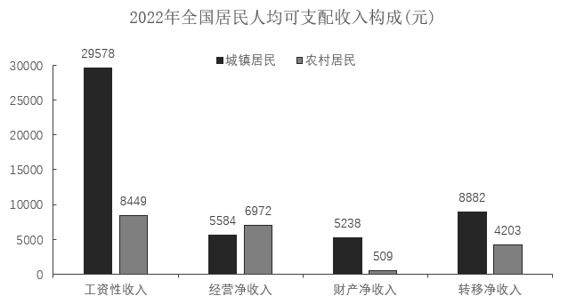
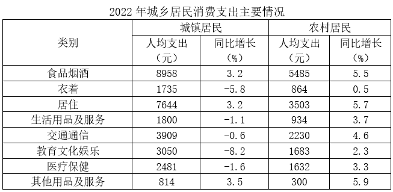

# 现期比重比较

考点：[[20-考点/资料分析/比重/现期比重比较|比重 / 现期比重比较]]
材料：[[15-材料/资料分析/340965 2022年全国、城镇、农村居民人均可|340965 2022年全国、城镇、农村居民人均可]]

**问法模型**：题干问'农村居民人均可支配收入中占比明显高于城镇居民的是哪类'→ 现期比重比较模型，比较各收入类别分别除以各自城乡人均可支配收入总额的比重大小

## 推理链
1. 第1步：从文字材料提取整体量：城镇人均可支配收入49283元、农村20133元；从图1提取四大来源城乡现期值：工资性29578/8449、经营净5584/6972、财产净5238/509、转移净8882/4203
2. 第2步：应用公式 比重=部分/整体，农村占比=农村各来源÷20133，城镇占比=城镇各来源÷49283
3. 第3步：逐项代入：工资性城镇29578/49283≈60.0%＞农村8449/20133≈42.0%；经营净城镇5584/49283≈11.3%＜农村6972/20133≈34.6%；财产净城镇≈10.6%＞农村≈2.5%；转移净城镇≈18.0%＜农村≈20.9%
4. 第4步：农村高于城镇的仅有经营净（34.6%-11.3%=23.3个百分点）和转移净（20.9%-18.0%=2.9个百分点），'明显高于'对应差距最大者
5. 第5步：23.3个百分点远大于2.9个百分点，故占比明显更高的是经营净收入，对照选项选B

**最快解法**：⚡ 分数性质比较法：农村整体量20133＜城镇49283（分母小），四大来源中唯有经营净收入农村6972＞城镇5584（分子大），'分子大分母小则分数必然大'，一步锁定经营净收入，全程无需计算具体比重，选B

## 易错点
- ⚠ 混淆'绝对值大'与'占比大'：农村转移净4203元绝对值低于城镇8882元，但占比20.9%反而高于18.0%，必须用各自收入总额作分母，不能直接比部分值大小
- ⚠ 图1柱状图目测陷阱：纵轴最大刻度30000，城镇工资性29578柱几乎顶格，估柱高易失准，必须以柱顶标注数值为准
- ⚠ 忽视'明显高于'的程度限定：转移净收入农村占比虽也高于城镇，但仅高2.9个百分点，唯有经营净高23.3个百分点才算'明显'；另需警惕误用全国口径四大来源值（工资性20590等）与城乡数据拼接比较

## 母题抽象
> 🧩 当题干出现'A群体中某部分占比明显高于B群体'且两群体整体量一大一小时，先扫分子：若某部分在整体量小的群体中绝对值反而更大，则该部分占比必然更高（分子大分母小分数大），无需逐项计算比重即可锁定答案

**同类特征**：所占比例明显高于、农村居民/城镇居民、人均可支配收入的来源构成、四大收入来源、现期比重比较、柱状图城乡分组数据

## 相关题
- [[10-真题/资料分析/比重/2052082 现期比重比较|2052082]]（吉林 2017，相关度3）
- [[10-真题/资料分析/比重/2031610 现期比重比较|2031610]]（广东 2016，相关度3）
- [[10-真题/资料分析/比重/2166225 现期比重比较|2166225]]（深圳市考 2018，相关度3）
- [[10-真题/资料分析/比重/2172876 现期比重比较|2172876]]（广州市考 2018，相关度3）
- [[10-真题/资料分析/比重/2272297 现期比重比较|2272297]]（选调 2015，相关度2）

---

### 题干
2022年，农村居民人均可支配收入中，所占比例明显高于城镇居民的是（    ）。

### 选项
- A. 工资性收入
- B. 经营净收入　✅
- C. 财产净收入
- D. 转移净收入

### 官方解析

根据题干“2022年······所占比例明显高于······”，可判定本题为现期比重问题。定位文字材料第一段可得：2022年，城镇居民人均可支配收入49283元；农村居民人均可支配收入20133元。定位统计图可得：2022年城镇居民与农村居民的工资性收入、经营净收入、财产净收入及转移净收入情况。

方法一：根据公式：比重。

A项：城镇居民工资性收入比重、农村居民工资性收入比重，城镇＞农村，不符合；

B项：城镇居民经营净收入比重、农村居民经营净收入比重，34.6%-11.3%=23.3%，即农村居民经营净收入比重高于城镇23.3个百分点；

C项：城镇居民财产净收入比重、农村居民财产净收入比重，城镇＞农村，不符合；

D项：城镇居民转移净收入比重、农村居民转移净收入比重，20.9%-18.0%=2.9%，即农村居民转移净收入比重高于城镇2.9个百分点。

比较可知，农村居民人均可支配收入中，所占比例明显高于城镇居民的是经营净收入。

方法二：根据公式：比重。

人均可支配收入：农村居民20133元＜城镇居民49283元；部分收入中只有居民经营净收入：农村居民6972元＞城镇居民5584元。结合分数比较技巧：分子大分母小，则分数必然大。因此农村居民人均可支配收入中，所占比例明显高于城镇居民的是经营净收入。

故正确答案为B。

### 给定材料

        2022年，全国居民人均可支配收入36883元，比上年增长（以下如无特别说明，均为同比名义增长）5.0%。分城乡看，城镇居民人均可支配收入49283元，增长3.9%；农村居民人均可支配收入20133元，增长6.3%。

        按收入来源分，2022年，全国居民人均工资性收入20590元，增长4.9%；人均经营性收入6175元，增长4.8%；人均财产净收入3227元，增长4.9%；人均转移净收入6892元，增长5.5%。

        2022年，全国居民人均消费支出24538元，比上年增长1.8%。分城乡看，城镇居民人均消费支出30391元，增长0.3%；农村居民人均消费支出16632元，增长4.5%。

