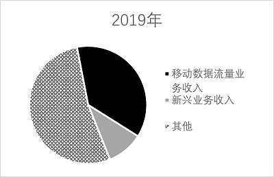
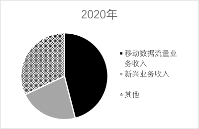
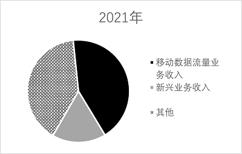

# 现期比重计算与饼图结构比对排除

考点：[[20-考点/资料分析/比重/现期比重计算与饼图结构比对排除|比重 / 现期比重计算与饼图结构比对排除]]
材料：[[15-材料/资料分析/340966 我国2018-2022年电信业务收入|340966 我国2018-2022年电信业务收入]]

**问法模型**：题干要求选出'最有可能准确反映该年度各类业务占比'的图形 → 先算现期各部分比重（部分÷总体）得锚点结构，再与各选项图形比例逐项比对排除

## 推理链
1. 第1步：锁定现期2022年：电信业务收入1.58万亿元=15800亿元，移动数据流量业务6397亿元占约40.5%，新兴业务3072亿元占19.4%
2. 第2步：用比重守恒求其余业务占比：1-40.5%-19.4%=40.1%，即2022年结构约为移动40.5%、新兴19.4%、其他40.1%（约'4:2:4'格局）
3. 第3步：验证D：D图中移动数据流量占比略大于50%，与2022年实际约40.5%明显不符，排除D
4. 第4步：验证B（对应2020年）：移动6204亿÷新兴1737亿≈3.6倍，而B图所示倍数不足3倍，排除B
5. 第5步：验证A（对应2019年）：2018年收入≈15800-2800=13000亿，2019年=13000×(1+0.5%)≈13065亿，(6096+1374)÷13065≈57%，A图所示占比小于50%，排除A
6. 第6步：仅剩C，其比例与2022年移动约40.5%、新兴约19.4%、其他约40.1%的结构吻合，故正确答案为C

**最快解法**：⚡ 锚点排除法+截位直除：先用现期比重锚点（移动40.5%+新兴19.4%≈60%，其他≈40%）直接锁定C的'四六开'结构；再用两个截位除法快速排他：6204/1737≈3.6倍排除B，(6096+1374)/(13000×1.005)≈7470/13065≈57%排除A，全程无需精算饼图角度

## 易错点
- ⚠ 量级与口径陷阱：1.58万亿元须换算为15800亿元（相差10000倍）；'较2018年增长超2800亿元'是增量，2018年基期≈13000亿而非2800亿，推2019年收入须先还原基期再乘(1+0.5%)链乘
- ⚠ 年份错配：四个选项分别对应不同年份数据（A对应2019、B对应2020、D对应2022口径），必须用对应年份的数据验证，勿把2022年占比硬套到所有选项
- ⚠ 干扰信息：四类新兴业务细分增速（云计算118.2%、大数据58%等）与占比结构判断无关；移动数据流量2022年增速仅0.3%远低于总盘8.0%，其占比是下降的，勿凭直觉认为占比上升

## 母题抽象
> 🧩 当题干出现'最有可能准确反映……占比的图形'时，先用现期比重（部分÷总体）算出锚点结构，再对每个选项用部分/总体或部分/部分的截位除法逐一排除与实际比例明显不符的图形，选结构吻合项

**同类特征**：最有可能准确反映、各类业务在电信业务收入中占比、饼图/结构图选项、现期比重、图形比例比对排除、'该年度'指现期2022年

## 相关题
- [[10-真题/资料分析/比重/4792819 现期比重计算（多部分比重依次求解）|4792819]]（新疆 2014，相关度1）
- [[10-真题/资料分析/比重/827355 现期比重比较（部分占比过半速判）|827355]]（政法干警 2014，相关度1）
- [[10-真题/资料分析/比重/2272297 现期比重比较|2272297]]（选调 2015，相关度1）
- [[10-真题/资料分析/比重/2032972 现期比重计算（多地区占比求和）|2032972]]（吉林 2015，相关度1）
- [[10-真题/资料分析/比重/2187857 现期比重计算（部分量需先由'总量−其中量'减法间接求得）|2187857]]（山东 2018，相关度1）

---

### 题干
以下最有可能准确反映该年度各类业务在电信业务收入中占比的是（    ）。

### 选项
- A. 

- B. 

- C. 

　✅
- D. 

### 官方解析
根据题干“······占比······”，结合材料给出各年份相应数据，可判定本题为现期比重问题。
D项：定位文字材料第二段可得，2022年移动数据流量业务收入6397亿元，比上年增长0.3%，在电信业务收入中占比约为40.5%。观察选项发现，该占比略大于50%，排除；
B项：定位图形材料2可得，2020年我国移动数据流量业务收入为6204亿元，新兴业务收入1737亿元。倍，观察选项发现，该倍数不足3倍，排除；
A项：定位文字材料第一段可得，2022年我国电信业务收入累计完成1.58万亿元，较2018年增长超2800亿元。定位图形材料1可得，2019年我国电信业务收入同比增长0.5%。定位图形材料2可得，2019年我国移动数据流量业务收入为6096亿元，新兴业务收入1374亿元。根据公式：现期量=基期量×（1+增长率），可得2019年我国电信业务收入亿元，2019年移动数据流量业务收入和新兴业务收入占电信业务收入的比重，观察选项发现，该占比小于50%，排除。
故正确答案为C。

### 给定材料

        五年来，我国积极推进网络强国和数字中国建设，着力深化数字经济与实体经济融合，为打造数字经济新优势、增强经济发展新动能提供有力支撑。2022年，我国电信业务收入累计完成1.58万亿元，比上年增长8%，较2018年增长超2800亿元。

        2022年移动数据流量业务收入6397亿元，比上年增长0.3%，在电信业务收入中占比约为40.5%。数据中心、云计算、大数据、物联网等新兴业务快速发展，对我国电信业务拉动作用持续增强。2022年新兴业务收入达3072亿元，在电信业务收入中占比由上年的16.1%提升至19.4%。其中，数据中心、云计算、大数据、物联网业务比上年分别增长11.5%、118.2%、58%和24.7%。

> [!warning] 疑点（官方解析可能有误，待人工复核）
> 官方解析文字存在缺漏（公式数值未显示）导致表述歧义：B项'该倍数不足3倍'实指B选项图中所画倍数不足3倍（实际6204/1737≈3.6倍）；A项'该占比小于50%'实指A图所示占比小于50%（实际计算约57%）。按此解读逻辑自洽，答案C无误，但原文表述易被误读为实际计算值
