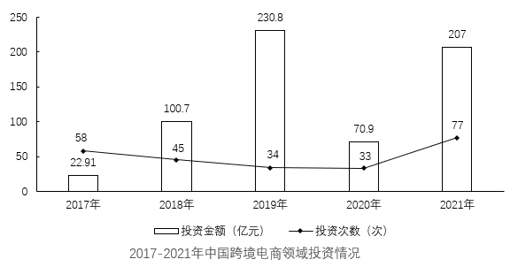

# 基期比重计算（分量增速不同的拆分结构）

考点：[[20-考点/资料分析/比重/基期比重计算（分量增速不同的拆分结构）|比重 / 基期比重计算（分量增速不同的拆分结构）]]
材料：[[15-材料/资料分析/340967 2021年中国跨境电商交易规模（总量|340967 2021年中国跨境电商交易规模（总量]]

**问法模型**：题干问『2020年（基期）出口占跨境电商交易总规模的比重』而材料给2021年现期数据 → 先用 A/(1+a) 还原出口、进口各自基期量，加总得基期整体，再作除法求比重

## 推理链
1. 第1步：题干时间口径为2020年，材料数据均为2021年：出口跨境电商11万亿元（同比+13.4%）、进口3.2万亿元（同比+14.3%），总规模14.2万亿元=11+3.2
2. 第2步：基期量公式：基期=现期÷(1+同比增速)；比重=基期出口÷(基期出口+基期进口)
3. 第3步：代入计算：2020年出口=11÷1.134≈9.70万亿元，2020年进口=3.2÷1.143≈2.80万亿元，2020年总规模≈9.70+2.80=12.50万亿元
4. 第4步：比重=9.70÷12.50=0.776=77.6%
5. 第5步：与选项对照：A.77.6%完全吻合，故选A

**最快解法**：⚡ 截位直除＋基期拆分：11÷1.134≈9.70、3.2÷1.143≈2.80，基期总量≈12.50，9.70÷12.50直除得77.6%；或用基期比重公式 11/14.2×(1+13.6%)/(1+13.4%)，混合总增速约13.6%，77.5%×1.002≈77.6%，无需精确还原两个基期量

## 易错点
- ⚠ 时间混淆：材料全是2021年数据而题干问2020年，须还原基期；直接算现期比重11/14.2≈77.5%虽碰巧接近A，但当出口与进口增速不同（13.4%≠14.3%）时必须先还原，否则属于侥幸
- ⚠ 口径陷阱：勿把『占货物进出口总额36.3%』当作增速或掺入分子分母，36.3%是现期结构比重且分母是另一个整体（货物进出口总额），与本题主无关
- ⚠ 选项陷阱：C.22.4%恰是2020年进口占比（1−77.6%），B.88.2%≈11÷12.5是『现期分子÷基期整体』的跨期混搭错误，注意分子分母必须同为基期

## 母题抽象
> 🧩 当题干出现『基期年份＋某部分占整体比重』且材料给出各分量现期值与各自同比增速时，用 基期比重=A/(1+a)÷[A/(1+a)+B/(1+b)]，或速记为现期比重×(1+整体增速)/(1+部分增速) 后验证选项

**同类特征**：问『2020年』而材料为2021年（基期问法）、出口…占…总规模的比重、整体拆分为出口+进口两个分量、两分量增速不同（13.4%与14.3%）、选项含77.6%/22.4%互补的百分数、单位为万亿元

## 相关题
- [[10-真题/资料分析/增长/5893772 年均增长量计算（基期倍数还原）|5893772]]（国考 2024，相关度1）
- [[10-真题/资料分析/增长/5510334 混合增长率（整体增速居中判断＋基期加权精确求值）|5510334]]（山东 2023，相关度1）

---

### 题干
2020年，我国出口跨境电商交易规模占跨境电商交易总规模的比重是：

### 选项
- A. 77.6%　✅
- B. 88.2%
- C. 22.4%
- D. 11.8%

### 官方解析

根据题干“2020年······占······的比重是”，结合材料时间为2021年，可判定本题为基期比重问题。定位文字材料可得：2021年，我国出口跨境电商交易规模11万亿元，同比增速13.4%；进口跨境电商交易规模3.2万亿元，同比增速14.3%。根据公式：基期量，则2020年我国出口跨境电商交易规模为万亿元，进口跨境电商交易规模为万亿元。根据公式：比重，则题干所求为。

故正确答案为A。

### 给定材料

        2021年，中国跨境电商交易规模达14.2万亿元，占我国货物进出口总额的比例为36.3%。其中出口跨境电商交易规模11万亿元，同比增速13.4%；进口跨境电商交易规模3.2万亿元，同比增速14.3%。2017-2022年第一季度，中国跨境电商领域共发生262次投资，投资总金额654.91亿元。

