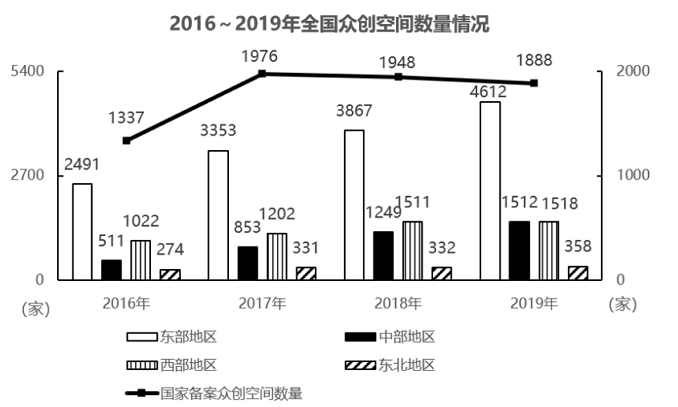

# 现期比重比较（多年份比重大小比较）

考点：[[20-考点/资料分析/比重/现期比重比较（多年份比重大小比较）|比重 / 现期比重比较（多年份比重大小比较）]]
材料：[[15-材料/资料分析/341357 2016~2019年全国众创空间数量|341357 2016~2019年全国众创空间数量]]

**问法模型**：题干问'下列年份中，国家备案众创空间数量占全国众创空间数量的比重最高的是'→ 对各年分别计算'部分(国家备案)/整体(四地区加总)'的比重并比较找最大

## 推理链
1. 第1步：从折线（右轴）提取国家备案众创空间数量：2016年1337家、2017年1976家、2018年1948家、2019年1888家
2. 第2步：全国众创空间数量未直接给出，需将同一年份四根柱值加总：2016年2491+511+1022+274=4298家；2017年3353+853+1202+331=5739家；2018年3867+1249+1511+332=6959家；2019年4612+1512+1518+358=8000家
3. 第3步：代入比重=国家备案数÷全国总数：2016年1337/4298≈31.1%；2017年1976/5739≈34.4%；2018年1948/6959≈28.0%；2019年1888/8000=23.6%
4. 第4步：比较四年比重，34.4%＞31.1%＞28.0%＞23.6%，2017年最高，对应选项B

**最快解法**：⚡ 截位直除+分子分母定性比较：分子1337→1976→1948→1888在2017年达到最大，而分母（全国总数4298→5739→6959→8000）逐年增大，故2017年'分子最大且分母较小'必为最高，优先直除1976/5739≈34.4%，再用1337/4298≈31%验证2016年次之即可锁定B，后两年无需精算

## 易错点
- ⚠ 双轴陷阱：折线读右轴（0~2000），图上折线位置偏高，但2016年国家备案1337家实际远小于东部柱值，不能凭视觉高低比较数据大小
- ⚠ 全国总量未直接给出，必须将同年四地区柱值加总，漏加任一地区（尤其是数值最小的东北274/331/332/358）会导致比重算错
- ⚠ 口径混淆：国家备案数2017年后逐年下降（1976→1948→1888），但因全国总数增速更快，比重实际逐年下降，不能误以为'备案数下降则比重可能上升'或直接用备案数大小代替比重比较；另注意1511/1512/1518三个近似数勿张冠李戴

## 母题抽象
> 🧩 当题干出现'下列年份中，A占B的比重最高/最低'且整体量B未直接给出时，先逐年加总得到各期整体量，再优先锁定'分子最大且分母较小'的年份定性判定极值，最后用截位直除验证即可，无需四年全部精算

**同类特征**：比重最高的是、国家备案众创空间占全国、跨年份比较比重大小、整体量需四地区加总、柱线复合双轴图、现期比重比较

## 相关题
- [[10-真题/资料分析/比重/19283749 现期比重比较（逐组求比重比大小）|19283749]]（国考 2025，相关度2）
- [[10-真题/资料分析/比重/10204607 现期比重比较（与1-3判定，分母需由累计值差分）|10204607]]（辽宁 2024，相关度1）
- [[10-真题/资料分析/比重/18643847 现期比值计算与百分点差值比较（资产负债率=总负债÷总资产）|18643847]]（四川 2026，相关度1）
- [[10-真题/资料分析/比重/2042810 现期比重比较（子口径占全口径比重，逐部计数判断）|2042810]]（江苏 2017，相关度1）
- [[10-真题/资料分析/比重/2052082 现期比重比较|2052082]]（吉林 2017，相关度1）

---

### 题干
下列年份中，国家备案众创空间数量占全国众创空间数量的比重最高的是（    ）。

### 选项
- A. 2016年
- B. 2017年　✅
- C. 2018年
- D. 2019年

### 官方解析

根据题干“下列年份中······占······比重最高的是”，可判定本题为现期比重问题。定位统计图可得：2016-2019年国家备案众创空间数量及对应年份的东部地区、中部地区、西部地区、东北地区众创空间数量。根据公式：比重，可得对应年份的国家备案众创空间数量占全国众创空间数量的比重如下：

2016年：；

2017年：；

2018年：；

2019年：。

比较可知，2017年国家备案众创空间数量占全国众创空间数量的比重最高。

故正确答案为B。

### 给定材料

