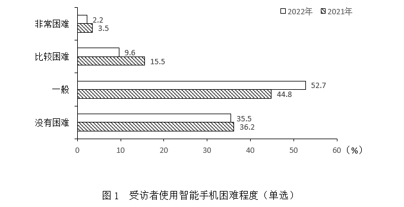

# 现期比重之两期人数比较计数求占比（样本量不同，部分=整体×比重）

考点：[[20-考点/资料分析/比重/现期比重之两期人数比较计数求占比（样本量不同，部分=整体×比重）|比重 / 现期比重之两期人数比较计数求占比（样本量不同，部分=整体×比重）]]
材料：[[15-材料/资料分析/348877 某市60岁以上老年人智能手机使用情况|348877 某市60岁以上老年人智能手机使用情况]]

**问法模型**：题干问'12个功能项中2022年使用人数多于2021年的项数占比' → 因两年样本量不同（1181 vs 1107），须将占比还原为人数（占比×各年样本量）逐项比较，再以命中项数÷12求结构比重

## 推理链
1. 第1步：从文字段提取条件：2021年受访1181人、2022年受访1107人，两年样本量不同；表中12个功能项数据均为各年占比（%，多选）
2. 第2步：所用规则：使用人数=样本量×占比，故满足条件为1107×2022年占比＞1181×2021年占比，整理等价于2022占比/2021占比＞1181/1107≈1.067，即占比增幅须超约6.7%
3. 第3步：快筛排除占比不升的3项：社交聊天82.7/83.9≈0.986、视听娱乐38.2/39.3≈0.972、投资理财21.3/22.3≈0.955，均不满足
4. 第4步：对其余9项算比值并与1.067比较：线上支付78.5/35.7≈2.20、挂号就医63.4/55.4≈1.144、照相修图50.7/41.9≈1.21、游戏18.1/16.1≈1.124、其他3.5/2.8=1.25、新闻资讯74.7/68.8≈1.086，共6项超临界值
5. 第5步：电话短信88.4/83.9≈1.054、网购71.2/68.9≈1.033、出行64.0/62.6≈1.022虽占比上升但未超1.067，不满足（如电话短信1107×88.4≈97859＜1181×83.9≈99086）
6. 第6步：命中6项（含'其他'）÷12项=50.0%，对照选项选B

**最快解法**：⚡ 比值临界法（截位估算）：临界比值=1181/1107≈1.067，即2022年占比须比2021年高约6.7%以上；先剔除占比下降的社交聊天、视听娱乐、投资理财3项，再对剩余9项估增幅，仅线上支付(+120%)、挂号就医(+14.4%)、照相修图(+21%)、游戏(+12.4%)、其他(+25%)、新闻资讯(+8.6%)超6.7%，得6项，6/12=50.0%，秒选B

## 易错点
- ⚠ 直接比较占比大小、忽略两年样本量不同：电话短信88.4%＞83.9%但1107×88.4≈97859＜1181×83.9≈99086，人数反而减少；网购、出行占比虽升但增幅不足6.7%，按占比升即计数会误得9/12
- ⚠ 新闻资讯74.7/68.8≈1.086与临界值1.067非常接近（1107×74.7≈82693 vs 1181×68.8≈81253），粗心截位易误判为不满足，错选A(41.7%即5项)
- ⚠ 漏数'其他'项：题干明确为12个功能项，'其他'（2.8→3.5，比值1.25）也须计入；另警惕表中'电话短信2021年83.9%'与'社交聊天83.9%'同值、'网购2022年71.2%'与'61~70岁占71.2%'同值的巧合干扰

## 母题抽象
> 🧩 当题干出现'两年样本量不同、比较各项目两期实际人数多少并求命中项占比'特征时，把各项目两期占比之比与基期/现期样本量之比（1181/1107≈1.067）比较（等价于占比增幅须超约6.7%），剔除占比下降项后逐项判定，命中数÷项目总数（勿漏'其他'）验证

**同类特征**：表中所列…12个功能项中、2022年使用人数多于2021年、项数占比、两年样本量不同（1181与1107）、多选题占比不能直接比大小、计数后除以总项数求比重

## 相关题
（暂无）

---

### 题干
表中所列智能手机的12个功能项中，2022年受访者中使用人数多于2021年的功能项数占比为（    ）。

### 选项
- A. 41.7%
- B. 50.0%　✅
- C. 58.3%
- D. 75.0%

### 官方解析

根据题干“······，2022年······占比为”，可判定本题为现期比重问题。定位文字材料可得：2021年、2022年分别获取了1181位和1107位60岁以上老年人使用智能手机的有关情况。定位表格材料可知，2021年、2022年受访者智能手机功能使用的占比情况。根据公式：部分=整体×比重，可得各项功能的使用人数=受访人数×各项功能使用人数占比，即所求需满足：1107×2022年各项功能使用人数占比&gt;1181×2021年各项功能使用人数占比，整理可得，则表中所列智能手机12个功能项2022年与2021年占比的比值分别为：

电话短信，，不满足；

社交聊天，，不满足；

线上支付，，满足；

新闻资讯，，满足；

网购，，不满足；

出行，，不满足；

挂号就医，，满足；

照相修图，，满足；

视听娱乐，，不满足；

投资理财，，不满足；

游戏，，满足；

其他，，满足。

比较可知，表中所列智能手机的12个功能项中，有6项功能满足2022年受访者中使用人数多于2021年，占比。

故正确答案为B。

### 给定材料

        2021年和2022年某市统计局通过两次调查，分别获取了该市1181位和1107位60岁以上老年人使用智能手机的有关情况。其中，2022年受访者中，年龄在61~70岁的占71.2%，71~80岁的占24.2%，81岁及以上的占4.6%。

