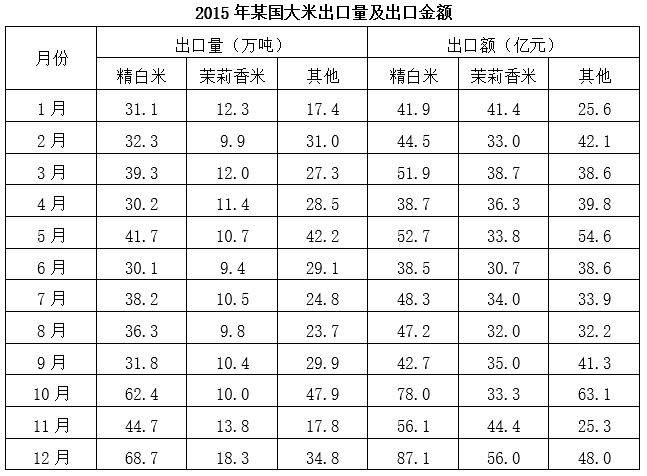

# 现期比重比较（比重-50%的逐月计数判断）

考点：[[20-考点/资料分析/比重/现期比重比较（比重-50%的逐月计数判断）|比重 / 现期比重比较（比重>50%的逐月计数判断）]]
材料：[[15-材料/资料分析/356839 2015年某国大米逐月出口状况：按精|356839 2015年某国大米逐月出口状况：按精]]

**问法模型**：题干问'有几个月精白米出口量占当月出口总量的一半以上'→ 现期比重>50%的判断，等价变形为'精白米>茉莉香米+其他'，逐月比较计数即可，无需算每月总量

## 推理链
1. 第1步：从统计表提取2015年下半年（7—12月）各月三类出口量（万吨）：7月精白米38.2/茉莉香米10.5/其他24.8；8月36.3/9.8/23.7；9月31.8/10.4/29.9；10月62.4/10.0/47.9；11月44.7/13.8/17.8；12月68.7/18.3/34.8
2. 第2步：'占总量一半以上'即 精白米/总量>50%，由2×精白米>精白米+茉莉香米+其他，化简为 精白米>茉莉香米+其他
3. 第3步：逐月代入：7月38.2>10.5+24.8=35.3✓；8月36.3>9.8+23.7=33.5✓；9月31.8<10.4+29.9=40.3✗；10月62.4>10.0+47.9=57.9✓；11月44.7>13.8+17.8=31.6✓；12月68.7>18.3+34.8=53.1✓
4. 第4步：满足条件的有7、8、10、11、12月共5个月，与选项C（5）对照，故正确答案为C

**最快解法**：⚡ 变形比较法：比重>50%⟺部分>其余部分之和，只做'茉莉香米+其他'的小加法再与精白米直接比大小，跳过'三类加总求总量'步骤；重点核对差距小的9月（31.8<40.3，不满足）和10月（62.4>57.9，满足），得5个月

## 易错点
- ⚠ 时间范围陷阱：题问下半年（7—12月），若误用上半年或全年数据会得出错误个数
- ⚠ 漏加'其他'列：总量=精白米+茉莉香米+其他三类之和，'其他'是并列品类而非合计行，漏加会误判9月、10月等边缘月份
- ⚠ 计算路径低效：直接算每月总量再作比工作量大，应变形为'精白米>其余两类之和'减少一步除法；同时注意10月62.4与57.9差距不大、9月31.8明显小于40.3，逐月判断不可粗略带过

## 母题抽象
> 🧩 当题干出现'某部分占总量一半以上/超过50%并问有几期'的特征时，将比重>50%变形为'该部分>其余部分之和'，逐期做小加法直接比大小计数，避免逐期求总量

**同类特征**：下半年、有几个月、占当月出口总量、一半以上、精白米出口量、现期比重逐月计数

## 相关题
- [[10-真题/资料分析/综合/12881982 文字材料综合判断（选非题）·现期比重计算|12881982]]（广东 2025，相关度1）
- [[10-真题/资料分析/综合/2255865 综合分析（选非题）——比重判断+平均数比较+大小比较逐项核验|2255865]]（江西 2016，相关度1）
- [[10-真题/资料分析/增长/4628167 增长量计算与比较（日均×当月天数换算+超阈值月份计数）|4628167]]（新疆 2021，相关度1）
- [[10-真题/资料分析/增长/5445931 增长量计算与比较（相邻月末时点做差计数）|5445931]]（国考 2023，相关度1）
- [[10-真题/资料分析/增长/15833680 同比增长量计算与计数比较（现期×r-(1+r)模型）|15833680]]（黑龙江 2026，相关度1）

---

### 题干
2015年下半年，有几个月精白米出口量占该国大米当月出口总量的一半以上？

### 选项
- A. 3
- B. 4
- C. 5　✅
- D. 6

### 官方解析
根据题干“2015年下半年······占······的一半以上”，可判定本题为现期比重问题。定位统计表可知2015年下半年该国各月各类型大米出口量。，即2×精白米出口量&gt;精白米出口量+茉莉香米出口量+其他大米出口量，化简可得：精白米出口量&gt;茉莉香米出口量+其他大米出口量，则有：
7月，38.2&gt;10.5+24.8=35.3；
8月，36.3&gt;9.8+23.7=33.5；
9月，31.8&lt;10.4+29.9=40.3；
10月，62.4&gt;10.0+47.9=57.9；
11月，44.7&gt;13.8+17.8=31.6；
12月，68.7&gt;18.3+34.8=53.1。
综上可知，2015年下半年该国精白米出口量占大米当月出口总量的一半以上的有7月、8月、10月、11月、12月，共5个月。
故正确答案为C。

### 给定材料

