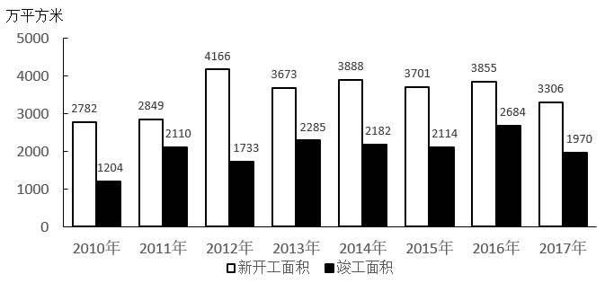

# 现期比重计算及两比重之差（百分点差）

考点：[[20-考点/资料分析/比重/现期比重计算及两比重之差（百分点差）|比重 / 现期比重计算及两比重之差（百分点差）]]
材料：[[15-材料/资料分析/357123 S省2010~2017年房屋新开工面|357123 S省2010~2017年房屋新开工面]]

**问法模型**：题干给出'某部分占整体的X%/Y%'并问X与Y相差约多少 → 分别用现期比重=部分÷整体算出两个比重，作差取绝对值，结果单位为百分点

## 推理链
1. 第1步：从文字段提取2017年四组数据——商品住宅竣工1414万平方米、房屋竣工1970万平方米；商品住宅新开工2411万平方米、房屋新开工3306万平方米（'其中'提示包含关系）
2. 第2步：现期比重公式：比重=部分÷整体，X=1414/1970（竣工口径），Y=2411/3306（新开工口径）
3. 第3步：截位直除代入：X=1414/1970≈71.8%≈72%，Y=2411/3306≈72.9%≈73%
4. 第4步：作差：|X−Y|≈73−72=1个百分点
5. 第5步：与选项对照，最小选项A（1）吻合，故选A

**最快解法**：⚡ 截位直除+选项反推：1414/1970≈14/19.7≈0.72，2411/3306≈24/33≈0.73，两个比重都在72%附近，差必为个位数且接近1，直接秒选A，无需精算小数

## 易错点
- ⚠ 差值单位陷阱：X、Y均为比重（%），两者相减得'百分点'，若按百分比之比或百分数再缩放会选错量级
- ⚠ 分子分母错位：X必须用竣工组（1414/1970）、Y用新开工组（2411/3306），若交叉搭配（如1414/3306）会得到完全不同的数值误选B/C/D
- ⚠ 两个比重数值非常接近（72%上下），若因除法粗算偏差以为差好几个百分点，容易误选B（5）等较大选项

## 母题抽象
> 🧩 当题干出现'同一时期A占B的X%、C占D的Y%，问X与Y相差约'特征时，直接用现期比重=部分÷整体分别截位直除再作差（结果为百分点），两比重都在同一量级时优先验证最小选项

**同类特征**：占……的X%、占……的Y%、X与Y相差约、同一年份两个现期比重、其中（包含关系提示）、文字材料直接取数

## 相关题
- [[10-真题/资料分析/比重/12881988 现期比重计算|12881988]]（广东 2025，相关度1）

---

### 题干
2017年S省商品住宅竣工面积占房屋竣工面积的X%，当年该省商品住宅新开工面积占房屋新开工面积的Y%，则X与Y相差约（    ）。

### 选项
- A. 1　✅
- B. 5
- C. 11
- D. 18

### 官方解析
根据题干“2017年······占······”，可判定本题为现期比重问题。定位文字材料可得：2017年，S省房屋新开工面积3306万平方米，其中商品住宅新开工面积2411万平方米；房屋竣工面积1970万平方米，其中商品住宅竣工面积1414万平方米。根据公式：比重，则；，X与Y相差73-72=1。
故正确答案为A。

### 给定材料

        2017年，S省房屋新开工面积3306万平方米，同比下降14.2%，其中商品住宅新开工面积2411万平方米，同比下降9.2%；房屋竣工面积1970万平方米，同比下降26.6%，其中商品住宅竣工面积1414万平方米，同比下降30.8%。

