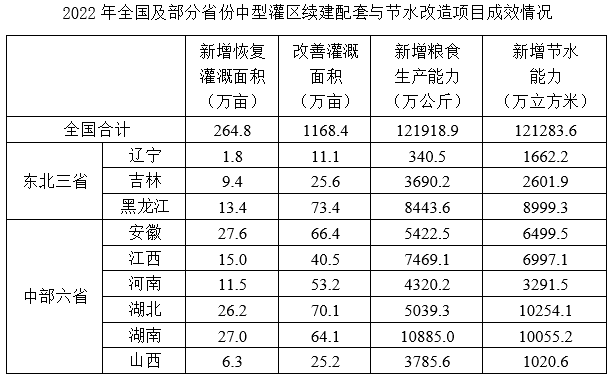

# 现期比重比较（超10%计数判断）

考点：[[20-考点/资料分析/比重/现期比重比较（超10%计数判断）|比重 / 现期比重比较（超10%计数判断）]]
材料：[[15-材料/资料分析/360775 2022年全国合计及部分省份（东北三|360775 2022年全国合计及部分省份（东北三]]

**问法模型**：题干问'东北三省占全国比重超过10%的指标有几个'→对4个指标分别求东北三省合计÷全国合计，与10%比较后计数；可等价转化为'东北三省合计 与 全国合计×10% 比大小'避免做除法

## 推理链
1. 第1步：题干需对4个指标逐一判断，分组标签行'东北三省'自身无数值，须先加总：新增恢复灌溉面积1.8+9.4+13.4=24.6万亩，改善灌溉面积11.1+25.6+73.4=110.1万亩，新增粮食生产能力340.5+3690.2+8443.6=12474.3万公斤，新增节水能力1662.2+2601.9+8999.3=13263.4万立方米
2. 第2步：现期比重=部分÷总体，'超过10%'等价于 部分合计＞全国合计×10%，故只需算全国合计的10%作比较基准
3. 第3步：全国合计×10%分别为：新增恢复灌溉面积264.8×10%=26.48万亩，改善灌溉面积1168.4×10%=116.84万亩，新增粮食生产能力121918.9×10%=12191.89万公斤，新增节水能力121283.6×10%=12128.36万立方米
4. 第4步：逐一比较：24.6＜26.48（比重约9.3%，不超）；110.1＜116.84（约9.4%，不超）；12474.3＞12191.89（约10.2%，超）；13263.4＞12128.36（约10.9%，超）
5. 第5步：超过10%的指标为新增粮食生产能力、新增节水能力，共2个，对照选项得B

**最快解法**：⚡ 等价比较法（比较替代计算）：不求比重，直接用东北三省加总值与'全国合计×10%'比大小；前两项24.6＜26.48、110.1＜116.84直接排除，后两项12474.3＞12191.89、13263.4＞12128.36满足，计数得2个，选B

## 易错点
- ⚠ 分组行'东北三省'自身无数值，必须先组内加总，3数连加易漏加辽宁的小数值（如新增恢复1.8万亩）或错位
- ⚠ 分母必须用'全国合计'行（264.8/1168.4/121918.9/121283.6），不能用东北三省+中部六省之和替代（如恢复灌溉面积两组和138.2万亩远小于全国264.8万亩），否则严重高估比重
- ⚠ 四个比重均在10%附近（9.3%、9.4%、10.2%、10.9%），不能粗估拍脑袋，须精确加总后与全国×10%精确比较；且四指标单位各不相同，只能逐列各自比较，不可跨列混淆

## 母题抽象
> 🧩 当题干出现'某组占总体比重超过X%的指标（项目）有几个'时，先对组内数值加总，再用'部分合计 与 总体合计×X%'作等价比较逐一计数，避免逐项做除法；分母务必取'总体合计'而非组间之和

**同类特征**：占全国比重超过10%、指标有几个（计数判断）、东北三省（组内需加总）、现期比重、分母为全国合计行、多指标逐一与同一阈值比较

## 相关题
- [[10-真题/资料分析/比重/4792819 现期比重计算（多部分比重依次求解）|4792819]]（新疆 2014，相关度1）
- [[10-真题/资料分析/比重/827355 现期比重比较（部分占比过半速判）|827355]]（政法干警 2014，相关度1）
- [[10-真题/资料分析/比重/2272297 现期比重比较|2272297]]（选调 2015，相关度1）
- [[10-真题/资料分析/比重/2032972 现期比重计算（多地区占比求和）|2032972]]（吉林 2015，相关度1）
- [[10-真题/资料分析/比重/2187857 现期比重计算（部分量需先由'总量−其中量'减法间接求得）|2187857]]（山东 2018，相关度1）

---

### 题干
在资料所给中型灌区续建配套与节水改造项目成效的4个指标中，东北三省占全国比重超过10%的指标有几个？

### 选项
- A. 1
- B. 2　✅
- C. 3
- D. 4

### 官方解析
根据题干“······占全国比重超过10%的指标有几个“，可判定本题为现期比重问题。根据表格数据可知：2022年东北三省新增恢复灌溉面积万亩&lt;264.8万亩×10%；东北三省改善灌溉面积万亩&lt;1168.4万亩×10%；东北三省新增粮食生产能力万公斤&gt;121918.9万公斤×10%；东北三省新增节水能力万立方米&gt;121283.6万立方米×10%。因此，资料所给的4个指标中，东北三省占全国比重超过10%的指标有新增粮食生产能力和新增节水能力，共2个。
故正确答案为B。

### 给定材料

