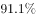
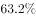
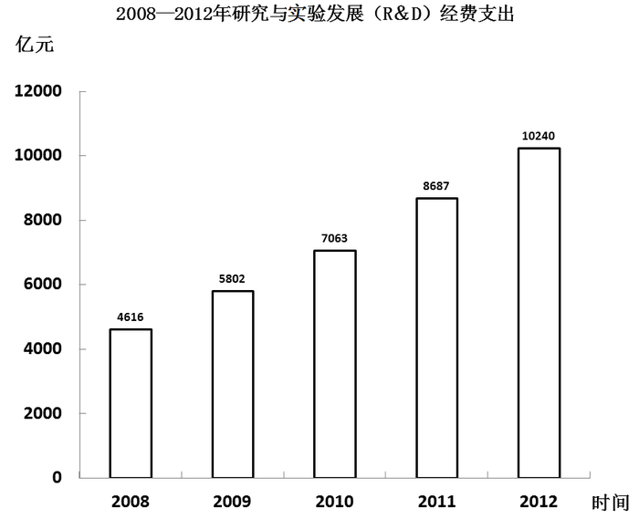

# 现期比重比较（部分占比过半速判）

考点：[[20-考点/资料分析/比重/现期比重比较（部分占比过半速判）|比重 / 现期比重比较（部分占比过半速判）]]

**问法模型**：题干问'在整体中甲与乙相比比例谁大'→ 用甲占整体比重与1−甲占比（乙占比）比较，或判断甲占比是否超过50%

## 推理链
1. 第1步：定位材料'截至年底，有效专利350.9万件，其中境内有效专利289.9万件，占82.6%'，题干时间与材料时间一致（2012年底），为现期比较
2. 第2步：整体=境内+境外，故境内占比+境外占比=100%，境外占比=1−82.6%=17.4%
3. 第3步：比较两项：境内82.6% vs 境外17.4%，82.6%＞17.4%（亦可速判：289.9万件＞350.9/2=175.45万件，境内已过半，必大于境外）
4. 第4步：前者为境内、后者为境外，境内比例大于境外，与选项A'前者比例大于后者'吻合

**最快解法**：⚡ 过半速判法：境内289.9万件＞350.9万件的一半175.45万件（或境内占比82.6%＞50%），则境内必大于境外=整体−境内，直接选A，无需精确计算

## 易错点
- ⚠ '前者/后者'指代顺序：题干先境内后境外，前者=境内，若颠倒则误选B
- ⚠ 境内占比82.6%以图片（LaTeX公式）形式给出，易漏读而试图用289.9÷350.9现算，浪费时间
- ⚠ 题干时间'截至2012年底'与材料一致，是现期比重比较，不要误套基期公式

## 母题抽象
> 🧩 当题干出现'在整体X中，甲与乙相比（比例大小）'且材料给出甲占整体的比重或甲的具体量时，用'乙占比=1−甲占比'或'甲是否过半'速判甲乙大小

**同类特征**：截至2012年底、在有效专利350.9万件中、境内与境外相比、前者/后者比例、现期比重、定性比较类选项

## 相关题
- [[10-真题/资料分析/比重/4792819 现期比重计算（多部分比重依次求解）|4792819]]（新疆 2014，相关度1）
- [[10-真题/资料分析/比重/2272297 现期比重比较|2272297]]（选调 2015，相关度1）
- [[10-真题/资料分析/比重/2032972 现期比重计算（多地区占比求和）|2032972]]（吉林 2015，相关度1）
- [[10-真题/资料分析/比重/2187857 现期比重计算（部分量需先由'总量−其中量'减法间接求得）|2187857]]（山东 2018，相关度1）
- [[10-真题/资料分析/比重/10297330 基数不同的比重加权合成（混合比重）|10297330]]（浙江 2025，相关度1）

---

### 题干
截至2012年底，在有效专利350.9万件中境内与境外有效专利相比：

### 选项
- A. 前者比例大于后者　✅
- B. 前者比例小于后者
- C. 前者与后者比例相同
- D. 前者比例与后者相差很小

### 官方解析
根据题干“截止2012年底，在······中······相比”，且选项为比例，结合材料时间为2012年，可判定本题为现期比重问题。定位文字材料可得：截止年底，有效专利350.9万件，其中境内有效专利289.9万件，占82.6%。则境外有效专利占比=1-82.6%=17.6%，故有效专利中，境内有效专利比例大于境外有效专利比例。
故正确答案为A。

### 给定材料

        2012年全国国内生产总值519322亿元，比上年增长，研究与试验发展（R&amp;D）经费支出10240亿元，比上年增长，占国内生产总值的，其中基地研究经费498亿元。全年受理境内外专利申请205.1万件，其中境内申请188.6万件，占。受理境内外发明专利申请65.3万件，其中境内申请52.3万件，占。全年授予专利权125.5万件，其中境内授权114.4万件，占。授予发明专利权21.7万件，其中境内授权13.7万件，占。截至年底，有效专利350.9万件，其中境内有效专利289.9万件，占；有效发明专利87.5万件，其中境内有效发明专利43.5万件，占。全年共签订技术合同28.2万项，技术合同成交金额6437.1亿元，比上年增长。全年成功发射卫星19次，神舟九号载人飞船与天宫一号目标飞行器顺利实现首次空间交会对接，北斗二号卫星导航系统完成区域组网并正式运行服务，蛟龙号载人深潜器海试成功突破7000米。

> [!warning] 疑点（官方解析可能有误，待人工复核）
> 官方解析中'境外有效专利占比=1−82.6%=17.6%'系笔误，1−82.6%=17.4%；不影响结论（82.6%＞17.4%，答案仍为A）
