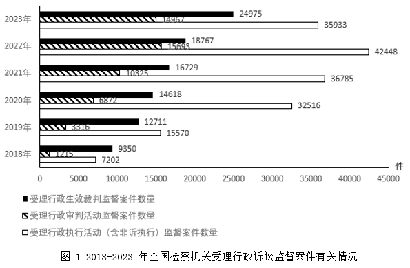
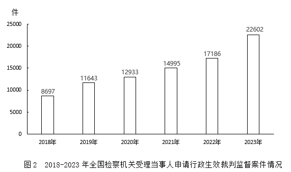

# 多指标逐年加和与固定阈值比较计数

考点：[[20-考点/资料分析/综合/多指标逐年加和与固定阈值比较计数|综合 / 多指标逐年加和与固定阈值比较计数]]
材料：[[15-材料/资料分析/4086496 2018-2023年全国检察机关受理|4086496 2018-2023年全国检察机关受理]]

**问法模型**：题干问'多年份中三类案件数量之和超过7万件的年份有几个'→逐年将图1三个指标加和，与阈值70000件逐一比较后计数

## 推理链
1. 第1步：从图1提取三类案件逐年数据：行政生效裁判监督案件2018-2023年为9350、12711、14618、16729、18767、24975件，行政审判活动监督案件为1245、3316、5872、10824、15683、14967件，行政执行活动（含非诉执行）监督案件为7202、15570、32516、36785、42448、35933件
2. 第2步：所用规则为逐年三类加和，与7万件阈值比较（'超过'即严格大于70000）
3. 第3步：代入计算各年之和：2018年9350+1245+7202=17797件，2019年12711+3316+15570=31597件，2020年14618+5872+32516=53006件，2021年16729+10824+36785=64338件，2022年18767+15683+42448=76898件，2023年24975+14967+35933=75875件
4. 第4步：与阈值对照：2018-2021年（17797/31597/53006/64338）均<7万件，2022年76898与2023年75875均>7万件，超7万件的年份共2个，与选项B吻合

**最快解法**：⚡ 截位加和（按万位粗加）+阈值比较：早期年份明显偏小直接排除（2018约1.8万、2019约3.2万）；2020年1.46+0.59+3.25≈5.3万<7万，2021年1.67+1.08+3.68≈6.4万<7万，2022年1.88+1.57+4.24≈7.7万>7万，2023年2.50+1.50+3.59≈7.6万>7万，仅2022、2023两年达标，选B

## 易错点
- ⚠ 口径陷阱：文字段79209件是2023年全部行政诉讼监督案件总量，大于图1三类之和75875件（存在其他未列示案件类型），本题只加图1三类，切勿引入79209或把三类之和当全年总量
- ⚠ 惯性误判'逐年上升'：2023年行政审判活动（14967）与行政执行活动（35933）较2022年均回落，但仍需逐年加和逐一年份比较，不能只看单一指标或只验算个别年份
- ⚠ 读图陷阱：图1每年三根条长度差异悬殊、2018与2019年短条数值密集，须对照图例花纹（实心黑/斜纹/空心白）逐条核对数值，防止张冠李戴；且'超过7万'为严格大于，2021年64338件若口算失误误超会错选C

## 母题抽象
> 🧩 当题干出现'某时间段内多指标之和超过（或达到）某阈值的年份有几个'时，用逐年截位粗加再与阈值逐一比较计数，只需对临界年份精算验证

**同类特征**：2018-2023年（多年份区间）、三类案件数量之和、超过7万件（固定阈值）、年份有几个（计数问法）、图1分组条形图三指标同源数据、加和比较型判断

## 相关题
- [[10-真题/资料分析/增长/14096263 增长率计算与比较（双指标同超20%的年份计数）|14096263]]（选调 2025，相关度1）

---

### 题干
2018-2023年，全国检察机关受理图1中三类案件数量之和超过7万件的年份有几个？

### 选项
- A. 1
- B. 2　✅
- C. 3
- D. 4

### 官方解析

定位统计图1可知2018-2023年全国检察机关受理三类案件的数量，则2018年-2023年全国检察机关受理三类案件数量之和分别为：

2018年：件&lt;7万件；

2019年：&lt;7万件；

2020年：件&lt;7万件；

2021年：件&lt;7万件；

2022年：件&gt;7万件；

2023年：件&gt;7万件。

综上所述，三类案件数量之和超过7万件的年份有2022年、2023年，共2年。

故正确答案为B。

### 给定材料

        2023年，全国检察机关共受理行政诉讼监督案件79209件。

