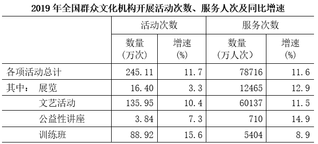
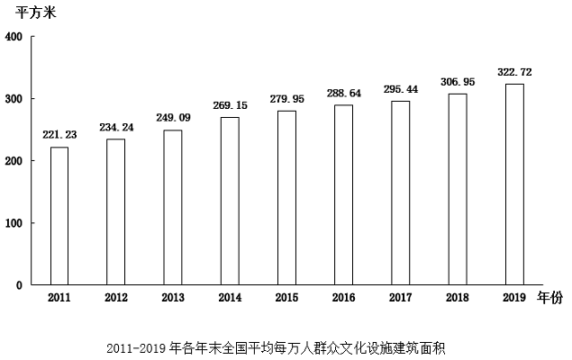

# 综合分析题（年均增量+基期比重+增长量计算+两期比值比较四模型混合验证）

考点：[[20-考点/资料分析/综合/综合分析题（年均增量+基期比重+增长量计算+两期比值比较四模型混合验证）|综合 / 综合分析题（年均增量+基期比重+增长量计算+两期比值比较四模型混合验证）]]
材料：[[15-材料/资料分析/4538641 2019年全国群众文化机构统计公报式|4538641 2019年全国群众文化机构统计公报式]]

**问法模型**：题干为'能够从上述资料中推出的是'的四选一综合判断 → 对A/B/C/D分别套用年均增量=（末年-初年）÷年份差、基期比重=A/B×(1+b)/(1+a)、增长量=现期×r/(1+r)、两期比值比较（a vs b）四个模型逐一验证排除

## 推理链
1. 第1步：A项从条形图取2011年221.23平方米、2019年322.72平方米，以2011年为基期，2019-2011共8个年度间隔
2. 第2步：年均增量=(322.72-221.23)÷8=101.49÷8≈12.69平方米>11平方米，A'小于11平方米'不成立，A错误
3. 第3步：B项从统计表取2019年文艺活动服务60137万人次（增速a=11.5%）、总服务78716万人次（增速b=11.6%）
4. 第4步：基期比重=60137/78716×(1+11.6%)/(1+11.5%)≈76.4%×1.001≈76.5%<80%，B'超过80%'不成立，B错误
5. 第5步：C项从统计表取2019年活动总计245.11万次、同比增速11.7%
6. 第6步：增长量=245.11×11.7%/(1+11.7%)≈28.68/1.117≈25.7万次<30万次，C'多不到30万次'成立，C正确
7. 第7步：D项从文字第二段取分子'业务用房'增速a=4.7%、分母'房屋建筑面积'增速b=5.5%，a<b故业务用房占房屋建筑面积的比值下降，D'高于上年'不成立，D错误
8. 第8步：四项验证仅C成立，故正确答案为C

**最快解法**：⚡ 综合题逐项速杀：A项直除，101.49÷8≈12.7>11排除；B项先看现期比重60137/78716≈76.4%已远低于80%，且两增速11.5%与11.6%几乎相等、基期比重≈现期比重，直接排除；C项百化分，11.7%≈1/8.5，增长量≈245.11÷(8.5+1)≈25.8万次<30万次锁定；D项口诀'分子增速<分母增速→比值下降'（4.7%<5.5%）秒排。

## 易错点
- ⚠ 年均增量的年份差：2011到2019间隔8年（2019-2011=8），错除以9虽得11.28仍>11不影响本题结论，但若阈值设在11.3左右就会误判，须牢记'以某年为基期'用年份差做分母
- ⚠ C项增长量必须除以(1+r)：245.11×11.7%≈28.7万次是漏除(1+11.7%)的错误算法（本题恰仍<30、结论碰巧一致），正确值约25.7万次；切勿因侥幸而固化错误公式
- ⚠ D项分子分母勿弄反：题干是'业务用房(4.7%)÷房屋建筑面积(5.5%)'，业务用房是分子，a<b比值下降；若看成'房屋÷业务'会误判比值上升；另注意两者是包含关系、5.5%与4.7%属不同口径

## 母题抽象
> 🧩 当题干出现'能够从上述资料中推出的是'且四个选项分属年均增量、基期比重、增长量、两期比值比较时，先算最简单的定量项（直除/百化分）快速排除，再对口诀型选项（a与b比大小）收尾，四模型各取一数即可锁定答案

**同类特征**：能够从上述资料中推出的是、年均增量（以某年为基期）、基期比重（分子分母各给增速）、比2018年多不到30万次（增长量阈值表述）、比值高于上年（两期比值比较）、文字+条形图+统计表分散取数

## 相关题
- [[10-真题/资料分析/综合/19283943 综合分析判断题（倍数比较+求和判断+隐含平均每场座位数反推）|19283943]]（国考 2025，相关度1）
- [[10-真题/资料分析/综合/1796162 综合判断（月均计算、平均运输距离、比重对比、增长量比较逐项验证）|1796162]]（贵州 2016，相关度1）
- [[10-真题/资料分析/综合/2133504 综合判断题（现期比重+现期平均数多项验证，一对三错）|2133504]]（国考 2018，相关度1）
- [[10-真题/资料分析/综合/2444706 综合判断题（增长量+比重+倍数逐项验证）|2444706]]（四川 2019，相关度1）
- [[10-真题/资料分析/综合/2571728 综合分析逐项判断（等差递推求和＋单位换算＋比值估算）|2571728]]（山东 2020，相关度1）

---

### 题干
能够从上述资料中推出的是：

### 选项
- A. 2011~2019年全国平均每万人群众文化设施建筑面积年均增量（以2011年为基期）小于11平方米
- B. 2018年全国群众文化机构开展活动中，文艺活动的服务人次占总服务人次的比重超过80%
- C. 2019年全国群众文化机构开展的活动次数比2018年多不到30万次　✅
- D. 2019年末全国群众文化机构实际使用业务用房建筑面积与实际使用房屋建筑面积的比值高于上年

### 官方解析
A项：定位统计图可得，2011年、2019年全国平均每万人群众文化设施建筑面积分别为221.23平方米、322.72平方米。根据公式：年均增量，则所求年均增量平方米&gt;11平方米，错误；
B项：定位统计表可得，2019年全国群众文化机构开展活动的总服务次数为78716万人次（B），同比增速为11.6%（b）；文艺活动的服务次数为60137万人次（A），同比增速为11.5%（a）。根据公式：基期比重，则所求比重，错误；
C项：定位统计表可得，2019年全国群众文化机构开展活动次数为245.11万次，同比增速为11.7%。根据公式：增长量，则所求增长量万次&lt;30万次，正确；
D项：定位文字材料第二段可得，2019年末，全国群众文化机构实际使用房屋建筑面积······比上年末增长5.5%（b）；业务用房面积······比上年末增长4.7%（a）。根据两期比例比较结论：当分子增长率（a）&gt;分母增长率（b）时，比值上升；当分子增长率（a）&lt;分母增长率（b）时，比值下降。因4.7%（a）&lt;5.5%（b），故比值下降，错误。
故正确答案为C。

### 给定材料

        2019年末，全国共有群众文化机构44073个，比上年末减少391个。其中乡镇综合文化站33530个，比上年末减少328个。年末全国群众文化机构从业人员190068人，比上年末增加4431人。其中具有高级职称的人员6675人，具有中级职称的人员17503人。

        2019年末，全国群众文化机构实际使用房屋建筑面积4518.18万平方米，比上年末增长5.5%；业务用房面积3295.21万平方米，比上年末增长4.7%。年末全国平均每万人群众文化设施建筑面积322.72平方米，比上年末提高15.77平方米。

