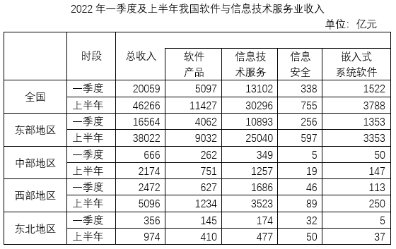

# 时段拆分推算（二季度=上半年累计-一季度）＋多条件均满足型比较计数

考点：[[20-考点/资料分析/综合/时段拆分推算（二季度=上半年累计-一季度）＋多条件均满足型比较计数|综合 / 时段拆分推算（二季度=上半年累计-一季度）＋多条件均满足型比较计数]]
材料：[[15-材料/资料分析/6369834 2022年上半年我国软件与信息技术服|6369834 2022年上半年我国软件与信息技术服]]

**问法模型**：题干问'二季度四类收入均高于一季度'的地区有几个 → 先用'上半年累计-一季度'推算二季度当期值，再逐格与一季度值比较，统计全部满足的地区数

## 推理链
1. 第1步：从表格提取4个地区四类收入的一季度值与上半年累计值，如东部软件产品一季度4062、上半年9032，东北信息安全一季度32、上半年50
2. 第2步：规则一：二季度当期值=上半年累计值-一季度值（'上半年'为累计口径，非二季度当期）；规则二：二季度>一季度等价于上半年>2×一季度，可免相减直接翻倍比较
3. 第3步：东部判定——软件产品9032-4062=4970>4062、信息技术服务25040-10893=14147>10893、信息安全597-256=341>256、嵌入式3353-1353=2000>1353，四类均满足
4. 第4步：中部判定——软件产品751-262=489>262、信息技术服务1257-349=908>349、信息安全19-5=14>5、嵌入式147-50=97>50，四类均满足
5. 第5步：西部判定——软件产品1234-627=607<627，第一项即不满足（一票否决），无需再查其余三项
6. 第6步：东北判定——软件产品410-145=265>145、信息技术服务477-174=303>174、嵌入式37-5=32>5，但信息安全50-32=18<32不满足，排除
7. 第7步：仅东部、中部共2个地区四类均高于一季度，对照选项得C

**最快解法**：⚡ 两倍判定法（翻倍比较代替相减）：'二季度>一季度'⟺'上半年>2×一季度'，将一季度值翻倍后与上半年值直接比大小——东部2×4062=8124<9032等四项全过、中部四项全过（2×5=10<19、2×50=100<147）、西部2×627=1254>1234立即出局、东北2×32=64>50出局，全程无一次减法

## 易错点
- ⚠ 把'上半年'累计值直接当作二季度当期值与一季度比较，跳过'上半年-一季度'的相减（材料导读明示的最典型陷阱）
- ⚠ 判定标准是'四类均高于'，任一分项不满足即整区排除；不能只看总收入（如西部总收入5096>2×2472=4944满足，但软件产品607<627不满足，看总判定会误计入西部）
- ⚠ 小量级数据集中在信息安全、嵌入式列（东北信息安全一季度32/上半年50，翻倍后64>50），易看错行列；西部软件产品607与627仅差20，需精确翻倍/相减不能毛估

## 母题抽象
> 🧩 当题干出现'二季度（或下半年、后期某月）与前期比较'且材料只给累计值时，用'累计值>2×前期值⟺后期>前期'的两倍判定法逐项筛查，验证'均满足/全部高于'型计数结论

**同类特征**：二季度、四类收入均高于、一季度水平、地区有几个、上半年累计-一季度推算、均满足型比较计数

## 相关题
- [[10-真题/资料分析/增长/10297464 时段拆分求当期值+环比增长率计算与排序比较|10297464]]（四川 2025，相关度1）

---

### 题干
在全国4个地区中，2022年二季度四类软件与信息技术服务业收入均高于一季度水平的有几个？

### 选项
- A. 4
- B. 3
- C. 2　✅
- D. 1

### 官方解析
定位表格可知2022年上半年和一季度全国四个地区四类软件与信息技术服务业的收入。则全国四个地区2022年二季度四类软件与信息技术服务业收入与一季度的比较如下：
东部地区：软件产品，亿元；信息技术服务，亿元；信息安全，亿元；嵌入式系统软件，亿元。则2022年二季度东部地区四类软件与信息技术服务业收入均高于一季度水平；
中部地区：软件产品，亿元；信息技术服务，亿元；信息安全，亿元；嵌入式系统软件，亿元。则2022年二季度中部地区四类软件与信息技术服务业收入均高于一季度水平；
西部地区：软件产品，1234-627=607亿元&lt;627亿元。则2022年二季度西部地区不满足四类软件与信息技术服务收入均高于一季度水平；
东北地区：软件产品，亿元；信息技术服务，亿元；信息安全，亿元。则2022年二季度东北地区不满足四类软件与信息技术服务收入均高于一季度水平。
综上，符合题意的有东部地区、中部地区，共2个。
故正确答案为C。

### 给定材料

        2022年上半年，我国软件与信息技术服务业总收入同比增长10.9%，增速较1~5月份提高0.3个百分点。软件与信息技术服务业收入中，软件产品收入、信息技术服务收入、信息安全收入、嵌入式系统软件收入同比分别增长10.2%、12%、11.4%和5%。信息技术服务收入中，云计算、大数据服务收入4790亿元，同比增长9.3%；集成电路设计收入1279亿元，同比增长15.2%。

        2022年上半年，我国东部、中部、西部、东北地区完成软件与信息技术服务业总收入同比增速分别为10.2%、14.4%、15.9%和6.3%。

 

