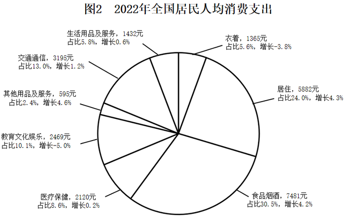

# 综合分析判断题（混搭占比排序、均值与中位数、名义-实际增速差、两期比重升降）

考点：[[20-考点/资料分析/综合/综合分析判断题（混搭占比排序、均值与中位数、名义-实际增速差、两期比重升降）|综合 / 综合分析判断题（混搭占比排序、均值与中位数、名义/实际增速差、两期比重升降）]]
材料：[[15-材料/资料分析/3052875 全国居民人均可支配收入（2018-2|3052875 全国居民人均可支配收入（2018-2]]

**问法模型**：题干问'以下正确的是'的综合判断题 → 逐项验证：读数类直接比大小，均值类用算术平均对比中位数，增速差类用名义增速(现期/基期-1)减实际增速，比重类用'部分增速<整体增速→比重下降'口诀。

## 推理链
1. 第1步：A项读图2占比：前四大项为食品烟酒30.5%、居住24.0%、交通通信13.0%、教育文化娱乐10.1%，衣着仅占3.6%排倒数第三，'食、住、衣、行'排序错误，排除A
2. 第2步：B项取图1五个柱值28228、30733、32189、35128、36883，加总得163161元，五年均值=163161÷5≈32632元
3. 第3步：五年中位数为居中年份2020年的32189元，32632>32189，均值大于中位数，B正确，可提前锁定答案
4. 第4步：C项逐年用柱值算名义增速：2019年30733/28228-1≈8.9%、2020年32189/30733-1≈4.7%、2021年35128/32189-1≈9.1%、2022年36883/35128-1≈5.0%，与实际增速(5.8%、2.1%、8.1%、2.9%)之差依次约3.1、2.6、1.0、2.1个百分点，2022年差值大于2021年，并非逐年收窄，排除C
5. 第5步：D项教育文化娱乐增速-5.0%为八项最低，由混合增长率居中可知2022年整体消费支出增速大于-5.0%，部分增速小于整体增速→该部分比重下降而非'略有上升'，排除D；综上选B

**最快解法**：⚡ 选项优先级法+口诀：先做计算量最小的B——五个数加总163161÷5≈32632>中位数32189，直接锁定；A项纯读图2占比排序排除；C项截位直除算各年名义增速再与折线实际增速作差（2021年差约1.0pp<2022年差2.1pp即破'逐年收窄'）；D项用两期比重口诀'部分增速(-5.0%)小于整体增速→比重下降'排除。

## 易错点
- ⚠ 实际增速≠名义增速：C项若直接拿折线数值相减或拿折线增速当名义增速会错判；必须用柱值两两相除计算名义增速再作差
- ⚠ 均值误当年均增长率或取错中位数：B项是五年算术平均（五年之和÷5），中位数是2020年的32189元，勿取2019或2021年数值
- ⚠ 两期比重方向搞反：D项须先用'混合增长率居中'确认整体消费支出增速大于-5.0%，再套'部分增速<整体增速→比重下降'，若跳过整体增速判断会误认为比重上升

## 母题抽象
> 🧩 当题干出现'以下说法正确的是'且选项混搭占比排序、均值中位数、增速差、两期比重时，先验证纯读数或简单加总的选项（排序、均值vs中位数）快速锁定答案，再用'名义增速=柱值现期/基期-1'与'部分增速<整体增速→比重下降'口诀排除其余。

**同类特征**：综合分析判断（选正确项）、五年均值与中位数比较、构成占比从大到小排序、名义增速与实际增速差值逐年变化、两期比重升降判断、混合增长率居中

## 相关题
- [[10-真题/资料分析/比重/4695914 两期比重比较（比重升降定性判断）|4695914]]（选调 2018，相关度1）
- [[10-真题/资料分析/增长/4713994 多月合计的同比增长量计算+混合增长率居中|4713994]]（福建 2018，相关度1）
- [[10-真题/资料分析/增长/5408635 混合增长率（居中原理判断1~2月同比增速区间）|5408635]]（四川 2022，相关度1）
- [[10-真题/资料分析/比重/5509916 两期比重升降判断（计数型）|5509916]]（黑龙江 2023，相关度1）
- [[10-真题/资料分析/增长/15833752 混合增长率（当期增速与累计增速比较计数）|15833752]]（内蒙古 2026，相关度1）

---

### 题干
根据上图，以下正确的是（    ）。

### 选项
- A. 2022年，全国居民人均消费支出构成占比按从大到小排序，前四的项目分别是食、住、衣、行
- B. 2018-2022年，全国居民人均可支配收入的五年均值大于这五年的中位数　✅
- C. 2019-2022年，全国居民人均可支配收入同比名义增速与实际增速的差值逐年收窄
- D. 2022年，全国居民人均教育文化娱乐支出占人均消费支出的比重同比略有上升

### 官方解析

A项：定位图2可知2022年全国居民人均消费支出构成占比。观察发现，全国居民人均消费支出构成占比按从大到小排序，前四的项目分别是食品烟酒（30.5%）、居住（24.0%）、交通通信（13.0%）、教育文化娱乐（10.1%），并非食、住、衣、行，错误；

B项：定位图1可知2018-2022年全国居民人均可支配收入。则2018-2022年全国居民人均可支配收入的均值为元，2018-2022年全国居民人均可支配收入的中位数为32189元，前者大于后者，正确；

C项：定位图1可知2018-2022年全国居民人均可支配收入及其同比实际增速。根据公式：增长率，则2022年全国居民人均可支配收入名义增速为，与实际增速的差值为5%-2.9%=2.1%，即2.1个百分点；2021年全国居民人均可支配收入名义增速为，与实际增速的差值为，即不到1.9个百分点。则2022年差值（2.1个百分点）&gt;2021年差值（不到1.9个百分点），并非逐年收窄，错误；

D项：定位图2可知2022年全国居民人均消费支出构成部分的同比增速。观察发现，2022年全国居民人均教育文化娱乐支出同比增速为最低（-5.0%），根据“混合增长率居中”可知，2022年全国居民人均消费支出同比增速大于-5.0%。根据两期比重比较结论：若部分增长率小于整体增长率，则比重下降，由于2022年全国居民人均教育文化娱乐支出同比增速小于全国居民人均消费支出同比增速，则比重下降，错误。

故正确答案为B。

### 给定材料

> [!warning] 疑点（官方解析可能有误，待人工复核）
> 官方解析文字存在转录缺漏：B项'均值为元'处缺失数值（应为163161/5≈32632元）；C项'差值为，即不到1.9个百分点'表述不完整，按柱值计算2021年名义增速约9.1%与实际8.1%之差约1.0个百分点（确属不到1.9），'2022年差值2.1pp>2021年差值'的判定成立，不影响答案B。

<!-- CODEX-ANSWER-REVIEW:BEGIN -->
### 本次独立复核

**复核状态：** `confirmed`（独立复算确认答案）

**计分答案：** B（可计分）

**复核解析：**

2018—2022人均可支配收入均值=(28228+30733+32189+35128+36883)/5=32632.2元，中位数32189元，均值更高，B正确。2022消费前四项不含衣；名义与实际增速差未逐年收窄；教育文化娱乐支出占比略降。

**相关信息：**

独立复核：按题干定义逐项检验，关键基数、比值、增速与图表读数写明以便复算。

**题源依据：** [固定版本原题](https://github.com/Mentat-Uran/kaogongzhentizhengliu/blob/84ab93d4b64b61d897bece8a1c0a5bab06b4feb2/10-%E7%9C%9F%E9%A2%98/%E8%B5%84%E6%96%99%E5%88%86%E6%9E%90/%E7%BB%BC%E5%90%88/10718189%20%E7%BB%BC%E5%90%88%E5%88%86%E6%9E%90%E5%88%A4%E6%96%AD%E9%A2%98%EF%BC%88%E6%B7%B7%E6%90%AD%E5%8D%A0%E6%AF%94%E6%8E%92%E5%BA%8F%E3%80%81%E5%9D%87%E5%80%BC%E4%B8%8E%E4%B8%AD%E4%BD%8D%E6%95%B0%E3%80%81%E5%90%8D%E4%B9%89-%E5%AE%9E%E9%99%85%E5%A2%9E%E9%80%9F%E5%B7%AE%E3%80%81%E4%B8%A4%E6%9C%9F%E6%AF%94%E9%87%8D%E5%8D%87%E9%99%8D%EF%BC%89.md)；固定内容 commit `84ab93d4b64b61d897bece8a1c0a5bab06b4feb2`，Markdown blob `b25754133a7cc2df1c9d45d7f4f0957557323eb3`。
<!-- CODEX-ANSWER-REVIEW:END -->
