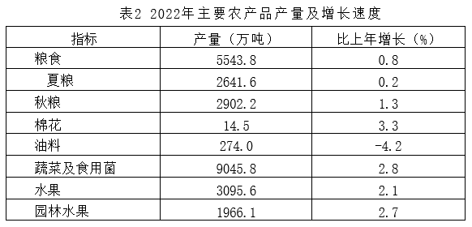

# 综合判断（增长量计算+单位换算；两期比重比较；下降速度比较）

考点：[[20-考点/资料分析/综合/综合判断（增长量计算+单位换算；两期比重比较；下降速度比较）|综合 / 综合判断（增长量计算+单位换算；两期比重比较；下降速度比较）]]
材料：[[15-材料/资料分析/6108202 某省2022年国民经济与农业统计公报|6108202 某省2022年国民经济与农业统计公报]]

**问法模型**：题干为'能够从上述资料中推出的是'的四选项综合判断 → 逐项验证：缺条件排除、定性规则排除、对剩余项套增长量公式并核查单位换算

## 推理链
1. 第1步：A项：表1仅给出2022年林业产值227.3亿元（增长8.5%），全材料未给林业种植面积，'平均亩产值=产值÷面积'缺分母，A无法推出。
2. 第2步：B项：表2给出2022年粮食产量5543.8万吨、比上年增长0.8%，代入增长量公式'增长量=现期×r/(1+r)'得5543.8×0.8%/(1+0.8%)≈44万吨。
3. 第3步：单位换算：1吨=2000斤，44万吨×2000=88000万斤=8.8亿斤，与B选项'约增加8.8亿斤'一致，B可推出。
4. 第4步：C项：第一产业增加值增速a=4.3%大于GDP增速b=3.9%，按两期比重比较规则'部分增速>整体增速→比重上升'，2022年第一产业增加值比重较上年上升而非下降，C错误。
5. 第5步：D项：表2油料增速-4.2%（即下降4.2%），文字段禽蛋产量下降3.8%，4.2%-3.8%=0.4个百分点，即油料下降速度比禽蛋快0.4个百分点，选项'慢0.4个百分点'方向错误，D错误。
6. 第6步：综上仅B能推出，与官方答案B一致。

**最快解法**：⚡ 综合题'先排除后计算'：A缺林业面积数据秒排；C用定性规则a=4.3%>b=3.9%→比重上升秒排；D比较4.2%与3.8%得'快0.4个百分点'，方向与选项'慢'不符排除；B用百化分：0.8%≈1/125，增长量≈5543.8/126≈44万吨，再×2000斤/吨=8.8亿斤，锁定B。

## 易错点
- ⚠ B项单位换算链长：44万吨→88000万斤→8.8亿斤，'1吨=2000斤'的万吨/亿斤换算易错一个数量级，需逐级验算。
- ⚠ C项方向陷阱：a=4.3%>b=3.9%应比重上升，勿凭'产业结构升级、第一产业占比萎缩'的主观印象误选'下降1个百分点'。
- ⚠ D项'快/慢'方向词陷阱：0.4个百分点数值对但方向反；且油料、禽蛋均为负增长，比较下降速度应取增速绝对值。

## 母题抽象
> 🧩 当题干出现'能够从上述资料中推出的是'时，按'缺条件排除→定性规则（a与b大小定比重升降）排除→唯一计算项套公式并严查单位换算'三步走，计算项重点核查增长量公式与吨/斤/亿斤换算。

**同类特征**：能够从上述资料中推出的是、四选一综合判断、增长量计算+单位换算（万吨→亿斤）、两期比重升降定性比较、下降速度快慢差比较、平均亩产值缺面积条件

## 相关题
- [[10-真题/资料分析/综合/1746812 综合判断题（逐项验证：比重计算、双指标排序比较、同比方向判断）|1746812]]（国考 2016，相关度2）
- [[10-真题/资料分析/综合/12536418 综合判断题（基期量计算+增长量计算+差额变化比较+两期比重比较混合考查）|12536418]]（四川 2024，相关度2）
- [[10-真题/资料分析/综合/15833800 综合判断（年均平均数+同比增量递增+最值查找+增长率多模型混合验证）|15833800]]（贵州 2026，相关度2）
- [[10-真题/资料分析/综合/2187843 综合判断题（混合增长率居中原理+现期比重+总量减部分差值）|2187843]]（山东 2018，相关度2）
- [[10-真题/资料分析/综合/2274545 综合分析判断题（平均数计算+增长量计算+翻番倍数+同比增长率多考点混合验证）|2274545]]（北京 2019，相关度2）

---

### 题干
能够从上述资料中推出的是：

### 选项
- A. 2022年，林业平均亩产值约为650元
- B. 2022年，粮食产量较上年约增加8.8亿斤　✅
- C. 2022年，第一产业增加值比重较上年约下降1个百分点
- D. 2022年，油料作物下降速度比禽蛋产量的慢0.4个百分点

### 官方解析
A项：定位表1可得：2022年，林业产值227.3亿元。材料中并未给出2022年林业种植面积的相关数据，即不能推出林业平均亩产值，错误；
B项：定位表2可得：2022年，粮食产量5543.8万吨，比上年增长0.8%。根据公式：增长量，则2022年，粮食产量较上年增加万吨。由于1吨=2000斤，则2022年，粮食产量较上年约增加44万吨×2000=88000万斤=8.8亿斤，正确；
C项：定位文字材料第一段可得：2022年全省实现地区生产总值87435.1亿元，按不变价格计算，比上年增长3.9%（b）。分产业看，第一产业增加值6298.6亿元，增长4.3%（a）。根据两期比重比较结论“当部分增长率（a）&gt;整体增长率（b）时，比重上升”，由于a（4.3%）&gt;b（3.9%），则2022年，第一产业增加值比重较上年上升，错误；
D项：定位文字材料第二段可得：2022年，禽蛋产量(不含小品种)下降3.8%。定位表2可得：2022年，油料产量比上年增长-4.2%。由于4.2%-3.8%=0.4%，即2022年，油料作物下降速度比禽蛋产量的快0.4个百分点，错误。
故正确答案为B。

### 给定材料

        2022年全省实现地区生产总值87435.1亿元，按不变价格计算，比上年增长3.9%。分产业看，第一产业增加值6298.6亿元，增长4.3%，三次产业结构为7.2：40.0：52.8。

        农林牧渔业产值12130.7亿元，按可比价格计算，比上年增长4.8%。猪牛羊禽肉产量838.4万吨，比上年增长2.9%；禽蛋产量（不含小品种)）438.1万吨，下降3.8%；牛奶产量304.4万吨，增长5.6%。水产品总产量（不含远洋渔业产量）843.9万吨，增长2.8%。其中，海水产品产量724.9万吨，增长2.6%；淡水产品产量119.0万吨，增长4.3%。

