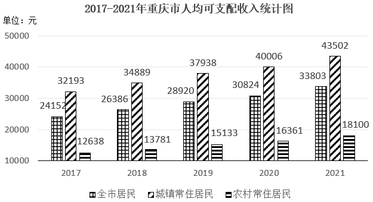

# 综合分析题-逐项验证（基期量换算比较、增长率计算与比较）

考点：[[20-考点/资料分析/综合/综合分析题-逐项验证（基期量换算比较、增长率计算与比较）|综合 / 综合分析题-逐项验证（基期量换算比较、增长率计算与比较）]]
材料：[[15-材料/资料分析/5071059 2017-2021年重庆市居民人均可|5071059 2017-2021年重庆市居民人均可]]

**问法模型**：“能够从上述资料中推出的是”→综合分析四选一，逐项验证：纯读数项直接查表比大小，增长率项用（现期-基期）/基期，基期比较项用现期÷(1+g)换算后比较

## 推理链
1. 第1步：A项需比较2020年两个基期量：表2给2021年城镇工资性收入25396元（同比+8.7%），文字段给2021年全市人均消费支出24598元（同比+13.5%），两者都需用基期量=现期÷(1+增长率)换算
2. 第2步：A项比较25396/1.087与24598/1.135：分子25396>24598且分母1.087<1.135，按“分子分母一大一小，分子大的分数大”得25396/1.087（≈23364元）>24598/1.135（≈21672元），即2020年城镇工资性收入高于2020年全市消费支出，A“低于”错误
3. 第3步：B项直接读表2财产性收入行“比上年增长(%)”：城镇8.6%、农村9.9%，8.6%<9.9%，B“城镇高于农村”错误
4. 第4步：C项从图1取数：2019年农村15133元、城镇37938元，2018年（基期）农村13781元、城镇34889元
5. 第5步：C项增长率=(现期-基期)/基期：农村(15133-13781)/13781=1352/13781≈9.8%；城镇(37938-34889)/34889=3049/34889≈8.7%
6. 第6步：C项9.8%>8.7%，2019年农村增速高于城镇增速，C正确
7. 第7步：D项从图1取数：2021年城镇43502元/2020年40006元，农村18100元/16361元；城镇增速(43502-40006)/40006=3496/40006≈8.7%，农村增速(18100-16361)/16361=1739/16361≈10.6%，城镇<农村，D“城镇高于农村”错误
8. 第8步：综上A、B、D均错误，仅C可推出，锁定答案C

**最快解法**：⚡ 综合分析按“先读数、后轻计算”顺序：B项纯读表2（城镇8.6%<农村9.9%）秒排除；C项用“增长量÷基期量”截位直除比增速——农村1352/13781首位商9（≈9.8%）、城镇3049/34889首位商8（≈8.7%），农村大，直接锁定C；A、D计算量较大可不再验算

## 易错点
- ⚠ A项基期换算陷阱：两个量均为2021年现期值，必须都除以(1+增长率)换算到2020年再比较，且2020年消费支出图中没有、只能用文字段24598÷1.135倒推，若拿现期值或只换算一个量都会出错
- ⚠ C项基期年份错位：2019年增长率必须以2018年为基期（15133/13781、37938/34889），错用2017年或相邻年份数据会算错增速
- ⚠ D项直觉陷阱：城镇收入绝对量大≠增速高，且图1纵轴从10000起非零起点、柱高视觉差被放大，必须以标注数值计算——实际农村增速10.6%高于城镇8.7%，D方向恰好说反

## 母题抽象
> 🧩 当题干出现“能够从上述资料中推出的是”时，按“纯读数→增长率计算→基期换算”的性价比顺序逐项验证：读数项直接查表比大小，增长率项用增长量÷基期截位直除，基期比较项用现期÷(1+g)后按分子分母相对大小定性，排除三项即得答案

**同类特征**：能够从上述资料中推出的是、综合分析四选一、逐项验证、同比增长率(%)比较、基期量换算、跨图1/表2/文字段取数

## 相关题
- [[10-真题/资料分析/综合/2031178 综合分析题（逐项验证：增长量计算、基期量反推、比重阈值判断）|2031178]]（北京 2017，相关度2）
- [[10-真题/资料分析/综合/2028370 综合分析判断（同比升降年份计数+比重变化定性判断+基期量定性比较）|2028370]]（国考 2017，相关度2）
- [[10-真题/资料分析/综合/2187869 综合分析判断（文字材料逐项验证+基期数回推）|2187869]]（山东 2018，相关度2）
- [[10-真题/资料分析/综合/2578807 综合分析题·混合增长率判断整体与部分增速关系（辅以基期倍数、增长量、两期平均数排除）|2578807]]（四川 2020，相关度2）
- [[10-真题/资料分析/综合/19283943 综合分析判断题（倍数比较+求和判断+隐含平均每场座位数反推）|19283943]]（国考 2025，相关度1）

---

### 题干
能够从上述资料中推出的是（    ）。

### 选项
- A. 2020年城镇常住居民工资性收入低于2020年全市居民人均消费支出
- B. 2021年城镇常住居民财产性收入增长率高于农村常住居民财产性收入增长率
- C. 2019年农村常住居民人均可支配收入增长率高于城镇常住居民人均可支配收入增长率　✅
- D. 2021年城镇居民人均可支配收入增长率高于农村居民人均可支配收入增长率

### 官方解析
A项：定位统计表可得，2021年重庆市城镇常住居民工资性收入为25396元，同比增长8.7%；定位文字材料可得，2021年重庆市全市居民人均消费支出24598元，比上年增长13.5%。根据公式：基期量，可得2020年重庆市城镇常住居民工资性收入为；2021年重庆市全市居民人均消费支出为。因的分子大且分母小，根据“分子分母一大一小，分子大的分数大”，故&gt;，即2020年城镇常住居民工资性收入高于2020年全市居民人均消费支出，错误；
B项：定位统计表可得，2021年城镇常住居民财产性收入同比增长8.6%，农村常住居民财产性收入同比增长9.9%，8.6%&lt;9.9%，错误；
C项：定位统计图可得，2019年农村常住居民人均可支配收入和城镇常住居民人均可支配收入分别为15133元和37938元，2018年分别为13781元和34889元。根据公式：增长率，可得：2019年农村常住居民人均可支配收入增长率；城镇常住居民人均可支配收入增长率，即2019年农村常住居民人均可支配收入增长率高于城镇常住居民人均可支配收入增长率，正确；
D项：定位统计图可得，2021年城镇常住居民人均可支配收入和农村常住居民人均可支配收入分别为43502元和18100元，2020年分别为40006元和16361元。根据公式：增长率，可得：2021年城镇常住居民人均可支配收入增长率；农村常住居民人均可支配收入增长率，即2021年城镇常住居民人均可支配收入增长率低于农村常住居民人均可支配收入增长率，错误。
故正确答案为C。

### 给定材料

        2021年重庆市全市居民人均消费支出24598元，比上年增长13.5%。按常住地分，城镇常住居民人均消费支出29850元，同比增长12.8%；农村常住居民人均消费支出16096元，同比增长13.8%。

