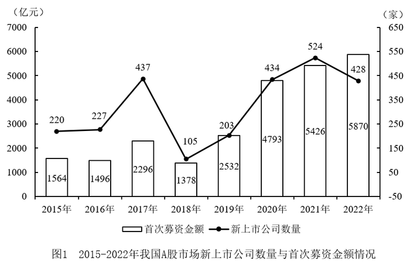

# 综合判断题（全年−上半年差额拆分＋平均每家募资额＋同比增长率比较＋两期对比）

考点：[[20-考点/资料分析/综合/综合判断题（全年−上半年差额拆分＋平均每家募资额＋同比增长率比较＋两期对比）|综合 / 综合判断题（全年−上半年差额拆分＋平均每家募资额＋同比增长率比较＋两期对比）]]
材料：[[15-材料/资料分析/4478128 我国A股市场新上市公司情况：图1给出|4478128 我国A股市场新上市公司情况：图1给出]]

**问法模型**：题干为'能够从上述资料中推出的是'的四选一综合判断 → 逐项验证：A/C/D用比较排除，B用'全年值−上半年值=下半年值'拆分后套平均数模型（募资额÷家数）

## 推理链
1. 第1步：从图1提取2022年全年数据：首次募资5870亿元、新上市428家；从表1汇总2022年上半年合计：家数30+54+68+19=171家，募资1064+1156+871+29=3120亿元
2. 第2步：建立差额拆分关系：下半年=全年−上半年，得2022年下半年募资5870−3120=2750亿元、家数428−171=257家
3. 第3步：验证A：下半年募资2750亿元<上半年3120亿元，'高于'不成立，A错误
4. 第4步：验证B：下半年平均每家募资=2750÷257≈10.7亿元，与选项'约10.7亿元'吻合，B正确
5. 第5步：验证C：按增长率=(现−基)/基，2019年=(203−105)/105≈93%，2020年=(434−203)/203≈114%，2020>2019，增长率最大的年份是2020年而非2019年，C错误
6. 第6步：验证D：2023年上半年家数38+41+52+42=173家>2022年上半年171家，'数量与募资金额都小于'不成立（募资2126亿元虽小于3120亿元，但家数增加了），D错误
7. 第7步：四个选项中仅B可推出，对照官方答案确认选B

**最快解法**：⚡ 差额拆分+截位直除：先锁定B需两个下半年口径数据——募资5870−3120=2750亿元、家数428−171=257家，直除2750/257≈10.7即锁定答案；A项比2750与3120大小、C项只需算2019年98/105≈93%与2020年231/203>100%两个分数即可排除，均无需精算

## 易错点
- ⚠ 时间口径分裂陷阱：图1是2022年全年值、表1是2022年上半年值，求'下半年'必须做全年−上半年的拆分，直接引用任一单图表数据都会算错
- ⚠ 平均数分子分母口径必须同为下半年：若家数误用全年428家或上半年171家，得2750/428≈6.4或2750/171≈16.1，均偏离10.7
- ⚠ C项易凭折线走势或增量大小误判：2019年增量98家略大于2017年增量210家之误读不可取，须比较增长率（基期小的2020年比率反超）；D项'都小于'需两项同时满足，家数173>171一项即否决

## 母题抽象
> 🧩 当综合判断题选项出现'全年中某半段时期'特征时，用'全年值−已知的半段值=另一半段值'做差额拆分，再套平均数（金额÷数量）或增长率公式逐项验证，其中只需一项与选项吻合即可锁定答案

**同类特征**：能够从上述资料中推出的是、下半年、平均每家首次募资金额、增长率最大的年份、全年值与上半年值口径拆分、都小于

## 相关题
- [[10-真题/资料分析/综合/19283943 综合分析判断题（倍数比较+求和判断+隐含平均每场座位数反推）|19283943]]（国考 2025，相关度1）
- [[10-真题/资料分析/综合/1796162 综合判断（月均计算、平均运输距离、比重对比、增长量比较逐项验证）|1796162]]（贵州 2016，相关度1）
- [[10-真题/资料分析/综合/2133504 综合判断题（现期比重+现期平均数多项验证，一对三错）|2133504]]（国考 2018，相关度1）
- [[10-真题/资料分析/综合/2444706 综合判断题（增长量+比重+倍数逐项验证）|2444706]]（四川 2019，相关度1）
- [[10-真题/资料分析/综合/2571728 综合分析逐项判断（等差递推求和＋单位换算＋比值估算）|2571728]]（山东 2020，相关度1）

---

### 题干
能够从上述资料中推出的是：

### 选项
- A. 2022年下半年，我国A股市场新上市公司首次募资总金额高于2022年上半年
- B. 2022年下半年，我国A股市场新上市公司平均每家首次募资金额约为10.7亿元　✅
- C. 2016-2022年期间，我国A股市场新上市公司数量增长率最大的年份出现在2019年
- D. 2023年上半年，我国A股市场新上市公司数量与首次募资金额都小于2022年上半年

### 官方解析

A项：定位统计图可知，2022年我国A股市场新上市公司首次募资金额为5870亿元；定位统计表可知2022年上半年我国A股市场主板、科创板、创业板、北交所新上市公司首次募资金额。2022年上半年我国A股市场新上市公司首次募资总金额为亿元，则2022年下半年我国A股市场新上市公司首次募资总金额为5870-3120=2750亿元，则2022年下半年低于2022年上半年，错误；

B项：定位统计图可知，2022年我国A股市场新上市公司数量为428家；定位统计表可知2022年上半年我国A股市场主板、科创板、创业板、北交所新上市公司数量；根据本题A项可知，2022年下半年我国A股市场新上市公司首次募资总金额为2750亿元。2022年上半年我国A股市场新上市公司总数量为30+54+68+19=171家。故题干所求亿元，正确；

C项：定位统计图可知2015-2022年我国A股市场新上市公司数量。根据公式：增长率，可得2019年我国A股市场新上市公司数量同比增长率、2020年同比增长率，2019年同比增长率小于2020年， 2019年同比增长率并非最大，错误；

D项：定位统计表可知2023年上半年我国A股市场主板、科创板、创业板、北交所新上市公司数量。根据本题B项可知，2022年上半年我国A股市场新上市公司总数量为171家。2023年上半年我国A股市场新上市公司总数量为38+41+52+42=173家，则2023年上半年大于2022年上半年，错误。

故正确答案为B。

### 给定材料

> [!warning] 疑点（官方解析可能有误，待人工复核）
> 官方解析中A项'首次募资总金额为亿元'与B项'故题干所求亿元'两处公式数字缺失（系解析文本排版丢失），应为3120亿元与2750÷257≈10.7亿元；经独立核算2750/257≈10.70亿元，结论与官方答案B一致，不影响判定

<!-- CODEX-ANSWER-REVIEW:BEGIN -->
### 本次独立复核

**复核状态：** `resolved`（答案与解析已核定）

**计分答案：** B（可计分）

**复核解析：**

1. 第1步：从图1提取2022年全年数据：首次募资5870亿元、新上市428家；从表1汇总2022年上半年合计：家数30+54+68+19=171家，募资1064+1156+871+29=3120亿元
2. 第2步：建立差额拆分关系：下半年=全年−上半年，得2022年下半年募资5870−3120=2750亿元、家数428−171=257家
3. 第3步：验证A：下半年募资2750亿元<上半年3120亿元，'高于'不成立，A错误
4. 第4步：验证B：下半年平均每家募资=2750÷257≈10.7亿元，与选项'约10.7亿元'吻合，B正确
5. 第5步：验证C：按增长率=(现−基)/基，2019年=(203−105)/105≈93%，2020年=(434−203)/203≈114%，2020>2019，增长率最大的年份是2020年而非2019年，C错误
6. 第6步：验证D：2023年上半年家数38+41+52+42=173家>2022年上半年171家，'数量与募资金额都小于'不成立（募资2126亿元虽小于3120亿元，但家数增加了），D错误
7. 第7步：四个选项中仅B可推出，对照官方答案确认选B

**最快解法**：⚡ 差额拆分+截位直除：先锁定B需两个下半年口径数据——募资5870−3120=2750亿元、家数428−171=257家，直除2750/257≈10.7即锁定答案；A项比2750与3120大小、C项只需算2019年98/105≈93%与2020年231/203>100%两个分数即可排除，均无需精算

**相关信息：**

考点：综合判断题（全年−上半年差额拆分＋平均每家募资额＋同比增长率比较＋两期对比）。来源：2025年新疆公务员录用考试《行测》试题（网友回忆版）；2025年。> 🧩 当综合判断题选项出现'全年中某半段时期'特征时，用'全年值−已知的半段值=另一半段值'做差额拆分，再套平均数（金额÷数量）或增长率公式逐项验证，其中只需一项与选项吻合即可锁定答案

**同类特征**：能够从上述资料中推出的是、下半年、平均每家首次募资金额、增长率最大的年份、全年值与上半年值口径拆分、都小于

**题源依据：** [固定版本原题](https://github.com/Mentat-Uran/kaogongzhentizhengliu/blob/84ab93d4b64b61d897bece8a1c0a5bab06b4feb2/10-%E7%9C%9F%E9%A2%98/%E8%B5%84%E6%96%99%E5%88%86%E6%9E%90/%E7%BB%BC%E5%90%88/13504466%20%E7%BB%BC%E5%90%88%E5%88%A4%E6%96%AD%E9%A2%98%EF%BC%88%E5%85%A8%E5%B9%B4%E2%88%92%E4%B8%8A%E5%8D%8A%E5%B9%B4%E5%B7%AE%E9%A2%9D%E6%8B%86%E5%88%86%EF%BC%8B%E5%B9%B3%E5%9D%87%E6%AF%8F%E5%AE%B6%E5%8B%9F%E8%B5%84%E9%A2%9D%EF%BC%8B%E5%90%8C%E6%AF%94%E5%A2%9E%E9%95%BF%E7%8E%87%E6%AF%94%E8%BE%83%EF%BC%8B%E4%B8%A4%E6%9C%9F%E5%AF%B9%E6%AF%94%EF%BC%89.md)；固定内容 commit `84ab93d4b64b61d897bece8a1c0a5bab06b4feb2`，Markdown blob `2a2817ec5de2f36534fe19328168309c2b35088b`。
<!-- CODEX-ANSWER-REVIEW:END -->
