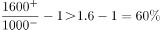
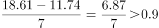
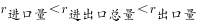
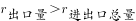

# 综合分析选非题（均价比较-年均增长量-两期比重比较-逐年双指标同比计数）

考点：[[20-考点/资料分析/综合/综合分析选非题（均价比较-年均增长量-两期比重比较-逐年双指标同比计数）|综合 / 综合分析选非题（均价比较/年均增长量/两期比重比较/逐年双指标同比计数）]]
材料：[[15-材料/资料分析/3624575 2015-2022年我国酱油进出口贸|3624575 2015-2022年我国酱油进出口贸]]

**问法模型**：题干问'从材料中不能推出的是'→选非综合分析题：对A-D四个选项逐一验真找唯一假项，分别套用均价=进口额÷进口量、年均增长量=(现期-基期)÷间隔年数、两期比重比较、逐年同比双增计数四个模型

## 推理链
1. 第1步：A项：2022年进口均价=1905万美元÷1.17万吨≈1628美元/吨（万美元÷万吨恰约掉10⁴，直除即得美元/吨），出口均价=18385÷18.61≈988美元/吨
2. 第2步：A项：1628÷988-1≈65%＞50%，进口均价高出出口均价50%以上，A项正确可推出
3. 第3步：B项：2016-2022年出口量年均增加=(18.61-11.74)÷7=6.87÷7≈0.98万吨＞0.9万吨，B项正确可推出
4. 第4步：C项：2022年出口量占比=18.61÷(18.61+1.17)≈94.1%，2021年=18.34÷(18.34+1.35)≈93.1%，94.1%＞93.1%比重提高，C项正确可推出（或用口诀：出口量增速约+1.5%＞总量混合增速＞进口量增速约-13.3%，部分增速＞整体增速则比重上升）
5. 第5步：D项：逐年核对进口量与进口额是否均比上年增加：2016(1.38↑,2109↑)✓、2017(1.46↑,2328↑)✓、2019(1.45↑,2289↑)✓、2021(1.35↑,2342↑)✓，共4个年份；2018(1.34↓)、2020(1.18↓)、2022(1.17↓)因进口量下降被排除
6. 第6步：D项称'有5个年份'与实际4个不符，为假命题；本题为选非题，故选D

**最快解法**：⚡ 选项直判法+截位直除：先攻D项逐年打钩计数——进口量仅2016、2017、2019、2021四年较上年上升（2018、2020、2022三年进口量下降即双增不成立），得4个≠5个，D为假，选非直接锁定答案；其余验真用三条速算：A项'万美元÷万吨=美元/吨'直除1905/1.17≈1628对988得65%；B项(18.61-11.74)÷7≈0.98；C项混合增速口诀'部分增速＞整体增速→比重上升'秒判，无需精算比重

## 易错点
- ⚠ D项计数须同时满足'进口量与进口额均增加'：2018(1.34＜1.46)、2020(1.18＜1.45)、2022(1.17＜1.35)三年进口量下降直接否掉，实际仅4个年份；只看单一指标或漏核相邻年份会误数成5个
- ⚠ B项年均增长量基期口径：'2016-2022年年均增加'应以2015年为基期、间隔7年，(18.61-11.74)÷7≈0.98万吨；若误取2016年为基期、间隔6年则口径错误（本题结论恰好不受影响）
- ⚠ A项单位口径：进口额/出口额单位是'万美元'、量是'万吨'，但万美元÷万吨恰约掉10⁴直接得美元/吨，勿再额外换算导致量级误判；进口量(1.17)与出口量(18.61)、进口额(1905)与出口额(18385)量级差约10倍，取数勿串行串列

## 母题抽象
> 🧩 当题干出现'不能推出/说法错误'且四个选项混跨均价、年均增长量、两期比重、逐年计数等模型时，优先做逐年打钩类计数项直判正误锁定答案，计算类用'万美元÷万吨=美元/吨'、'(现期-基期)÷间隔年数'、'部分增速＞整体增速则比重上升'三条口径快速验真

**同类特征**：不能推出的是、选非题、进口均价比出口均价高50%以上、年均增加超过、占进出口总量的比重比上年有所提高、均比上年增加的年份有5个

## 相关题
- [[10-真题/资料分析/综合/2452601 综合判断选非题：两期平均数比较+两期比重比较+环比基期量估算|2452601]]（江苏 2020，相关度2）
- [[10-真题/资料分析/综合/2452713 综合分析选非题（核心：增长量计算与比较，辅以倍数计算与增速范围判断）|2452713]]（江苏 2020，相关度2）
- [[10-真题/资料分析/综合/250219 综合分析选非题（图表数据可推断性判断）|250219]]（深圳市考 2008，相关度1）
- [[10-真题/资料分析/综合/10297333 综合分析选非题（同比增速逐年比较+年均增长量+比重百分点还原）|10297333]]（浙江 2025，相关度1）
- [[10-真题/资料分析/综合/14355349 综合分析-选非题（增长率计算比较+人均值计算）|14355349]]（浙江 2024，相关度1）

---

### 题干
从上述材料中不能推出的是：

### 选项
- A. 2022年我国酱油进口均价比出口均价高50%以上
- B. 2016-2022年我国酱油出口量年均增加超过0.9万吨
- C. 2022年我国酱油出口量占进出口总量的比重比上年有所提高
- D. 2016-2022年我国酱油进口量和进口额均比上年增加的年份有5个　✅

### 官方解析

A项：定位表格可知2022年我国酱油进、出口量及进、出口额。根据公式：均价，则2022年我国酱油进口均价为美元/吨，出口均价为美元/吨，前者比后者高，正确；

B项：定位表格可得：2015年与2022年我国酱油的出口量分别为11.74万吨和18.61万吨。根据公式：年均增长量，则2016-2022年我国酱油出口量年均增加万吨，正确；

C项：定位表格可知2021年与2022年我国酱油出口量与进口量。方法一：根据公式：比重，则2022年出口量占进出口总量的比重为，2021年的比重为，前者大于后者，即2022年我国酱油出口量占进出口总量的比重比上年有所提高，正确；

方法二：出口量+进口量=进出口总量，且2022年出口量同比增速为正（18.61＞18.34），进口量同比增速为负（1.17＜1.35），根据混合增长率口诀“混合后居中”，则。又根据两期比重比较结论“部分增长率＞整体增长率，则比重上升”，，则2022年我国酱油出口量占进出口总量的比重比上年有所提高，正确；

D项：定位表格可知2015-2022年各年我国酱油进口量和进口额。进口量和进口额均比上年增加的年份有2016年、2017年、2019年和2021年，共4个年份，错误。

本题为选非题，故正确答案为D。

### 给定材料

