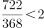

# 综合判断题（年均增速比较+总量加总逐年比较+增速数据链完整性判断+两期增速比较）

考点：[[20-考点/资料分析/综合/综合判断题（年均增速比较+总量加总逐年比较+增速数据链完整性判断+两期增速比较）|综合 / 综合判断题（年均增速比较+总量加总逐年比较+增速数据链完整性判断+两期增速比较）]]
材料：[[15-材料/资料分析/6109562 2019—2022年中国锂电池产业数|6109562 2019—2022年中国锂电池产业数]]

**问法模型**：题干为'能够从上述资料中推出的有几项'的逐项判断计数模型 → 对①②④四个命题各自独立验证，正误分别定位到图2、图1（表格）和文字段，数出正确项数

## 推理链
1. 第1步：①定位图2，三类锂电池2019年出货量为9.5/36.5/71.0GWh，2022年为130.0/48.0/480.0GWh，考查2019—2022年均增速，年份差n=3相同
2. 第2步：①按'年份差相同直接比较总倍数(1+g)³=现期/基期'规则：储能130.0/9.5≈13.7倍＞动力480.0/71.0≈6.8倍＞数码48.0/36.5≈1.3倍，储能年均增速最快，①正确
3. 第3步：②中国锂电池年出货量材料未直接给出，须将图2三类逐年加总：2019年9.5+36.5+71.0=117.0、2020年16.2+46.2+80.0=142.4、2021年47.7+53.5+226.0=327.2、2022年658GWh（与文字段658GWh吻合），四年递增，②正确
4. 第4步：③数码锂电池2020—2022年增速可算（46.2/36.5−1≈26.6%、53.5/46.2−1≈15.8%、48.0/53.5−1≈−10.3%），但2019年增速需2018年基期值，材料未给，'逐年下降'链条缺第一环，③无法推出、错误
5. 第5步：④定位表格，中国新能源汽车产量2020—2022年为146/368/722万辆，比较增速即比较现期/基期倍数：2021年368/146≈2.52，2022年722/368≈1.96，2.52＞1.96，故2022年增速慢于2021年，④正确
6. 第6步：综上①②④正确、③错误，能推出的共3项，对照选项选C

**最快解法**：⚡ 综合判断先易后难+速算组合：①年份差相同比总倍数，13.7/6.8/1.3一眼锁定储能最快，无需逐年算增速；②先预制总量表117.0/142.4/327.2/658再判递增（后面小题还要复用）；④增速比较直接比现期/基期倍数（368/146≈2.5 vs 722/368≈2.0），不必算出增速具体值；③先查数据链完整性——材料无2018年数据直接判'推不出'，跳过计算

## 易错点
- ⚠ ③是直觉陷阱：2020—2022数码增速确实逐年下降（约26.6%→15.8%→−10.3%），但命题覆盖'2019—2022逐年'，需2019年增速，缺2018年基期值无法计算，凭后三年趋势直觉选'正确'即掉坑
- ⚠ ②的总量必须自行把图2三类加总（材料只给2022年658GWh）；注意数码类2022年48.0GWh低于2021年53.5GWh，是分项下降而总量仍递增，勿以分项波动否定总量递增
- ⚠ ④勿混淆增长量与增速：2022年增长量354万辆＞2021年222万辆，但基期也大得多（368 vs 146万辆），实际增速约96.2%低于152.1%；①年均增速是复合增长模型，勿误用'逐年增速的算术平均'或拿年均出货量替代

## 母题抽象
> 🧩 当题干出现'能够从资料中推出的有几项'时，逐项独立验证：年均增速比较先确认年份差是否相同（相同则只比现期/基期总倍数）；'逐年'类命题先核查数据链首环是否缺失（缺上一年基期值即判'推不出'）；两期增速比较直接比现期/基期倍数，无需算出增速本身

**同类特征**：能够从上述资料中推出的有几项、年均增速最快（年份差相同的倍数比较）、逐年增加（需自算总量加总）、同比增速逐年下降（数据链完整性判断）、增速慢于上年水平（两期增速比较）、综合判断题逐项计数选个数

## 相关题
- [[10-真题/资料分析/综合/4637204 综合判断题（加权合格率+临界值计数+倍数放缩三表述逐项验证）|4637204]]（国考 2022，相关度1）
- [[10-真题/资料分析/综合/12536407 综合判断·信息可推出性核验（隔年基期平均数、两期占比+基期总量拼合、缺基数比重不可求）|12536407]]（四川 2024，相关度1）
- [[10-真题/资料分析/综合/16593069 综合判断-信息推出项数（增长量计算+基期比重+部分量倒推混合验证）|16593069]]（甘肃 2024，相关度1）
- [[10-真题/资料分析/综合/16593084 综合判断题（基期量比较+月均计算+均价比较+基期比重逆推）|16593084]]（甘肃 2024，相关度1）

---

### 题干
在以下信息中，能够从上述资料中推出的有几项？
①2019-2022年，中国储能锂电池出货量年均增速为3类锂电池中最快
②2019-2022年，中国锂电池出货量逐年增加
③2019-2022年，中国数码锂电池年出货量同比增速逐年下降
④2022年，中国新能源汽车产量同比增速慢于2021年水平

### 选项
- A. 1
- B. 2
- C. 3　✅
- D. 4

### 官方解析

①定位统计图可得，2019年中国储能锂电池、数码锂电池、动力锂电池出货量分别为9.5GWh、36.5GWh、71.0GWh；2022年三者出货量分别为130.0GWh、48.0GWh、480.0GWh。根据年均增长率公式：，当年份差n相同时，直接比较即可。储能锂电池：；数码锂电池：；动力锂电池：，比较可得储能锂电池出货量年均增速最快，正确；

②定位文字材料可得，2022年中国锂电池出货量658GWh；定位统计图可得2019-2021年中国锂电池出货量。2019-2022年中国锂电池出货量分别为：9.5+36.5+71.0=117GWh、16.2+46.2+80.0=142.4GWh、47.7+53.5+226.0=327.2GWh、658GWh。比较可得2019-2022年，中国锂电池出货量逐年增加，正确；

③定位统计图可得2019-2022年中国数码锂电池年出货量，但材料未给出2018年相关数据，无法计算2019年同比增速，故无法判断2020年的增速是否较2019年下降，错误；

④定位统计表可得，2020-2022年中国新能源汽车产量分别为146万辆、368万辆、722万辆。比较增速大小时，当，可直接比较，则2021年：；2022年：。即2022年中国新能源汽车产量同比增速慢于2021年水平，正确。

综上所述，说法正确的有3个。

故正确答案为C。

### 给定材料

        2022年中国锂电池出货量658GWh，同比增长101.1%。2022年中国动力锂电池装车量达294.6GWh，同比增长90.7%，高于全球同比增速18.9个百分点，占全球动力锂电池装车量的56.9%。

