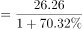

# 综合判断（四选项逐项正误验证：占比判断+比例上限+基期量折现）

考点：[[20-考点/资料分析/综合/综合判断（四选项逐项正误验证：占比判断+比例上限+基期量折现）|综合 / 综合判断（四选项逐项正误验证：占比判断+比例上限+基期量折现）]]
材料：[[15-材料/资料分析/180730 2014年全国市场主体情况：既有期末|180730 2014年全国市场主体情况：既有期末]]

**问法模型**：题干为'能够从上述资料中推出的是'的综合判断问法 → 对四个选项逐项代入材料验证正误：可直除的占比/比例项快速排除，依赖增速的选项用现期量÷(1+增速)做基期折现验证

## 推理链
1. 第1步：A项取段3：2014年新登记现代服务业企业114.10万户，其中教育业仅0.68万户，占比=0.68÷114.10≈0.6%，教育业占比极小，'大部分属于教育行业'不成立
2. 第2步：B项取段1+段2：2014年末实有农民专业合作社128.88万户（存量口径），2014年新登记农民专业合作社30.95万户（流量口径）；成立不满一年者至多为当年新登记的30.95万户，30.95÷128.88≈24%＜1/3，'超过三分之一'不成立
3. 第3步：C项取段1：2014年末注册资本129.23万亿元，2013年末=129.23÷(1+r)（'比上年末增长%'数值在提供文本中缺失），据官方解析折现结果大于100万亿元，'不足100万亿元'不成立
4. 第4步：D项取段3：2014年新登记科学研究和技术服务业企业26.26万户，同比增长r（该数值在提供文本中缺失），2013年同期=26.26÷(1+r)，据官方解析直除首位只能商1，结果落在10～19万户区间
5. 第5步：D项'2013年新登记科学研究和技术服务业企业不到20万户'成立，A、B、C均被排除，故正确答案为D

**最快解法**：⚡ 逐项排除法+直除：A用0.68÷114.10＜1%直接排除；B用30.95÷128.88≈24%＜33.3%（128.88÷3≈42.96＞30.95）直接排除；C按解析口径129.23÷(1+r)＞100万亿元排除；D用26.26÷(1+r)截位直除首位商1（即10～19万户量级）锁定D

## 易错点
- ⚠ 存量/流量口径混用：B项整体必须用段1期末实有的128.88万户、部分用段2新登记的30.95万户，'成立不满一年'只能以当年新登记数为上限；误把新登记市场主体总量1292.5万户等其他口径当整体即错
- ⚠ A项'大部分'须用段3内部子项占比（0.68÷114.10），勿错用段2新登记总量1292.5万户或段1存量做整体
- ⚠ 段1、段3、段4多处'增长%'数值在提供文本中缺失，C、D定量验证须依赖官方解析回填结论；另勿把段2的绝对增量（160.97万户、9.66万亿元）或'4.02个百分点'误当增速代入折现公式

## 母题抽象
> 🧩 当题干出现'能够从上述资料中推出的是'且四个选项分属材料不同段、存量与流量双口径并存时，用逐项排除法：先用占比/比例直除秒杀易判项，再对剩余项做现期量÷(1+增速)的基期折现验证，全程盯紧存量与流量口径不可互充

**同类特征**：能够从上述资料中推出的是、四个选项分属材料不同段落、口径各不相同、期末实有存量与年度新登记流量并存、占比/比例直除即可排除的选项、需基期量折现验证的选项、'不到/不足/超过/大部分'等量级判断词

## 相关题
- [[10-真题/资料分析/综合/19283943 综合分析判断题（倍数比较+求和判断+隐含平均每场座位数反推）|19283943]]（国考 2025，相关度1）
- [[10-真题/资料分析/综合/1796162 综合判断（月均计算、平均运输距离、比重对比、增长量比较逐项验证）|1796162]]（贵州 2016，相关度1）
- [[10-真题/资料分析/综合/2133504 综合判断题（现期比重+现期平均数多项验证，一对三错）|2133504]]（国考 2018，相关度1）
- [[10-真题/资料分析/综合/2444706 综合判断题（增长量+比重+倍数逐项验证）|2444706]]（四川 2019，相关度1）
- [[10-真题/资料分析/综合/2571728 综合分析逐项判断（等差递推求和＋单位换算＋比值估算）|2571728]]（山东 2020，相关度1）

---

### 题干
能够从上述资料中推出的是：

### 选项
- A. 2014年新登记注册现代服务业企业大部分属于教育行业
- B. 2014年末超过三分之一的农民专业合作社成立不满一年
- C. 2013年全国实有各类市场主体注册资本（金）不足100万亿元
- D. 2013年新登记注册科学研究和技术服务业企业不到20万户　✅

### 官方解析

A项：2014年，新登记注册现代服务业企业114.10万户，教育业0.68万户，教育业占比较小，教育不占主要地位，错误。

B项：2014年12月底，农民专业合作社128.88万户，新登记注册农民专业合作社30.95万户，则成立不满一年的农民专业合作社比例，错误。

C项：2014年12月底，全国实有各类市场主体注册资本（金）129.23万亿元，比上年末增长，则2013年全国实有各类市场主体注册资本（金）万亿元，错误。

D项：2014年科学研究和技术服务业26.26万户，同比增长，则2013年科学研究和技术服务业万户，首位只能商1，因此不到20万户，正确。

故正确答案为D。

### 给定材料

        截至2014年12月底，全国实有各类市场主体6932.22万户，比上年末增长，增速较上年同期增加4.02个百分点；注册资本（金）129.23万亿元，比上年末增长。其中，企业1819.28万户，个体工商户4984.06万户，农民专业合作社128.88万户。

        2014年，全国新登记注册市场主体1292.5万户，比上年同期增加160.97万户；注册资本（金）20.66万亿元，比上年同期增加9.66万亿元。其中，企业365.1万户，个体工商户896.45万户，农民专业合作社30.95万户。

        2014年，新登记注册现代服务业企业114.10万户，同比增长。其中，信息传输、软件和信息技术服务业14.67万户，同比增长；科学研究和技术服务业26.26万户，同比增长；文化、体育和娱乐业6.59万户，同比增长；教育业0.68万户，同比增长。

        2014年，新登记注册外商投资企业3.84万户，同比增长。投资总额2763.31亿美元，同比增长；注册资本1796.39亿美元，同比增长。

> [!warning] 疑点（官方解析可能有误，待人工复核）
> 提供文本中段1'比上年末增长%'、段3及段4'同比增长%'数值缺失，C、D两项无法从材料文本独立复算，本笔记按官方解析口径回填结论（C为2013年注册资本＞100万亿元、D为26.26÷(1+r)直除首位商1即＜20万户），官方答案D本身无异议

<!-- CODEX-ANSWER-REVIEW:BEGIN -->
### 本次独立复核

**复核状态：** `resolved`（答案与解析已核定）

**计分答案：** D（可计分）

**复核解析：**

1. A项：2014年新登记现代服务业企业114.10万户，其中教育业0.68万户，占0.68/114.10≈0.6%，远非“大部分”，A错误。
2. B项：年末实有农民专业合作社128.88万户；当年新登记30.95万户，即使把当年新登记者都视为成立不满一年，也只占30.95/128.88≈24.0%，不到三分之一，B错误。
3. C项：原公式图给出注册资本同比增长27.70%，2013年末注册资本=129.23/1.277≈101.20万亿元，不低于100万亿元，C错误。
4. D项：原公式图给出科学研究和技术服务业新登记企业同比增长70.32%，2013年同期数量=26.26/1.7032≈15.42万户，少于20万户，D成立。
故唯一可推出项为D。

**相关信息：**

考點：综合判断（四选项逐项正误验证：占比判断+比例上限+基期量折现）。來源：2016年国家公务员录用考试《行测》题（副省级）；2016年。> 🧩 当题干出现'能够从上述资料中推出的是'且四个选项分属材料不同段、存量与流量双口径并存时，用逐项排除法：先用占比/比例直除秒杀易判项，再对剩余项做现期量÷(1+增速)的基期折现验证，全程盯紧存量与流量口径不可互充

**同类特征**：能够从上述资料中推出的是、四个选项分属材料不同段落、口径各不相同、期末实有存量与年度新登记流量并存、占比/比例直除即可排除的选项、需基期量折现验证的选项、'不到/不足/超过/大部分'等量级判断词

**题源依据：** [固定版本原题](https://github.com/Mentat-Uran/kaogongzhentizhengliu/blob/84ab93d4b64b61d897bece8a1c0a5bab06b4feb2/10-%E7%9C%9F%E9%A2%98/%E8%B5%84%E6%96%99%E5%88%86%E6%9E%90/%E7%BB%BC%E5%90%88/1746794%20%E7%BB%BC%E5%90%88%E5%88%A4%E6%96%AD%EF%BC%88%E5%9B%9B%E9%80%89%E9%A1%B9%E9%80%90%E9%A1%B9%E6%AD%A3%E8%AF%AF%E9%AA%8C%E8%AF%81%EF%BC%9A%E5%8D%A0%E6%AF%94%E5%88%A4%E6%96%AD%2B%E6%AF%94%E4%BE%8B%E4%B8%8A%E9%99%90%2B%E5%9F%BA%E6%9C%9F%E9%87%8F%E6%8A%98%E7%8E%B0%EF%BC%89.md)；固定内容 commit `84ab93d4b64b61d897bece8a1c0a5bab06b4feb2`，Markdown blob `c644dddfb960edf861d9813455bfa640c837abd8`。
<!-- CODEX-ANSWER-REVIEW:END -->
