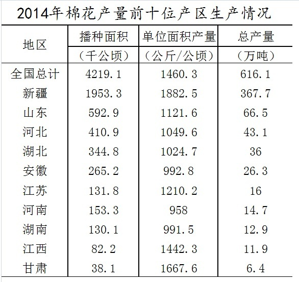

# 综合判断题（逐项验证：比重计算、双指标排序比较、同比方向判断）

考点：[[20-考点/资料分析/综合/综合判断题（逐项验证：比重计算、双指标排序比较、同比方向判断）|综合 / 综合判断题（逐项验证：比重计算、双指标排序比较、同比方向判断）]]
材料：[[15-材料/资料分析/180728 2014年全国棉花生产情况：全国播种|180728 2014年全国棉花生产情况：全国播种]]

**问法模型**：题干问'能够从上述资料中推出的是'→ 对A~D四个陈述逐项定位数据验证，只有一项为真，用排除法先易后难

## 推理链
1. 第1步：A项定位表格——山东总产量66.5万吨，仅低于新疆367.7万吨，总产量确为第二；但单产1121.6公斤/公顷低于新疆1882.5、甘肃1667.6、江苏1210.2，单产并非第二，'均为第二'不成立，排除A
2. 第2步：B项定位表格——河南播种面积153.3千公顷＞湖南130.1千公顷，但河南单产958.0公斤/公顷＜湖南991.5公斤/公顷，'均高于'有一项不符即排除B
3. 第3步：C项由文字段'2014年播种面积4219.1千公顷，比2013年减少2.9%'知2014年面积小于2013年（2013年≈4219.1÷(1-2.9%)≈4345千公顷），方向为减少，'比2013年多126千公顷'说法方向颠倒，排除C
4. 第4步：D项计算比重——新疆367.7÷全国616.1，与一半（616.1÷2≈308.05）比较：367.7＞308.05，即约59.7%＞50%，'占一半以上'成立
5. 第5步：A、B、C均被排除，D为唯一可推出项，故选D

**最快解法**：⚡ 综合判断排除法+比重口算：D项不需精确计算，只需口算全国的一半616.1÷2≈308，新疆367.7明显大于308即过半，直接锁定D；再用A项反证（单产列扫一眼，甘肃1667.6＞山东1121.6，山东非第二）即可放心

## 易错点
- ⚠ C项量级+方向双重陷阱：126千公顷恰是2013年与2014年面积之差（4345-4219.1≈126），数值对但方向反——2014年是减少2.9%，写成'比2013年多'即错，基期方向不能用'+'号
- ⚠ A项一票否决陷阱：总产量第二易验证，但单产第二须扫全列比较，按表格行序（总产量降序）想当然会误以为山东单产靠前，实际甘肃1667.6、江苏1210.2、新疆1882.5都高于它
- ⚠ B项'均高于'需双指标同时成立，河南面积大但单产958.0低于湖南991.5，只比面积一项会误判B对；阅读陷阱提示找'单产最高/第二'不能按行序、找'面积大小'不能按行序（江苏131.8排在河南153.3前）

## 母题抽象
> 🧩 当题干出现'能够从上述资料中推出的是'的综合判断特征时，用排除法逐项验证：比重类先与'总量一半'口算比较，排名类（'均为第二''均高于'）须双指标各扫一列、一票否决，同比类先定增减方向再算差值，验证唯一的真命题即答案

**同类特征**：能够从上述资料中推出的是、四选一综合判断、'均为第二'双指标排名、'均高于'双指标比较、同比减少的方向表述、占全国总产量一半以上

## 相关题
- [[10-真题/资料分析/综合/10942304 综合判断（增长量计算+单位换算；两期比重比较；下降速度比较）|10942304]]（山东 2024，相关度2）
- [[10-真题/资料分析/综合/12536418 综合判断题（基期量计算+增长量计算+差额变化比较+两期比重比较混合考查）|12536418]]（四川 2024，相关度2）
- [[10-真题/资料分析/综合/15833800 综合判断（年均平均数+同比增量递增+最值查找+增长率多模型混合验证）|15833800]]（贵州 2026，相关度2）
- [[10-真题/资料分析/综合/2187843 综合判断题（混合增长率居中原理+现期比重+总量减部分差值）|2187843]]（山东 2018，相关度2）
- [[10-真题/资料分析/综合/2274545 综合分析判断题（平均数计算+增长量计算+翻番倍数+同比增长率多考点混合验证）|2274545]]（北京 2019，相关度2）

---

### 题干
关于2014年棉花生产情况，能够从上述资料中推出的是：

### 选项
- A. 山东棉花总产量和单位面积产量均为全国第二
- B. 河南棉花播种面积和单位面积产量均高于湖南
- C. 全国播种面积比2013年多126千公顷
- D. 新疆棉花产量占全国总产量的一半以上　✅

### 官方解析
A项：根据表格数据，14年山东棉花总产量66.5万吨，第二；山东棉花单位面积产量1121.6公斤/公顷，小于新疆、江苏等，非第二，错误；
B项：14年棉花播种面积，河南（153.3千公顷）&gt;湖南（130.1千公顷）；14年单位面积产量河南（958.0公斤/公顷）&lt;湖南（991.5公斤/公顷），错误；
C项：14年全国棉花播种播种面积增长为－2.9%，故14年棉花播种面积应小于13年，错误；
D项：14年新疆棉花总产量占全国的比重=，正确。
故正确答案为D。

### 给定材料

一、根据以下资料，回答111～115题。

        2014年全国棉花播种面积4219.1千公顷，比2013年减少2.9％。棉花总产量616.1万吨，比2013年减产2.2％。

> [!warning] 疑点（官方解析可能有误，待人工复核）
> 官方解析D项计算式缺失（'比重=，正确'处为空白），但按表格数据367.7÷616.1≈59.7%＞50%，结论无误；C项解析中'播种播种面积'为笔误，均不影响答案判定
