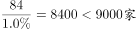

# 综合分析判断（增长量计算+比重逆推总量+口径定性排除）

考点：[[20-考点/资料分析/综合/综合分析判断（增长量计算+比重逆推总量+口径定性排除）|综合 / 综合分析判断（增长量计算+比重逆推总量+口径定性排除）]]
材料：[[15-材料/资料分析/181116 2015年1-5月B区规模以上文化创|181116 2015年1-5月B区规模以上文化创]]

**问法模型**：『下列推断中正确的一项』→ 逐项验证：增长类选项用增长量公式现期×r/(1+r)，占比类选项用部分÷比重逆推总量，『不可能/一定』类选项用门类总量对个体做上界定性判断，缺数选项先查时间口径是否给全。

## 推理链
1. 第1步：A项，统计表定位广告会展：2015年1-5月收入6.3亿元，增速20%（即r=1/5）
2. 第2步：套增长量公式：增长量=现期×r/(1+r)，r=20%时等价于现期÷(n+1)=6.3÷6
3. 第3步：6.3÷6=1.05亿元，即'增长1亿多元'成立，A正确
4. 第4步：B项，文字第三段：B区法人单位84家、仅占全市1.0%，全市=84÷1.0%=8400家<9000家，'超过9000家'不成立
5. 第5步：C项，统计表：广播、电视、电影业收入合计0.4亿元（3家），门类总量0.4亿元<1亿元，其中任何一家企业收入都不可能达到亿元，'有的来自'不成立
6. 第6步：D项，材料只给1-5月从业人员平均人数1.3万人，未给2015年5月当月从业人数，题干问'2015年5月平均每家'无数据支撑；即便错用1.3万÷84≈155人也到不了'200多名'
7. 第7步：综上只有A推断正确，与官方答案一致

**最快解法**：⚡ A项用百化分（增长量速算）：20%=1/5，增长量=现期/(n+1)=6.3/6≈1.05亿元>1亿元，秒判A正确；B项截位直除84÷1%=8400；C、D定性排除，全题30秒内完成。

## 易错点
- ⚠ D项时间口径陷阱：材料给的是'1-5月从业人员平均人数'，题干问'5月当月'，平均人数≠当月人数，先查数据是否给全再动笔
- ⚠ C项口径理解：'收入达亿元企业'按单个企业判断，须用门类收入合计0.4亿元做上界封死，勿因该门类有3家单位就误以为可能藏有亿元企业
- ⚠ A项算法坑：直接算6.3×20%=1.26亿元是错误公式（那是把基期当现期），正确为6.3×20%/1.2=1.05亿元；本题两种算法都>1亿元结论碰巧一致，但不能把错法当通法
- ⚠ B项时点口径：'截止5月底84家占全市1.0%'为时点数，逆推全市=84÷1.0%=8400家，勿与1-5月累计口径混淆或把1.0%看错档位

## 母题抽象
> 🧩 当综合分析题出现'增长了多少'选项时，先看增速是否为1/n型（如20%=1/5），直接用现期/(n+1)秒算增长量；'占全市x%'选项用部分÷比重逆推总量；'不可能/一定'选项用门类总量对个体上限做定性封堵；缺时间口径的选项直接判无法推出。

**同类特征**：下列推断中正确的一项、同比增长了1亿多元、仅占全市的1.0%、收入达亿元企业只有8家、平均每家单位从业人员、四选一综合分析

## 相关题
- [[10-真题/资料分析/综合/2050552 综合分析（基期计算＋增速趋势判断＋口径辨析）|2050552]]（吉林 2017，相关度1）
- [[10-真题/资料分析/综合/2021916 综合分析判断（混合增长率居中+两期比重变化+平均数计算+基期量估算）|2021916]]（吉林 2016，相关度1）

---

### 题干
根据上述材料，下列推断中正确的一项是

### 选项
- A. 2015年1-5月该区广告会展业收入同比增长了1亿多元　✅
- B. 2015年5月底全市规模以上文化创意产业法人单位超过9000家
- C. 2015年1-5月该区收入超过亿元的企业中有的来自广播、电视、电影业
- D. 2015年5月该区平均每家规模以上文化创意产业法人单位拥有200多名从业人员

### 官方解析

A项，定位统计表可得：2015年1-5月该区广告会展收入6.3亿元，增长率为。根据公式：，可得2015年1-5月该区广告会展业收入同比增长了亿元，正确；

B项，定位文字材料第三段可得：“截止到5月底，B区规模以上文化创意产业规模较小，法人单位只有84家，仅占全市的”。根据公式：，2015年5月底全市规模以上文化创意产业法人单位=，错误；

C项，定位统计表可得：2015年1-5月，该区广播、电视、电影业收入合计0.4亿元，未超过亿元，故2015年1-5月该区收入超过亿元的企业不可能来自广播、电视、电影业，错误；

D项，定位文字材料第三段可得：截止到5月底，B区规模以上文化创意产业规模较小，法人单位只有84家。但材料并未给出5月份该区规模以上文化创意产业从业人数，故无法求得2015年5月该区平均每家单位从业人员数量，错误。

故正确答案为A。

### 给定材料

        2015年1-5月，B区规模以上文化创意产业完成收入46.2亿元，比上年同期增长10.8%，比1-4月增幅收窄0.8个百分点，从业人员平均人数1.3万人，比上年同期下降2.4%。

        1-5月，B区规模以上文化创意产业实现利润总额-0.4亿元，亏损额比1-4月略有扩张，亏损额同比略有收窄。其中，新闻出版亏损额进一步扩大，实现利润总额-0.3亿元，比上年同期亏损额增加0.2亿元；软件、网络及计算机服务受个别企业业务整合的影响，降幅较大，实现利润0.2亿元，同比下降81.3%；其他辅助服务亏损额大幅收窄，实现利润-0.1亿元，亏损额同比减少1.1亿元。

        截止到5月底，B区规模以上文化创意产业规模较小，法人单位只有84家，仅占全市的1.0%；大型企业匮乏，收入达亿元企业只有8家，中小型企业居多。

