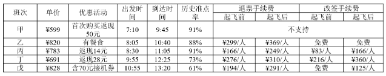

# 改签总费用组合计算（实付票款+起飞后档手续费）与花费区间反推班次

考点：[[20-考点/资料分析/综合/改签总费用组合计算（实付票款+起飞后档手续费）与花费区间反推班次|综合 / 改签总费用组合计算（实付票款+起飞后档手续费）与花费区间反推班次]]
材料：[[15-材料/资料分析/181280 某旅游网站推荐的M地至N地5月30日|181280 某旅游网站推荐的M地至N地5月30日]]

**问法模型**：由'10:30航班已起飞+改签+总花费900多元'反推班次 → 先按时刻筛除未起飞班次，再用'实付票款（扣返现）+起飞后档改签手续费'逐项试算，匹配'900多元'区间

## 推理链
1. 第1步：由题干'10:30到达机场时飞机已经起飞'对照出发时刻筛选：乙8:05、丙8:30、丁9:55已起飞，戊10:55尚未起飞，排除A项戊（甲7:10虽已起飞但改签'不支持'且不在选项中）
2. 第2步：因航班已起飞，改签须查表中'起飞后'档改签手续费：乙免费（0元）、丙¥166/人、丁¥560/人
3. 第3步：按官方口径'订票费（有返现需减去返现）+改签费'计算总花费：乙=820+0=820元；丙=783-14+166=935元；丁=691-28+560=1223元
4. 第4步：对照'一共花费900多元'：乙820为800多、丁1223为1200多、丙935为900多，唯一符合区间的是丙班次
5. 第5步：与选项对照，C项丙班次为正确答案，验证官方结论

**最快解法**：⚡ 排除法+口算加总：先按起飞时刻一票排除戊（10:55未起飞，与'已经起飞'矛盾），再对乙丙丁心算'票价-返现+起飞后改签费'得820、935、1223，仅935落入900多区间，锁定丙（C）

## 易错点
- ⚠ 档位判断错误：10:30时乙(8:05)、丙(8:30)、丁(9:55)已起飞，必须用'起飞后'档改签费，若误用'起飞前'档则丙=769+83=852、丁=663+166=829，全是800多无选项可配，易陷入僵局或错选；戊(10:55)未起飞直接排除，误不筛时点会误选A
- ⚠ 返现与注释口径：注释'退票取消优惠'仅针对退票，改签情形官方口径仍扣返现（丙783-14）；乙'含早餐'、戊'70元接机券'为非现金优惠，不冲抵票款，若当现金减免会算错总花费
- ⚠ '免费'与'不支持'混淆：乙改签两档均'免费'按0元计，甲的'不支持'是无法办理而非0元；退票/改签手续费为定额'元/人'非费率，历史准点率(91%/88%等)为纯干扰信息，误入算式即掉坑

## 母题抽象
> 🧩 当题干出现'某时刻到达机场+航班已起飞+办理改签+总花费区间'特征时，先按出发时刻表筛除未起飞班次并确认用'起飞后'档手续费，再用'实付票价（扣返现）+对应档手续费'逐一试算，验证唯一落入给定花费区间的班次

**同类特征**：10:30到达机场、所购班次飞机已经起飞、隔天同一班次、价钱不变、在窗口办理改签、一共花费900多元

## 相关题
（暂无）

---

### 题干
5月30日早晨，王先生由于记错了时间，10：30到达机场时，所购班次的飞机已经起飞。幸运的是隔天同一班次的机票还有售，且价钱不变，于是在窗口办理了改签，加上之前网上订票的费用，王先生一共花费了900多元，他所购买的最可能是哪个班次的机票?

### 选项
- A. 戊班次
- B. 丁班次
- C. 丙班次　✅
- D. 乙班次

### 官方解析
由题干“10：30到达机场时，所购班次的飞机已经起飞”和表格中各个班次飞机出发时间可以判断A项错误；由表格可得订票费（有返现需减去返现）+改签费：B项丁班次，错误；C项丙班次，正确；D项乙班次，错误。
故正确答案为C。

### 给定材料

下表是某旅游网站上推荐的从M地到N地的机票价格（5月30日）及在线支付的优惠活动。

注：如果发生退票，取消相应的优惠活动。

