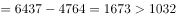
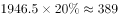
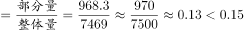
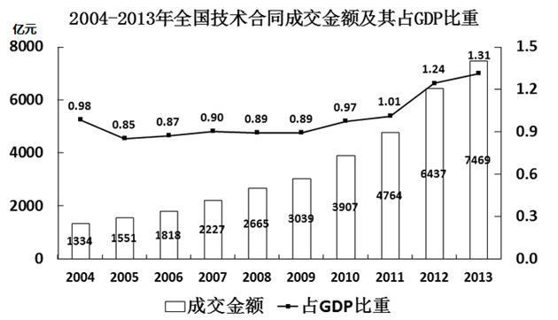

# 综合判断题（比重计算+同比增量比较+年份间隔+扇区计数验证）

考点：[[20-考点/资料分析/综合/综合判断题（比重计算+同比增量比较+年份间隔+扇区计数验证）|综合 / 综合判断题（比重计算+同比增量比较+年份间隔+扇区计数验证）]]
材料：[[15-材料/资料分析/181638 2004-2013年全国技术合同成交|181638 2004-2013年全国技术合同成交]]

**问法模型**：题干出现'能够从上述资料中推出的是'→四选项逐一验证的综合判断题，优先验证含具体数值、运算量小的选项（如D项比重），用排除法锁定正确项。

## 推理链
1. 第1步：A项验证——图1柱状数据2011年4764、2012年6437、2013年7469，2012年增量=6437-4764=1673亿元＞2013年增量=7469-6437=1032亿元，2013年同比增量并非最大，A排除
2. 第2步：B项验证——图1折线中占比最低0.85%（2005年）、最高1.31%（2013年），年份差=2013-2005=8年≠4年，B排除
3. 第3步：C项验证——图2电子信息技术1946.5亿元，两成=1946.5×20%≈389.3亿元，低于该值的有核应用技术335.5、新材料及其应用321.2、农业技术233.0、其他164.0共4个明确扇区，但'其他164.0'内部包含的领域数未知，无法确定恰有5个领域，C排除
4. 第4步：D项计算——图2现代交通968.3亿元，图1中2013年成交总金额7469亿元，比重=968.3÷7469≈12.97%
5. 第5步：对照判定——12.97%小于13%，也小于1/7≈14.3%（7469×1/7≈1067＞968.3），'比重不到'成立，D正确

**最快解法**：⚡ 特殊分数比对（百化分）+增量作差：D项968.3/7469与1/7≈14.3%比对，7469×1/7≈1067＞968.3，一步锁定D；A项用相邻柱差速算，6437-4764=1673为最大增量即排除。

## 易错点
- ⚠ '同比增量最大'误判：2013年金额7469最大但增量1032仅排第三，最大增量是2012年的1673亿元，看柱高不等于看柱高差
- ⚠ B项'相差4年'陷阱：最高（2013年）与最低（2005年）间隔=2013-2005=8年，易误按包含两端或数序错算
- ⚠ C项计数陷阱：'其他164.0'是正式扇区但内部含数个未知领域，直接数出4个、或把'其他'当1个领域凑成5个均不可靠，此类'包含关系不明'的选项通常推不出
- ⚠ D项分母须用图1的2013年总额7469亿元（与饼图各扇区合计互验），不能用单一扇区或2012年6437替代；分式基准（1/7≈14.3%）需先换算再比对

## 母题抽象
> 🧩 当题干出现'能够从上述资料中推出的是'的综合判断时，优先验证含具体数字的选项——增量用相邻年份作差、比重用特殊分数（1/7≈14.3%、1/8=12.5%）作差比对，年份间隔=末年-首年，计数选项警惕'其他'兜底扇区导致结论不可确定。

**同类特征**：能够从上述资料中推出的是、同比增量最大、占GDP比重最高和最低的年份相差、不足两成、占…比重不到（分数）、柱线双轴图+饼图跨图取数

## 相关题
- [[10-真题/资料分析/综合/2742296 综合判断题（同比增量比较、增长率临界判断、两地合计验证、保持增速的现期预测）|2742296]]（北京 2021，相关度2）
- [[10-真题/资料分析/综合/19283943 综合分析判断题（倍数比较+求和判断+隐含平均每场座位数反推）|19283943]]（国考 2025，相关度1）
- [[10-真题/资料分析/综合/1796162 综合判断（月均计算、平均运输距离、比重对比、增长量比较逐项验证）|1796162]]（贵州 2016，相关度1）
- [[10-真题/资料分析/综合/2133504 综合判断题（现期比重+现期平均数多项验证，一对三错）|2133504]]（国考 2018，相关度1）
- [[10-真题/资料分析/综合/2444706 综合判断题（增长量+比重+倍数逐项验证）|2444706]]（四川 2019，相关度1）

---

### 题干
能够从上述资料中推出的是（    ）。

### 选项
- A. 
2005年-2013年，技术合同成交金额同比增量最大的是2013年

- B. 
2004年-2013年，技术合同成交金额占GDP比重最高和最低的年份相差4年

- C. 
有5个技术领域2013年的技术合同成交金额不足当年电子信息技术合同成交金额的两成

- D. 
2013年现代交通技术合同成交金额占当年技术合同成交总金额的比重不到
　✅

### 官方解析

A项：定位图1柱状图，2013年亿元，2012年增长量亿元，故2013年的增长量不是最大的，错误；

B项：定位图1折线图，占GDP比重最高的年份和最低的年份分别为2013年和2005年，相差8年，错误；

C项：定位图2饼状图，电子信息技术合同成交额为1946.5亿元，其两成为亿元，则成交金额小于389亿元有“其他、农业技术、新材料及其应用、核应用技术”，而“其他”中包含几个技术领域未知，故不能确定2013年技术合同成交金额不足当年电子信息技术合同成交金额的两成的技术领域有5个，错误；

D项：定位图2饼状图，2013年现代交通的成交金额为968.3亿元，定位图1柱状图，2013年技术成交金额为7469亿元，则所求比重，正确。

故正确答案为D。

### 给定材料

 

