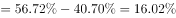
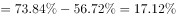
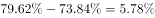
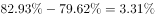
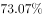
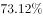
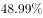

# 综合判断题（城镇化率过半判断、比重增量比较、跨行跨期数据比对）

考点：[[20-考点/资料分析/综合/综合判断题（城镇化率过半判断、比重增量比较、跨行跨期数据比对）|综合 / 综合判断题（城镇化率过半判断、比重增量比较、跨行跨期数据比对）]]
材料：[[15-材料/资料分析/181642 中国2005-2014年城镇与乡村人|181642 中国2005-2014年城镇与乡村人]]

**问法模型**：题干问'下列表述正确的是'→ 对四个选项逐一定位验证：比重过半用'部分与整体一半比较'，增量高低用相邻时点率差，逐年变化扫描回落点，跨期比较按年份对位取数

## 推理链
1. 第1步：A项验证——图1中2010年城镇人口66978万<乡村人口67113万，城镇化率=66978/134091≈49.9%<50%，首次超过50%应为2011年（69079/134735≈51.3%），A错误
2. 第2步：B项定位图2韩国行：1970年40.70、1980年56.72、1990年73.84、2000年79.62、2010年82.93
3. 第3步：计算各十年增量（百分点）：1970-1980为56.72−40.70=16.02；1980-1990为73.84−56.72=17.12；1990-2000为79.62−73.84=5.78；2000-2010为82.93−79.62=3.31
4. 第4步：增量最大为17.12个百分点，对应1980-1990年即上世纪80年代，B正确
5. 第5步：C项定位图2德国行：1990年73.12→2000年73.07出现回落，并非每年均增长，C错误
6. 第6步：D项——中等收入国家2010年城镇化率48.99%，上中等收入国家10年前（2000年）为50.63%，48.99<50.63，D错误
7. 第7步：综上只有B正确，与官方答案一致

**最快解法**：⚡ 

## 易错点
- ⚠ A项：图1无'总人口'列，若老老实实加总再除会慢；速判口诀是城镇化率>50%等价于城镇人口>乡村人口，且首次过半是2011年而非2010年
- ⚠ C项：图2年份不连续（仅1970/1980/1990/2000/2010/2011六个时点），'每年均增长'只能用表中时点判断，2000年低于1990年即推翻，不可自行插值
- ⚠ B项：'上世纪80年代'指1980-1990年的增量（17.12个百分点），勿误判为1970-1980（70年代，16.02）；且增量比较用百分点差，直接口算即可

## 母题抽象
> 🧩 当题干出现'下列表述正确的是'的综合判断时，逐项套模板：过半判断用'部分是否大于整体一半'，增量最大用相邻时点差值口算，'每年均增长'专扫回落点，'N年前的水平'按年份精确对位跨行取数

**同类特征**：下列表述正确的是、城镇化率首次超过50%、增量最高/上世纪80年代、每年均比上一年有所增长、高于10年前的水平、跨图1图2综合判断

## 相关题
- [[10-真题/资料分析/综合/2187818 净资产额计算与多主体大小比较（净资产=总资产-总负债，综合判断选正确项）|2187818]]（天津 2018，相关度1）
- [[10-真题/资料分析/综合/2050982 综合判断题（两期比重升降比较＋增长量要素齐备性＋指标口径核对）|2050982]]（江西 2017，相关度1）

---

### 题干
根据所给资料，下列表述正确的是（  ）。

### 选项
- A. 
2010年起，我国城镇化率首次超过

- B. 
韩国城镇化率增量最高是在上世纪80年代
　✅
- C. 
1970-2010年，德国的城镇化率每年均比上一年有所增长

- D. 
中等收入国家2010年的城镇化率高于上中等收入国家10年前的水平

### 官方解析

A项：定位图1柱状图，若城镇化率超过，则城镇人口大于乡村人口，观察发现2010年城镇人口数小于乡村人口数，错误；

B项：定位表格2最后一行，1970-1980年，韩国城镇化率增量；1980-1990年，其城镇化率增量；1990-2000年，其城镇化率增量=；2000-2010年，其城镇化率增量=，故可判断1980-1990年城镇化率增量最大，正确；

C项定位表格2，观察德国的城镇化率变化趋势，可发现2000年城镇化率为低于1990年的城镇化率，错误；

D项：定位表格2，中等收入国家2010年的城镇化率为，上中等收入国家2000年城镇化率为，前者小于后者，错误。

故正确答案为B。

### 给定材料

 

