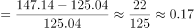
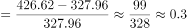
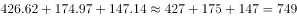
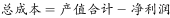
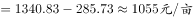
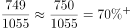

# 综合分析题（增长率比较＋趋势判断＋总成本反推求比重＋逐年最值核验）

考点：[[20-考点/资料分析/综合/综合分析题（增长率比较＋趋势判断＋总成本反推求比重＋逐年最值核验）|综合 / 综合分析题（增长率比较＋趋势判断＋总成本反推求比重＋逐年最值核验）]]
材料：[[15-材料/资料分析/181454 全国水稻生产情况：2013年种植面积|181454 全国水稻生产情况：2013年种植面积]]

**问法模型**：“关于2008-2012年每亩主要成本，下列说法正确的是”→逐项验证型综合判断：A用增长率比较、B用逐年单调性、C用注释桥梁反推总成本算比重、D用逐年查表找最小值，排除三错选一对

## 推理链
1. 第1步：从表1提取六项成本2008—2012年数据（元/亩）：种子26.27→48.32、化肥124.02→133.57、农药42.37→48.97、机械作业费81.79→147.14、人工成本214.65→426.62、土地成本109.04→174.97
2. 第2步：A项用增长率公式（现期−基期）/基期：2011→2012机械作业费增幅=22.10/125.04≈17.7%，人工成本增幅=98.66/327.96≈30.1%，人工＞机械，“增幅最大是机械作业费”不成立，A错
3. 第3步：B项逐年核验单调性：农药42.37→40.69→43.17、化肥124.02→108.22→105.98均为先降后升，与种子等单调递增项趋势不同，B错
4. 第4步：C项先用注释“产值合计=总成本+净利润”从图1反推2012年总成本=1340.83−285.73=1055.10元/亩；排名前三为人工426.62、土地174.97、机械147.14，合计748.73元/亩，占比748.73/1055.10≈71%，超过选项阈值，“未超过”不成立，C错
5. 第5步：D项逐年找最小值：种子各年26.27/29.48/36.17/42.51/48.32均小于当年其余五项（次小项为农药各年40.69~48.97，2012年种子48.32仍小于农药48.97），种子始终最小，D对
6. 第6步：综上A、B、C均错，故选D

**最快解法**：⚡ 综合判断题“先易后难＋直选纯查表项”：先做D项——逐列扫最小值，种子每一年均为六项中最小（2012年48.32对农药48.97仅险胜0.65），可直接锁定D；A、B凭增减趋势秒杀排除（化肥、农药中途下降），C需跨图反推总成本（1340.83−285.73=1055.10）最费时，放最后或直接跳过

## 易错点
- ⚠ C项口径陷阱：表1是“主要成本”六项，2012年六项之和约979.59元/亩小于总成本1055.10元/亩，不能把六项之和当总成本，必须用注释“产值合计=总成本+净利润”跨图表反推
- ⚠ B项只对比2008与2012首尾年份会误判“各项都上升、趋势相同”，化肥、农药中途有下降，须逐年看单调性
- ⚠ A项“增幅”默认指增长率而非增长量（2011→2012人工增速30.1%＞机械17.7%）；D项2012年种子48.32与农药48.97仅差0.65，扫数粗心易看错

## 母题抽象
> 🧩 当题干出现“关于……下列说法正确的是”且四个选项分别涉及增长率、趋势、比重、最值时，先用纯查表比较项（“始终最小/最大”）直选或排除，凡涉及“占总成本（总量）比重”的选项先用注释桥梁（产值合计−净利润=总成本）反推总量再算占比验证

**同类特征**：关于……下列说法正确的是（综合判断型）、2011-2012年增幅最大（增长率比较）、变化趋势是相同的（逐年单调性核验）、排名前三项的成本总和未超过总成本的（比重＋反推总量）、始终是最小的（逐年最值查表）、跨图表联动：产值合计等于总成本与净利润之和

## 相关题
（暂无）

---

### 题干
关于2008-2012年每亩水稻生产的主要成本，下列说法正确的是（    ）。

### 选项
- A. 
从每亩水稻生产成本构成上看，2011-2012年增幅最大的是机械作业费

- B. 
2008-2012年，表中各项成本的变化趋势是相同的

- C. 
2012年，表中排名前三项的成本总和未超过总成本的

- D. 
每亩水稻的生产成本中，种子成本始终是最小的
　✅

### 官方解析

A项：定位表格2，根据增长率，则机械作业费增长率，人工成本增长率，后者大于前者，错误；

B项：定位表格2，要想变化趋势相同，则2008-2012年，每项均呈现增长或者减少趋势，观察发现，在2008-2010期间，种子的成本呈递增趋势，而农药成本呈现先递减后递增的趋势，错误；

C项：定位表格2最后一列，2012年表中排名前三项分别为：人工成本、土地成本、机械作业费，成本之和为元/亩，定位柱状图1，2012年产值合计为1340.83元/亩，净利润为285.73元/亩，因为产值合计等于总成本与净利润之和，则2012年的，则排名前三的成本总和占总成本的比重=，大于，错误；

D项：定位表格2，纵向观察表中2008-2012年每一年成本的数据，比较发现种子的成本确实是最小的，正确。

故正确答案为D。

### 给定材料

        2013年全国水稻种植面积达4.55亿亩，比上年增加260多万亩。但由于强降雨及洪涝灾害，总产量较上年减少62万吨，总产量为20361万吨。下图反映的是20082012年我国水稻每亩的产值情况及水稻生产的主要成本构成情况。

注：产值合计等于总成本与净利润之和。

> [!note] 复核校正
> 图1与官方解析均为2012年净利润285.73元/亩；选项C阈值图清楚为70%，前三项占总成本748.73/1055.10≈70.96%，超过阈值，C错。种子成本各年均最低，答案D。

<!-- CODEX-ANSWER-REVIEW:BEGIN -->
### 本次独立复核

**复核状态：** `resolved`（答案与解析已核定）

**计分答案：** D（可计分）

**复核解析：**

A：人工成本增幅426.62/327.96−1≈30.1%，大于机械作业费增幅147.14/125.04−1≈17.7%，故“增幅最大的是机械作业费”错误。B：农药成本2008—2012年先降后升，趋势并非各项相同，错误。C：排名前三项合计426.62+174.97+147.14=748.73元/亩；总成本=1340.83−285.73=1055.10元/亩，占比748.73/1055.10≈70.96%，超过题项中的70%，所以“未超过”错误。D：种子成本每年均低于其他五项，正确。

**相关信息：**

独立复核：资料分析综合判断。按题干定义逐项检验并保留单位/基期口径；仅在题干及本地原图足以复算时确认。

**题源依据：** [固定版本原题](https://github.com/Mentat-Uran/kaogongzhentizhengliu/blob/84ab93d4b64b61d897bece8a1c0a5bab06b4feb2/10-%E7%9C%9F%E9%A2%98/%E8%B5%84%E6%96%99%E5%88%86%E6%9E%90/%E7%BB%BC%E5%90%88/1758946%20%E7%BB%BC%E5%90%88%E5%88%86%E6%9E%90%E9%A2%98%EF%BC%88%E5%A2%9E%E9%95%BF%E7%8E%87%E6%AF%94%E8%BE%83%EF%BC%8B%E8%B6%8B%E5%8A%BF%E5%88%A4%E6%96%AD%EF%BC%8B%E6%80%BB%E6%88%90%E6%9C%AC%E5%8F%8D%E6%8E%A8%E6%B1%82%E6%AF%94%E9%87%8D%EF%BC%8B%E9%80%90%E5%B9%B4%E6%9C%80%E5%80%BC%E6%A0%B8%E9%AA%8C%EF%BC%89.md)；固定内容 commit `84ab93d4b64b61d897bece8a1c0a5bab06b4feb2`，Markdown blob `db9a86188935dcc681b41f96545a40640a3744e2`。
<!-- CODEX-ANSWER-REVIEW:END -->
