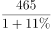
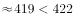

# 综合判断题（选非）——核心验证点为混合增长率（合计增速居中且偏向基期量大者）

考点：[[20-考点/资料分析/综合/综合判断题（选非）——核心验证点为混合增长率（合计增速居中且偏向基期量大者）|综合 / 综合判断题（选非）——核心验证点为混合增长率（合计增速居中且偏向基期量大者）]]
材料：[[15-材料/资料分析/182148 2015年1-7月我国机电产品、七大|182148 2015年1-7月我国机电产品、七大]]

**问法模型**：题干为'下列判断不正确的是'的选非型综合判断，逐项到原文定位验证；其中'两类商品合计同比平均增长-1.3%'的特征 → 采用混合增长率模型（混合增速介于各分项增速之间，且偏向基期量大的分项）

## 推理链
1. 第1步：A项验证——玩具2015年1-7月出口额465.0亿元、同比+11.0%，基期=465.0÷1.11≈418.9亿元＜422亿元，A判断正确
2. 第2步：B项验证——肥料出口量同比+54.7%、出口额同比+62.7%，两个增速均超过50%，B判断正确
3. 第3步：C项验证——7大类劳动密集型产品中出口额正增长的有家具(+7.6%)、塑料制品(+2.3%)、箱包及类似容器(+8.0%)、玩具(+11.0%)共4类，4/7超过半数，C判断正确
4. 第4步：D项定位——电器及电子产品出口19373.1亿元(+4.1%)，机械设备出口12865.6亿元(-6.6%)，两者合计的混合增速必介于-6.6%与+4.1%之间
5. 第5步：确定偏向——电器基期≈19373.1÷1.041≈18610亿元＞机械设备基期≈12865.6÷0.934≈13775亿元，故混合增速应更靠近+4.1%一方，精确计算约(32238.7-32384.8)÷32384.8≈-0.4%
6. 第6步：对照断言值——-1.3%到-6.6%的带符号距离(5.3)小于其到+4.1%的距离(5.4)，即-1.3%偏向基数小的机械设备一侧，与混合增长率规则矛盾，D判断错误
7. 第7步：本题为选非题，判断不正确的项为D

**最快解法**：⚡ 混合增长率定性判定（免精算）：合计增速必在-6.6%与+4.1%之间且偏向基期大的电器(+4.1%)；断言值-1.3%带符号距离比较|-1.3-(-6.6)|=5.3＜|-1.3-4.1|=5.4，明显偏向-6.6%一侧，直接判D错；A、B、C用截位速算快速排错（465÷1.11≈419＜422；54.7%、62.7%＞50%；正增长4/7过半）

## 易错点
- ⚠ 数据嫁接陷阱：D项的'-1.3%'恰是材料第二段'7大类劳动密集型出口额合计同比-1.3%'的现成数字，误把这一其他口径的合计增速套在电器+机械两类商品上即中招
- ⚠ 负号丢失：机械设备是'下降6.6%'即-6.6%，混合区间为[-6.6%,+4.1%]；比较-1.3%偏向哪方时必须带符号算距离，漏掉负号会得出相反的偏向结论
- ⚠ 混合增速偏向的是基期量（基数）大的一方，不是增速大或现期量大的一方；另B项肥料'量+54.7%/额+62.7%'成对混排，勿把出口量增速当出口额增速用

## 母题抽象
> 🧩 当选项断言'两类（或多类）合计的平均/混合增速=某具体值'时，用混合增长率法则验证：混合增速必介于各分项增速之间且偏向基期量大的一方，若断言值偏向基数小的分项即可判错，并警惕该值恰为材料另一口径的合计增速（数据嫁接）

**同类特征**：下列判断不正确的是（选非型综合判断）、同比平均增长-1.3%（两类合计混合增速断言）、2014年1—7月……少于422亿元（基期量推算断言）、同比增长均超过50%（量额双指标直接读数）、多数出口额同比有所增长（正增长个数过半）、选项跨段调用不同商品数据，需一次理清量/额、正/负对应关系

## 相关题
（暂无）

---

### 题干
下列判断不正确的是：

### 选项
- A. 
2014年1—7月，我国玩具出口额少于422亿元

- B. 
2015年1—7月，我国肥料出口量和出口额同比增长均超过50

- C. 
2015年1—7月，我国7大类劳动密集型产品中，多数出口额同比有所增长

- D. 
2015年1—7月，我国电器及电子产品和机械设备出口额同比平均增长1.3
　✅

### 官方解析

通过材料逐一分析题目选项，找出判断不正确的一项。

A项：2015年1-7月玩具出口465.0亿元，同比增长11.0，则2014年1-7月出口额=，正确；

B项：2015年1-7月肥料出口量同比增长54.7，出口额同比增长62.7，均超过50，正确；

C项：在7大类劳动密集型产品中，出口额同比增长的有家具、塑料制品、箱包及类似容器和玩具4类，超过一半，正确；

D项：定位材料第一段可知，电器及电子产品出口额19373.1亿元，同比增长4.1；机械设备出口额12865.6亿元，同比下降6.6。根据混合增长率知识点，平均增长率应该介于4.1和6.6之间，且更接近4.1。而1.3与4.1的差大于1.3与6.6的差，故1.3实际上更偏向于6.6，错误。

本题为选非题，故正确答案为D。

### 给定材料

根据以下资料，回答116-120题

        2015年1-7月，我国机电产品出口额44359.4亿元，同比增长1.2%，占出口总额的57.2%，其中，电器及电子产品出口19373.1亿元，同比增长4.1%，机械设备出口12865.6亿元，同比下降6.6%，同期，服装出口5709.9亿元，同比下降6.4%，纺织品出口3825.5亿元，同比下降1.7%，鞋类出口1901.7亿元，同比下降1.9%，家具出口1883.7亿元，同比增长7.6%，塑料制品出口553.7万吨，出口额1293.3亿元，出口量同比增长2.9%，出口额同比增长2.3%；箱包及类似容器出口166.9万吨，出口额998.9亿元，出口量同比下降3.8%，出口额同比增长8.0%；玩具出口465.0亿元，同比增长11.0%。

        上述7大类劳动密集型出口额合计同比下降1.3%，此外，肥料出口1957.3万吨，出口额366.1亿元，出口量同比增长54.7%，出口额同比增长62.7%；钢材出口6213.2万吨，出口额2319.5亿元，出口量同比增长26.6%，出口额同比下降2.6%；汽车出口44.5万辆，出口额411.0亿元，出口量同比下降13.6%，出口额同比下降4.5%。

> [!warning] 疑点（官方解析可能有误，待人工复核）
> 官方解析文字不严谨：'平均增长率应该介于4.1和6.6之间'应为'介于-6.6%与+4.1%之间'；'1.3与4.1的差大于1.3与6.6的差'须按带符号计算（|-1.3-4.1|=5.4＞|-1.3-(-6.6)|=5.3）才成立，若字面不加负号则差值大小关系相反；但解析结论方向（-1.3%偏向-6.6%一侧、与靠近+4.1%的混合规则矛盾）与答案D均正确。
