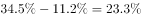
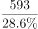
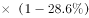
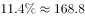
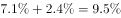

# 综合判断·线段法（比重差推人数比）+占比基数口径核验

考点：[[20-考点/资料分析/综合/综合判断·线段法（比重差推人数比）+占比基数口径核验|综合 / 综合判断·线段法（比重差推人数比）+占比基数口径核验]]
材料：[[15-材料/资料分析/182186 2015年6月某市统计局对应届毕业生|182186 2015年6月某市统计局对应届毕业生]]

**问法模型**：题干'下列判断正确的是'（综合判断）→ 人数比较类用线段法（偏离平均的距离之比=人数反比），占比类逐项核对'基数是谁×占比多少'及'至少/超过'能否坐实

## 推理链
1. 第1步：A项提取条件——男生打算创业占34.5%，比女生高11.2个百分点，则女生=34.5%−11.2%=23.3%；全体打算创业占28.6%（593名，总样本=593÷28.6%≈2073名）
2. 第2步：线段法（加权平均）规则：男生偏离平均34.5%−28.6%=5.9个百分点，女生偏离平均28.6%−23.3%=5.3个百分点，距离之比等于人数的反比
3. 第3步：代入得男:女=5.3:5.9，5.3<5.9，即男生人数少于女生（男≈982名、女≈1092名），A项正确
4. 第4步：B项核对基数——'害怕风险25.3%'出自图1，基数是'没有创业打算的受访者'（≈2073−593=1480名），并非全体受访者，主体偷换，B错误
5. 第5步：C项计算——'更愿意在体面的单位工作'占11.4%，人数≈1480×11.4%≈169名，但总样本系由593÷28.6%反推的近似值，'至少168名'的下限无法坐实，官方判'至少'表述不当，C错误
6. 第6步：D项核对饼图——官方按'50万以上'仅对应2.4%（100万元以上档），不足一成，'超过1成'不成立，D错误（题面若含50-100万档12.8%则合计15.2%，与解析矛盾，见疑点）
7. 第7步：四个选项中仅A项成立，锁定答案A

**最快解法**：⚡ 线段法秒杀A：女生比重=34.5%−11.2%=23.3%，男距平均5.9、女距平均5.3，人数比=距离反比=5.3:5.9，女生>男生，直接锁定A；B/C/D只需核基数（图1基数=不创业者≈1480名、图2基数=593名）与'至少/超过'表述即可排除，不必精算

## 易错点
- ⚠ 百分点≠比重：女生创业比重必须用34.5%−11.2%=23.3%换算，勿把'高11.2个百分点'的11.2%当比重代入
- ⚠ 基数口径陷阱：总样本须由593÷28.6%≈2073名反推（勿把593当总人数）；图1基数为'没有创业打算者'≈1480名，B项25.3%、C项11.4%只能乘1480而非全体受访者，跨图拼数据须各乘各的基数
- ⚠ 确定性表述陷阱：'至少''超过1成'等断言需能坐实——总样本是近似反推值故C的'至少168名'不成立；饼图扇区须按图案对应图例（2.4%=100万元以上而非2万元及以下），D须按官方档位口径核对

## 母题抽象
> 🧩 当综合判断题出现'甲群体比重比乙高/低X个百分点'且已知总占比时，用线段法：两群体偏离平均水平的距离之比=人数反比，秒判人数多少；其余选项逐项验证'基数是谁×占比多少'，并对'至少/超过'类断言检查能否坐实

**同类特征**：下列判断正确的是（综合判断）、比重差以'个百分点'表述、由比重差反推男女人数比较、图1基数=不打算创业者、图2基数=打算创业593名、'至少/超过1成'等确定性量词

## 相关题
（暂无）

---

### 题干
关于本次调查，下列判断正确的是：

### 选项
- A. 受访男生人数比女生少　✅
- B. 有25.3%的受访者因害怕风险而不打算创业
- C. 至少有168名受访者因更愿意在体面的单位上班而不打算创业
- D. 有超过1成的打算创业的毕业生能承担50万元以上的创业资金额度

### 官方解析

通过材料逐一分析题目选项，找出说法正确的一项。

A项：定位文字材料第一段，的男生打算创业，比女生高11.2个百分点，则的女生打算创业。男女总共打算创业的人数占总人数的，根据线段法可知，距离之比等于人数的反比，故男女人数比例为5.3：5.9，女生人数大于男生人数，正确；

B项：根据柱形图可知，在没有创业打算的受访者中有25.3%是因为害怕风险，而并非所有的受访者，主体错误；

C项：更愿意在体面单位上班的人数，“至少”表述不当，错误；

D项：定位饼状图可知，能够承担50万以上创业资金的毕业生所占比重为，不足一成，错误。

故正确答案为A。

### 给定材料

        2015年6月某市统计局对应届毕业生的抽样调查显示：有593名受访者打算创业，占28.6%。其中，大专生打算创业的比重比平均水平高7.0个百分点，本科生打算创业的比重比平均水平低3.9个百分点，31.4%的研究生打算创业，有34.5%的受访男生打算创业，比女生高11.2个百分点。

        在没有创业打算的受访者应届毕业生中，因缺乏启动资金，缺乏社会经验，缺乏创业方向等原因不打算创业的情况见图1，有创业打算的受访应届毕业生能承担的创业资金额度情况见图2.

> [!warning] 疑点（官方解析可能有误，待人工复核）
> 题面D项为'50万元以上'，按材料导读的图2口径应含50-100万（12.8%）与100万元以上（2.4%），合计15.2%>10%，D数值上似应为真；但官方解析写'所占比重为（缺数值），不足一成，错误'，疑为原题D项实为'100万元以上'（仅2.4%<10%）或解析只计了2.4%档。遵从铁律不改官方答案A，仅在此记录口径出入。
