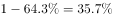

# 综合分析正误判断（多段落读数比对+互补项100%减法+全称判断可判定性检验）

考点：[[20-考点/资料分析/综合/综合分析正误判断（多段落读数比对+互补项100%减法+全称判断可判定性检验）|综合 / 综合分析正误判断（多段落读数比对+互补项100%减法+全称判断可判定性检验）]]
材料：[[15-材料/资料分析/182296 2015年5月国家统计局调查队在江苏|182296 2015年5月国家统计局调查队在江苏]]

**问法模型**：'下列判断正确的是'→逐项回原文定位对应占比，用数值比对、100%减法换算和可判定性检验逐项排除，保留唯一与材料一致项

## 推理链
1. 第1步：题干为综合判断题，四个选项分属材料不同数据套：A项查闲暇活动中'读书看报'与'打牌'占比，B项查居住方式中'在子女家轮流住'占比，C项查'看电视'与'听广播'的交叉关系，D项查性别占比。
2. 第2步：A项验证：材料第二段给出六项主要闲暇活动占比，官方解析确认读书看报占比＜打牌占比，与A项'喜欢读书看报的多于喜欢打牌的'方向相反，A错误。
3. 第3步：B项验证：材料第一段'在子女家轮流住的占（具体数值）'，将B项所给数值与该原文占比比对，两者不一致，B错误。
4. 第4步：C项验证：闲暇活动属多选型指标，材料只给看电视、听广播等各单项占比，未提供任何交叉或互斥信息，'喜欢看电视的受访老人都不喜欢听广播'属全称判断，无法由占比推出，C错误。
5. 第5步：D项验证：材料只直接给出'（某值）的受访老人为男性'，女性占比=100%−男性占比（互补项100%减法），D项所给数值与该换算结果相符，D正确。
6. 第6步：A、B、C均被排除，唯一与材料一致的判断为D，故正确答案选D。

**最快解法**：⚡ 综合判断'先排不可判定+互补减法'：C项含'都不喜欢'全称判断，闲暇活动是多选型指标（占比和可超100%），无交叉信息必为'无法判断'直接排除；D项用100%减法一步验证（女性=1−男性占比）；A、B只需将选项数值与原文对应占比作大小/数值比对即可锁定答案。

## 易错点
- ⚠ A项凭生活常识默认'读书看报应多于打牌'而误判，必须以材料数值为准（本材料中读书看报占比＜打牌占比）
- ⚠ C项忽略闲暇活动为多选型指标，单项占比之间不存在互斥或包含关系，'都（不）'类全称判断不能由占比大小推出，误当作可比较的排斥关系
- ⚠ D项女性占比材料未直接给出，误以为'没给数据就不能判断'而漏掉，实际女性占比=100%−男性占比属可求间接数据；B项需防止把'在子女家轮流住'与'与配偶同住/与未婚子女同住'等居住方式子项串行读错

## 母题抽象
> 🧩 当综合判断题出现'下列判断正确的是'且四个选项横跨材料多套占比时，先用'都/一定'类全称判断+多选型指标排除不可判定项，再用互补项100%减法（女性=1−男性）验证间接数据项，最后逐项与原文数值比对选唯一正确项。

**同类特征**：下列判断正确的是（综合正误判断）、选项分属闲暇活动/居住方式/性别多套占比、多选型指标单项占比比较、全称判断'都不喜欢'、互补项（女性占比）间接求值、纯文字密集占比材料逐项定位

## 相关题
（暂无）

---

### 题干
下列判断正确的是（  ）。

### 选项
- A. 
受访老人中喜欢读书看报的多于喜欢打牌的

- B. 
在子女家轮流住的受访老人占

- C. 
喜欢看电视的受访老人都不喜欢听广播

- D. 
受访老人中女性占
　✅

### 官方解析

A项：根据文字材料第二段“调查显示，打牌（）、读书看报（）是农村老人的主要闲暇活动。”可知，读书看报（）＜打牌（），错误；

B项：根据文字材料第一段“在子女家轮流住的占”可知，错误；

C项：根据文字材料第二段“调查显示，看电视（）、串门聊天（）、打牌（）、散步（）、听广播（）和读书看报（）是农村老人的主要闲暇活动。”可知，无法判断喜欢看电视的受访老人都不喜欢听广播，错误；

D项：根据文字材料第一段“的受访老人为男性。”可知，受访老人中女性占，正确。

故正确答案为D。

### 给定材料

        2015年5月，国家统计局调查队在江苏省某市开展了农村养老现状专项调研。受访老人中岁的占，岁的占，80岁及其以上的占。受访老人中有一个子女的占，有两个子女的占，无子女的占。受访老人中与配偶同住的占，与未婚子女同住的占，与某个已婚子女同住的占，在子女家轮流住的占，独居的占。的受访老人为男性。从不同住子女探望老人的频率看，的受访老人表示每天来探望，的表示每周来探望，的表示每月来探望，其余的表示子女遇事或根据要求来探望。

        调查显示，看电视（）、串门聊天（）、打牌（）、散步（）、听广播（）和读书看报（）是农村老人的主要闲暇活动。当问及“你想不想参加集体活动”时，的受访老人表示“想参加”，的老人表示“可参加可不参加”，还有的老人表示“不想参加”。关于受访老人对当前生活状态的满意度，从年龄层看，岁、岁，80岁及其以上的老人对当前生活状态的满意度分别为、、；从居住状态看，与子女同住、与配偶同住、独居的老人对当前生活状态的满意度分别为、、；从与村委会互动的频率看，经常互动、偶尔互动、基本不互动的老人对当前生活状态的满意度分别为、、。

