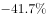
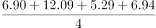
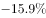
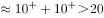

# 综合判断题（隔年倍数-翻番 + 月均计算 + 基期量求和 + 负增长占比混合验证）

考点：[[20-考点/资料分析/综合/综合判断题（隔年倍数-翻番 + 月均计算 + 基期量求和 + 负增长占比混合验证）|综合 / 综合判断题（隔年倍数/翻番 + 月均计算 + 基期量求和 + 负增长占比混合验证）]]
材料：[[15-材料/资料分析/182464 2014年4月至2015年4月全国租|182464 2014年4月至2015年4月全国租]]

**问法模型**：'能够从上述资料中推出的是'的综合判断问法 → 对A/B/C/D逐项套用基期量公式(现期/(1+同比))、平均数公式(加总/月数)、占比公式(计数/总月数)逐一核算排除

## 推理链
1. 第1步：从图中提取关键数据：2015.4总额6.94亿美元(同比105.0%)、2014.4为3.39亿美元(同比-41.7%)、2014.8为8.57亿美元(同比-15.9%)、2014.9为14.58亿美元(同比38.7%)、2015年1-4月为6.90/12.09/5.29/6.94亿美元、同比为负的月份共4个(2014.4、2014.8、2014.11、2015.3)
2. 第2步：A项'翻一番'=2015.4是2013.4的2倍，需隔年基期换算：2013.4=3.39/(1-41.7%)=3.39/0.583≈5.81亿美元
3. 第3步：代入验证A项：6.94/5.81≈1.19倍≠2倍，A错误
4. 第4步：B项月均=(6.90+12.09+5.29+6.94)/4=31.22/4=7.805<8亿美元，B错误
5. 第5步：C项求2013年8、9月基期：2013.8=8.57/(1-15.9%)=8.57/0.841≈10.2亿美元，2013.9=14.58/(1+38.7%)=14.58/1.387≈10.5亿美元，合计≈20.7>20亿美元，C正确
6. 第6步：D项同比下降(同比增速<0)月份为4个，总月数为13个(2014.4—2015.4)，占比4/13≈30.8%<1/3，D错误
7. 第7步：综上仅C可推出，故选C

**最快解法**：⚡ 先扫易项快速排除：B项加总31.22÷4=7.8<8排除；D项数负增速共4个，4/13≈31%<1/3排除；再精算C项（仅需两次除法）：8.57/0.841≈10.2、14.58/1.387≈10.5（14.58÷1.4≈10.4再放大修正），和≈20.7>20锁定C；A项隔年换算最费算力可留最后，3.39/0.583≈5.8，6.94/5.8≈1.19倍非翻番

## 易错点
- ⚠ 柱线双轴标签张冠李戴：105.0%、-15.9%、124.6%等是同比增速而非总额，6.94、8.57、14.58等才是总额；C项必须'总额÷(1+对应增速)'，不能拿增速当总额加总（8.57+14.58=23.15是2014年8-9月而非2013年）
- ⚠ 负增长基期方向搞反：2014.8同比-15.9%为下降，2013.8=8.57/(1-15.9%)应大于8.57（≈10.2）；若误写为8.57×(1-15.9%)≈7.2，则两项和≈17.7<20会误判C错误
- ⚠ 分母与倍数口径：D项总月数是13个（2014.4—2015.4）而非12个，4/13≈30.8%易误看成'约三分之一'而错选D；A项'翻一番'=2倍，2015.4比2014.4增长105%（刚好翻番）≠比2013年4月翻番，隔年累计增幅并非105%×2

## 母题抽象
> 🧩 当综合判断题选项出现'翻一番/几倍、月均超过、某年同期基期合计、下降月份占几分之几'等表述时，逐项套用隔年基期=现期/[(1+r₁)(1+r₂)]、月均=加总/月数、基期和=Σ现期/(1+rᵢ)、占比=负增长月数/总月数，先做计数与加总类易项排除，再对除法类选项截位直除验证

**同类特征**：能够从上述资料中推出的是、翻了一番（倍数表述）、月均……超过（平均数判断）、基期（2013年）合计、同比下降月份占比（几分之几）、柱线双轴复合图多条件验证

## 相关题
- [[10-真题/资料分析/综合/19283943 综合分析判断题（倍数比较+求和判断+隐含平均每场座位数反推）|19283943]]（国考 2025，相关度1）
- [[10-真题/资料分析/综合/1796162 综合判断（月均计算、平均运输距离、比重对比、增长量比较逐项验证）|1796162]]（贵州 2016，相关度1）
- [[10-真题/资料分析/综合/2133504 综合判断题（现期比重+现期平均数多项验证，一对三错）|2133504]]（国考 2018，相关度1）
- [[10-真题/资料分析/综合/2444706 综合判断题（增长量+比重+倍数逐项验证）|2444706]]（四川 2019，相关度1）
- [[10-真题/资料分析/综合/2571728 综合分析逐项判断（等差递推求和＋单位换算＋比值估算）|2571728]]（山东 2020，相关度1）

---

### 题干
能够从上述资料中推出的是：

### 选项
- A. 2015年4月全国租赁贸易进出口额比2013年4月翻了一番
- B. 2015年1~4月月均全国租赁贸易进出口额超过8亿美元
- C. 2013年8~9月全国租赁贸易进出口额超过20亿美元　✅
- D. 表中全国租赁贸易进出口额同比下降的月份占总数的三分之一

### 官方解析

A项：由图形材料可知2015年4月，全国租赁贸易进出口额6.94亿美元，而2014年4月全国租赁贸易进出口额3.39亿美元，同比增长，那么2015年4月全国租赁贸易进出口额是2013年4月的，而非翻一番（2倍），错误；

B项：由图形材料可知2015年1-4月，全国租赁贸易进出口总额分别为6.90、12.09、5.29、6.94亿美元，求平均可得，错误；

C项：由图形材料可知2014年8月和9月，全国租赁贸易进出口额分别为8.57、14.58亿美元，同比增长、，则2013年8—9月的全国租赁贸易进出口额为亿美元，正确；

D项：由图形材料可得，全国租赁贸易进出口额同比下降的月份为2014年4月、8月、11月及2015年3月，共4个月，而2014年4月-2015年4月共13个月，故占比不到三分之一，错误。

故正确答案为C。

### 给定材料

