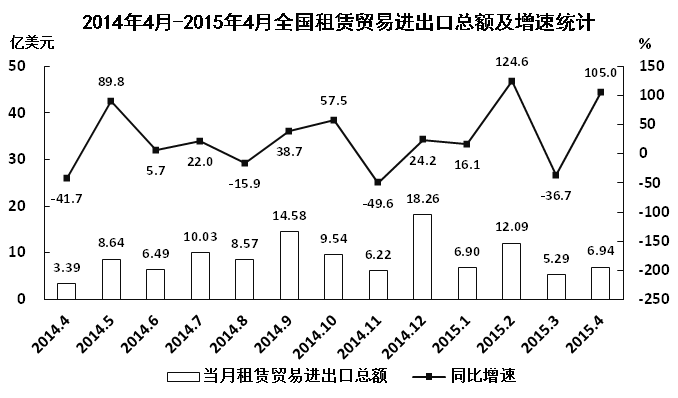

# 多条件筛选计数（当月总额与同比增速均高于上月）

考点：[[20-考点/资料分析/综合/多条件筛选计数（当月总额与同比增速均高于上月）|综合 / 多条件筛选计数（当月总额与同比增速均高于上月）]]
材料：[[15-材料/资料分析/182464 2014年4月至2015年4月全国租|182464 2014年4月至2015年4月全国租]]

**问法模型**：题干问'总额及同比增速均高于上月的月份有几个' → 对13个月逐月做双条件（总额>上月 且 同比>上月）筛选后计数

## 推理链
1. 第1步：以2014.4(3.39, -41.7)为基点，列出2014.5—2015.4各月(总额, 同比)：2014.5(8.64, 89.8)、2014.6(6.49, 5.7)、2014.7(10.03, 22.0)、2014.8(8.57, -15.9)、2014.9(14.58, 38.7)、2014.10(9.54, 57.5)、2014.11(6.22, -49.6)、2014.12(18.26, 24.2)、2015.1(6.90, 16.1)、2015.2(12.09, 124.6)、2015.3(5.29, -36.7)、2015.4(6.94, 105.0)
2. 第2步：先用柱形标签做条件一'总额>上月'快筛，只有2014.5(8.64>3.39)、2014.7(10.03>6.49)、2014.9(14.58>8.57)、2014.12(18.26>6.22)、2015.2(12.09>6.90)、2015.4(6.94>5.29)共6个月通过，其余6个月总额均下降直接排除
3. 第3步：对入围的6个月验证条件二'同比>上月'：89.8>-41.7、22.0>5.7、38.7>-15.9、24.2>-49.6、124.6>16.1、105.0>-36.7，6个月全部满足
4. 第4步：反查陷阱点：2014.10同比57.5>38.7（满足增速条件）但总额9.54<14.58（不满足总额条件），双条件不同时成立，不计数
5. 第5步：符合条件的月份为2014年5、7、9、12月和2015年2、4月，共6个，对照选项选B

**最快解法**：⚡ 先易后难的分步筛选法：条件一用柱形数值标签'总额>上月'快筛（一次锁定6个候选月），条件二只对这6个点核对折线标签是否高于前点；不必对全部12个月做双条件逐一点验，最后用2014.10这类'增速升但总额降'的点排除干扰项C

## 易错点
- ⚠ 只比增速不比总额（或反之）：2014.10同比57.5高于上月38.7，但总额9.54低于上月14.58，若漏掉总额条件会误数成7个而错选C
- ⚠ 双轴标签张冠李戴：2014.5的89.8、2015.2的124.6是同比增速（%），不是当月总额（亿美元），比总额时误用增速值会全盘错乱
- ⚠ 负值方向看反：2014.12的24.2要高于-49.6、2015.4的105.0要高于-36.7，同比有-41.7/-15.9/-49.6/-36.7多个负值，比较时方向弄错会漏计

## 母题抽象
> 🧩 当题干出现'两个指标均高于上月/上年的月份有几个'时，先用数据列更易读的一列做单条件快筛缩小范围，再仅对入围月份验证第二条件，并专门反查'只满足单条件'的月份以排除干扰选项

**同类特征**：均高于上月、月份有几个（计数型提问）、双条件同时满足、总额及同比增速、逐月相邻比较、2014年5月~2015年4月

## 相关题
- [[10-真题/资料分析/增长/17764858 环比增长逐月判断与计数（双列同时增长）|17764858]]（湖北 2024，相关度1）
- [[10-真题/资料分析/增长/2031174 同比增速读数比较（双条件筛选计数）|2031174]]（北京 2017，相关度1）
- [[10-真题/资料分析/增长/4770006 环比升降判断（双指标同时增长计数）|4770006]]（四川 2017，相关度1）
- [[10-真题/资料分析/增长/2307738 增长率比较（总量与同比增速双条件综合判断，即增速的边际变化比较）|2307738]]（辽宁 2018，相关度1）

---

### 题干
2014年5月~2015年4月间，全国租赁贸易进出口总额及同比增速均高于上月的月份有几个？

### 选项
- A. 5
- B. 6　✅
- C. 7
- D. 8

### 官方解析
定位图形材料，全国租赁贸易进出口总额及增长率均高于上月的有2014年5、7、9、12月和2015年2、4月，总共6个月。
故正确答案为B。

### 给定材料

