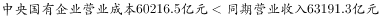
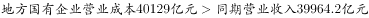

# 综合判断题（现期成本收入比较＋基期比重超一成判定＋同比增长量阈值验证＋两期比值升降比较的混合验证）

考点：[[20-考点/资料分析/综合/综合判断题（现期成本收入比较＋基期比重超一成判定＋同比增长量阈值验证＋两期比值升降比较的混合验证）|综合 / 综合判断题（现期成本收入比较＋基期比重超一成判定＋同比增长量阈值验证＋两期比值升降比较的混合验证）]]
材料：[[15-材料/资料分析/182458 2015年1-3月全国国有企业经营与|182458 2015年1-3月全国国有企业经营与]]

**问法模型**：题干为'能够从上述资料中推出的是'的综合判断→四个选项分别套模型：A项现期成本与收入直接比大小（全称判断找反例），B项基期比重是否超一成，C项增长量=现期×r/(1+r)与12万亿元阈值比较，D项资产负债率升降只比负债增速a与资产增速b。

## 推理链
1. 第1步：A项取数——第一、二段：中央企业收入63191.3亿元、成本60216.5亿元（成本<收入）；地方国有企业收入39964.2亿元、成本40129亿元（成本>收入）。
2. 第2步：'均低于'属全称判断，一个反例即破：地方成本40129>收入39964.2，故A错误。
3. 第3步：B项先比现期——应交税金9383÷营业总收入103155.5≈9.1%，本已不足一成；又因收入同比下降r%、税金同比增长g%，基期比重=9.1%×(1-r)/(1+g)<9.1%，更不足一成，故B错误。
4. 第4步：C项取数——第四段2015年3月末资产总额1054875.4亿元（≈105.5万亿元），同比增速约12%（文本增速空白，回原图核补）。
5. 第5步：套增长量公式：增长量=1054875.4×12%÷(1+12%)≈113000亿元≈11.3万亿元（切勿误用1054875.4×12%≈12.66万亿元）。
6. 第6步：11.3万亿元<12万亿元，C正确；等价判据：若增长恰为12万亿元，临界增速=12÷(105.49-12)=12÷93.49≈12.8%，实际增速约12%<12.8%。
7. 第7步：D项——资产负债率=负债÷资产，升降只看分子增速a与分母增速b，原图中地方a<b，比值下降，即低于上年同期水平，故D错误。
8. 第8步：四项中仅C可推出，答案选C。

**最快解法**：⚡ 增长量公式法（百化分）＋直除一票否决：先验C——1054875.4×12/112≈11.3万亿元<12万亿元，直接锁定C；排除项各一步：A比40129>39964.2即破，B直除9.1%<10%且增速方向使基期更低即破，D比地方a<b即破。

## 易错点
- ⚠ A项'均低于'是全称判断，中央成立≠地方成立（40129>39964.2），且收入/成本同名指标分总体、中央、地方三层，读数极易串行错位。
- ⚠ C项最大陷阱：增长量=现期×r/(1+r)，若直接用1054875.4×12%≈12.66万亿元会误判'超过12万亿'而错杀C；另注意量级：1054875.4亿元≈105.5万亿元，12万亿元=120000亿元。
- ⚠ B项勿忘两期比重方向（收入下降＋税金增长使基期比重必低于现期9.1%）；D项两期比值升降只比增速a与b、无需算具体负债率数值，且须用地方数据勿与中央混淆。

## 母题抽象
> 🧩 当综合判断题出现'均低于/高于（全称判断）''占……一成以上（基期比重）''同比增长不到X（增长量阈值）''高于上年同期（两期比值）'时，依次用：找反例、基期比重=现期比重×(1-降幅)/(1+增速)看方向、增长量=现期×r/(1+r)对照阈值（可反解临界增速=Δ/(现期-Δ)）、只比分子分母增速a与b。

**同类特征**：能够从上述资料中推出的是、同比增长不到12万亿元（增长量阈值验证）、均低于（全称判断找反例）、占……一成以上（基期比重判定）、资产负债率高于上年同期（两期比值升降比a与b）

## 相关题
- [[10-真题/资料分析/综合/19283943 综合分析判断题（倍数比较+求和判断+隐含平均每场座位数反推）|19283943]]（国考 2025，相关度1）
- [[10-真题/资料分析/综合/1796162 综合判断（月均计算、平均运输距离、比重对比、增长量比较逐项验证）|1796162]]（贵州 2016，相关度1）
- [[10-真题/资料分析/综合/2133504 综合判断题（现期比重+现期平均数多项验证，一对三错）|2133504]]（国考 2018，相关度1）
- [[10-真题/资料分析/综合/2444706 综合判断题（增长量+比重+倍数逐项验证）|2444706]]（四川 2019，相关度1）
- [[10-真题/资料分析/综合/2571728 综合分析逐项判断（等差递推求和＋单位换算＋比值估算）|2571728]]（山东 2020，相关度1）

---

### 题干
能够从上述资料中推出的是：

### 选项
- A. 2015年1-3月，中央和地方国有企业营业成本均低于同期营业收入
- B. 2014年1-3月，国有企业应交税金占同期营业总收入的一成以上
- C. 2015年3月末，国有企业资产总额同比增长不到12万亿元　✅
- D. 2015年3月末，地方国有企业资产负债率高于上年同期水平

### 官方解析

A项，定位文字材料第一段和第二段，2015年1-3月，，成本低于收入；，成本高于收入，错误；

B项，定位文字材料第一段和第三段，2014年1~3月国有企业应交税金占同期营业总收入的比重，不足一成，错误；

C项，定位文字材料第四段，2015年3月末，国有企业资产总额同比增长量=万亿元，正确；

D项，定位文字材料第四段，地方国有企业资产负债率（）是否高于上年同期水平，需要比较负债总额的增长率a与资产总额的增长率b，而，故地方国有企业资产负债率低于上年同期水平，错误。

故正确答案为C。

### 给定材料

根据以下资料，回答下列问题。

        2015年1-3月，国有企业营业总收入103155.5亿元，同比下降。其中，中央企业收入63191.3亿元，同比下降。地方国有企业收入39964.2亿元，同比下降。

        1-3月，国有企业营业总成本100345.5亿元，同比下降，其中销售费用、管理费用和财务费用同比分别下降、增长和增长。其中，中央企业成本60216.5亿元，同比下降；地方国有企业成本40129亿元，同比下降。

        1-3月，国有企业利润总额4997.3亿元，同比下降。国有企业应交税金9383亿元，同比增长。

        3月末，国有企业资产总额1054875.4亿元，同比增长；负债总额685766.3亿元，同比增长；所有者权益合计369109.1亿元，同比增长。其中，中央企业资产总额554658.3亿元，同比增长；负债总额363304亿元，同比增长；所有者权益为191354.4亿元，同比增长。地方国有企业资产总额500217.1亿元，同比增长；负债总额322462.3亿元，同比增长；所有者权益为177754.7亿元，同比增长。

> [!warning] 疑点（官方解析可能有误，待人工复核）
> 所给材料文本中所有同比增速均为空白（'同比增长□%'），官方解析C项（资产总额增速约12%、增长量≈11.3万亿元）及D项（地方负债增速a<资产增速b）所用数值须回原图核补后方可复现计算；按官方结论答案C无误，此为文本缺数问题而非解析错误。
