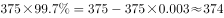
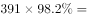
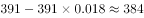
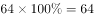

# 综合判断题（选非题）

考点：[[20-考点/资料分析/综合/综合判断题（选非题）|综合 / 综合判断题（选非题）]]
材料：[[15-材料/资料分析/182478 广东省2014—2015年省级新农村|182478 广东省2014—2015年省级新农村]]

**问法模型**：题干'下列说法有误的是'→四个选项逐项与材料数据核对口径后比较，排除三个正确说法，错误项即答案

## 推理链
1. 第1步：题干为选非题，需逐项验证A—D；数据源为项目与资金段（启动/竣工按粤东西北、珠三角二分）及村庄规划编制段、群众参与段
2. 第2步：A项核启动项目数——粤东西北1539个＞珠三角1154个，'启动项目比珠三角多'成立，A说法正确，排除
3. 第3步：B项自构竣工率=竣工数÷启动数——粤东西北821/1539≈53.3%，珠三角890/1154≈77.1%，'竣工率低于珠三角'成立，B说法正确，排除（或用放缩：分子821＜890且分母1539＞1154，比值必小，免计算）
4. 第4步：D项核行政村口径——首批64个行政村已全部完成规划编制（64个），第二批完成规划编制的行政村55个，64＞55，'首批比第二批多'成立，D说法正确，排除
5. 第5步：C项核村民理事会——首批375个自然村中占比□%、第二批391个自然村中占比□%（按原卷数据，第二批成立村民理事会的自然村个数大于首批），故'第二批比第一批少'不成立，C说法有误
6. 第6步：选非题锁定说法有误的C项为正确答案

**最快解法**：⚡ 排除法＋分子分母同向放缩：A、D为直接读数比较（1539＞1154、64＞55）秒杀；B项因821＜890且1539＞1154，两分数直接判小免直除；剩余C项结合'第二批自然村总数391＞首批375'与原卷理事会占比数据，判定第二批个数不比第一批少，锁定C

## 易错点
- ⚠ B项'竣工率'材料未直接给出，须自构比率（竣工÷启动）；勿只拿竣工绝对数821＜890或启动数1539＞1154单独下结论，分子分母要同看
- ⚠ C项依赖'成立村民理事会的占□%'两处留空百分数（按原卷补数），且第二批自然村总数391＞首批375，即便占比持平个数也会更多，勿凭'完成率常第二批偏低'的直觉误判'少'
- ⚠ 口径双坑：D项比的是'行政村'（64对55），勿混用自然村口径（375/386）；本题选非，勿顺手选说法正确的A、B、D

## 母题抽象
> 🧩 当题干出现'下列说法有误的是'（选非综合题）时，先扫可直接读数的选项快速排除，再对需自构比率的选项用'分子小分母大⇒比值必小'的放缩验证，最后核对剩余项的口径（谁除以谁、哪一批次/地区），逐项溯源到材料段落即可锁定错误项

**同类特征**：说法有误的是（选非题）、粤东西北与珠三角二分比较、竣工率需自构（竣工÷启动）、村民理事会占比（材料留空数据段）、行政村与自然村两套口径并存、首批与第二批分母不同（375对391）

## 相关题
（暂无）

---

### 题干
下列说法有误的是（    ）。

### 选项
- A. 第一、二批示范片建设中粤东西北启动的项目比珠三角多
- B. 第一、二批示范片建设中粤东西北的项目竣工率低于珠三角的项目竣工率
- C. 第二批示范片成立村民理事会的自然村比第一批少　✅
- D. 第一批示范片完成村庄规划编制的行政村比第二批多

### 官方解析

A项：由材料第二段可知全省第一、二批40个示范片（含珠三角6市）启动建设项目中，粤东西北1539个，珠三角占1154个，前者大于后者，A项正确；

B项：由材料第二段可知全省第一、二批40个示范片（含珠三角6市）启动建设项目中，粤东西北1539个，珠三角占1154个，竣工项目中，粤东西北占821个，珠三角占890个，粤东西北启动项目比珠三角多，竣工项目比珠三角少，则其竣工率必小于珠三角，B项正确；

C项：由材料最后一段可知第一、二批自然村数量与成立村民理事会的占比，则第一批成立村民理事会的自然村个数为 个，第二批成立村民理事会的自然村个数为个，后者大于前者，C项错误；

D项：由材料第三段可知，第一批示范片完成村庄规划编制的行政村个数为个，第二批示范片完成村庄规划编制的行政村个数为55个，前者大于后者，D项正确。

本题为选非题，故正确答案为C。

### 给定材料

根据下列资料，回答86~90题：

        从2014年起，我省在粤东西北地区以县（市、区）为单位遴选首批14个省级新农村连片示范建设工程，三年将建成42个省级新农村示范片（不含珠三角地区）。根据工作进度安排，示范片建设一年初见成效，两年基本实现目标。与此同时，珠三角地区每年选取6个片区开展示范片建设，为期三年。

        截至2015年年底，全省第一、二批40个示范片（含珠三角6市）启动建设项目2693个（粤东西北1539个，珠三角1154个），竣工项目1711个（粤东西北821个，珠三角890个），累计投入各类资金40亿元（粤东西北16.6亿元，珠三角23.4亿元）。

        示范片村庄规划编制：首批示范片的64个行政村和375个自然村，已完成村庄规划编制。第二批示范片的59个行政村和386个自然村中，已完成村庄规划编制的行政村55个，自然村307个，分别占和。

        示范片村庄环境卫生：首批示范片中已完成环境卫生整治的自然村357个，占。第二批391个自然村中，310个自然村已完成环境卫生整治，占。

        示范片自来水建设：首批示范片中有326个自然村实现通自来水，占。第二批391个自然村中，有的自然村实现通自来水。

        村巷道硬底化建设：首批示范片中完成村巷道硬底化建设的自然村有256个，占。第二批中有的自然村完成村巷道硬底化建设。

        群众参与共谋共建情况：首批示范片375个自然村中，成立村民理事会的占。第二批391个自然村中，成立村民理事会的占。

> [!warning] 疑点（官方解析可能有误，待人工复核）
> 官方解析C项'第一批成立村民理事会的自然村个数为□个、第二批为□个'两处数值留空——因给定材料中该两处'占□%'百分数留空，现有材料无法独立复算C项的个数比较，只能依据官方结论'后者大于前者'确认C错误；官方答案C与解析逻辑一致，不作更改
