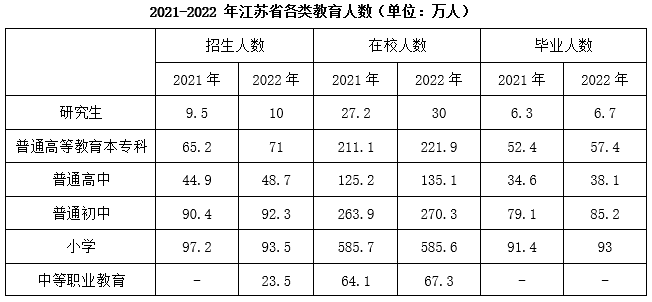

# 学年口径在校人数构成平衡方程倒推基期（2020年）招生数

考点：[[20-考点/资料分析/综合/学年口径在校人数构成平衡方程倒推基期（2020年）招生数|综合 / 学年口径在校人数构成平衡方程倒推基期（2020年）招生数]]
材料：[[15-材料/资料分析/3155310 2022年江苏省（'我省'）各类教育|3155310 2022年江苏省（'我省'）各类教育]]

**问法模型**：题干问材料覆盖期之前的'2020年初中招生数x的取值范围'（基期的基期、年份缺口型问法）→ 用'年末在校=当年招生+上年招生+前年招生'的学制流动方程，用2021、2022两个年末在校数各解一次x，夹逼出区间。

## 推理链
1. 第1步：从表格提取初中数据：2021/2022年招生90.4、92.3万人，2021/2022年年末在校263.9、270.3万人，2022年毕业85.2万人；文字材料'年末全省共有普通高等学校168所'表明全部数据为年末口径。
2. 第2步：规则：9月至次年7月为一个学年，招生在学年初（9月）、毕业在学年末（7月），故年末在校=当年初一+当年初二+当年初三，即2022年末在校=2022招生(初一)+2021招生(初二)+2020招生(初三)；同理2022年毕业的85.2万人正是2021年末的初三在读。
3. 第3步：列2022年方程：92.3+90.4+x=270.3，解得x=270.3−92.3−90.4=87.6万人。
4. 第4步：列2021年方程：90.4+x+85.2=263.9，解得x=263.9−90.4−85.2=88.3万人。
5. 第5步：两方程分别解出87.6与88.3（差异来自转学等流动），x的取值应落在87.6~88.3之间，对照选项，仅A项区间包含该结果（必含87.6），故选A。

**最快解法**：⚡ 考场最快：只列2022年一条平衡方程心算减法 270.3−92.3−90.4=87.6，x必为87.6，扫选项只有A区间包含87.6，直接锁定A，无需再解2021年方程（官方备注明确此法可行）。

## 易错点
- ⚠ 年份缺口陷阱：材料最早只到2021年，若把2021年招生的90.4万直接当作2020年招生值即掉坑，必须靠在校人数的年级构成方程倒推。
- ⚠ 学年与自然年口径混淆：年末在校=当年招生+上年招生+前年招生；若按自然年错位对应年级，会把2022年毕业的85.2万错误放进2022年末在校（85.2万实为2021年末的初三），多加少减必错。
- ⚠ 单一解vs区间：2021、2022两条方程解出的x不同（88.3与87.6，因转学等学生流动），答案是区间而非单一数值；只验一个解可能误选不含87.6的其他区间。

## 母题抽象
> 🧩 当题干问'材料覆盖期之前某年的招生数/存量'且材料同时给出招生、在校、毕业三列时，用'年末在校=近三年招生之和'的学年口径平衡方程倒推，并用相邻两年方程分别解x夹逼取值范围，验证选项区间是否包含解（必含用现期年末方程解出的那个值）。

**同类特征**：2020年（材料最早年份2021之前，基期的基期）、招生数x取值范围（区间型选项）、初中在校人数263.9/270.3、招生+在校+毕业跨列跨年拼数、年末口径与学制流动（9月入学、7月毕业）、年份缺口需方程倒推

## 相关题
（暂无）

---

### 题干
2020年初中教育招生数为x（单位：万人），则x的取值在哪个范围？

### 选项
- A. 

　✅
- B. 

- C. 

- D. 

### 官方解析
由于9月至次年7月为一个完整学年，所以招生时间在学年初（9月），毕业时间在学年末（7月），且根据文字材料“年末全省共有普通高等学校168所”，可以判断材料中的数据均为年末数据。定位表格材料可知，2021-2022年江苏省初中招生人数分别为90.4万人、92.3万人，2021-2022年江苏省初中在校人数分别为263.9万人、270.3万人，2022年江苏省初中毕业人数为85.2万人。
如下表所示，若2020年初中教育招生数为x万人（此时为初一新生），则2021年这批学生上初二，2022年上初三；2021年初中招生人数为90.4万人（此时为初一新生），则2022年这批学生上初二；2022年初中招生人数为92.3万人（此时为初一新生）。同理，2022年初中毕业人数为85.2万人，逆推可得：则2021年这批学生上初三，2020年这批学生上初二。

由于初中在校人数=初一人数+初二人数+初三人数，则2021年初中在校人数=90.4+x+85.2=263.9，解得x=88.3；2022年初中在校人数=92.3+90.4+x=270.3，解得x=87.6。综上，x的取值范围应该为，在A项范围内。
故正确答案为A。
备注：如果不考虑转学等情况，根据2022年初中在校人数解得x=87.6，正确答案的取值范围一定包含87.6，只有A项符合，在考场上直接选择A项即可，不必考虑其他条件。若根据2021年初中在校人数解得x=88.3，则说明结果应该为，结合选项，只能选择A项。实际情况中，可能会有转学等情况出现，如果转入和转出的学生数量不同，则结果可能会比该范围更大或更小，此时则没有正确答案。

### 给定材料

        2022年我省教育事业稳步推进。年末全省共有普通高等学校168所（含独立学院）。普通高等教育本专科招生数71.0万人，在校生数221.9万人，毕业生数57.4万人；研究生招生数10.0万人，在校生数30.0万人，毕业生数6.7万人。中等职业教育（不含技工学校）招生数23.5万人，在校生数67.3万人。全省共有幼儿园8143所，比上年增加27所；在园幼儿237.1万人，比上年减少15.4万人。

