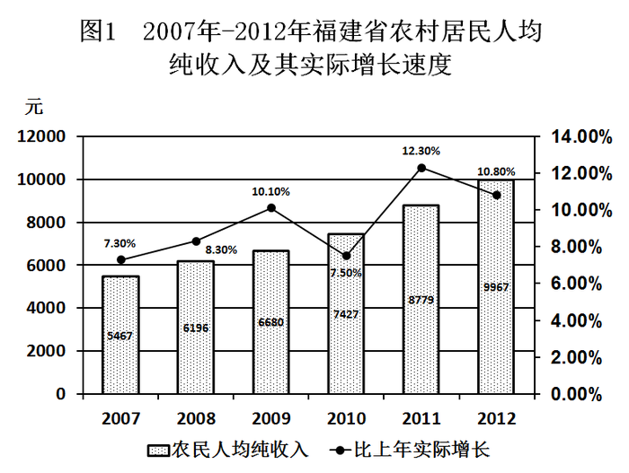

# 增速逐年比较+差距变化+综合分析选非题

考点：[[20-考点/资料分析/综合/增速逐年比较+差距变化+综合分析选非题|综合 / 增速逐年比较+差距变化+综合分析选非题]]
材料：[[15-材料/资料分析/184306 福建省2012年民生统计：常住人口、|184306 福建省2012年民生统计：常住人口、]]

**问法模型**：'下列描述错误的是'选非题 → 逐项对照两图折线实际增速与柱值差额，验证A/B/D为真、找出唯一假项

## 推理链
1. 第1步：从图1、图2折线提取2007-2012年实际增速——农村：7.3%/8.3%/10.1%/7.5%/12.3%/10.8%，城镇：10.1%/10.8%/10.9%/8.0%/8.7%/10.0%
2. 第2步：A项算城乡绝对差额：2007年15505-5467=10038元，2008年11765元、2009年12897元、2010年14354元、2011年16128元，2012年28055-9967=18088元，逐年增大，A正确
3. 第3步：B项看增速升降趋势：2007-2011年城乡增速同走'升-升-降-升'，仅2012年农村降（12.3→10.8）而城镇升（8.7→10.0）一年不同，'大致相同'成立，B正确
4. 第4步：C项数农村增速慢于城镇的年份：2007年7.3%<10.1%、2008年8.3%<10.8%、2009年10.1%<10.9%、2010年7.5%<8.0%，共4年而非3年，C错误
5. 第5步：D项算增速差（百分点）：2007-2012年分别为2.8/2.5/0.8/0.5/3.6/0.8个百分点，2011年12.3%-8.7%=3.6个百分点最大，D正确
6. 第6步：本题为选非题，唯一错误描述为C，故选C

**最快解法**：⚡ 折线并列逐格比较法：将两图6对实际增速对齐排列，先攻C项（计数型选项）——逐格比对发现2010年7.5%<8.0%这一组最易漏，慢于城镇的为2007/2008/2009/2010共4年，直接锁定C错误；A项只看首尾差额10038→18088即可确认逐年扩大；D项口算逐年增速差确认2011年3.6个百分点最大

## 易错点
- ⚠ 两套增速口径：文字中名义增速（13.5%/12.6%）与图中折线实际增速（10.8%/10.0%）并存，比较增速只能统一用折线的实际增速，混用名义值会误判2012年等年份
- ⚠ C项最易漏数2010年：7.5%与8.0%仅差0.5个百分点，肉眼估读易误认为相等，导致数成3年而误选C'正确'
- ⚠ B项'增长趋势'指增速（折线）的升降变化而非柱值涨跌：柱值六连涨看不出差异，须按折线走势判断'升-升-降-升-（2012年分歧）'
- ⚠ D项'增长速度间的差距'是百分点之差，需逐年口算（2.8/2.5/0.8/0.5/3.6/0.8）确认2011年最大，勿凭感觉；且本题为选非题，勿把方向做反

## 母题抽象
> 🧩 当题干出现'下列描述错误的是'且选项含'增速慢的年份有几年''差距最大'等定量断言时，先把两图折线增速逐年并列成表逐格比较，差额型选项只核首尾或逐年做差，带计数的选项逐格数清，最后回扣'选错误项'方向

**同类特征**：下列描述错误的是（选非题）、2007-2012年跨6年区间、绝对差距呈增大趋势、增长趋势大致相同、增速慢的年份有几年、增长速度间的差距最大

## 相关题
（暂无）

---

### 题干
根据上述材料，下列描述错误的是：

### 选项
- A. 2007-2012年，农村居民人均纯收入与城镇居民人均可支配收入间的绝对差距呈增大趋势
- B. 2007-2012年，农村居民人均纯收入与城镇居民人均可支配收入增长趋势大致相同
- C. 2007-2012年，农村居民人均纯收入与城镇居民人均可支配收入相比增速慢的年份有3年　✅
- D. 2011年，农村居民人均纯收入与城镇居民人均可支配收入增长速度间的差距最大

### 官方解析
第一步：分析问题。
根据两个柱状图表进行做题。增长趋势相同是指城乡的增长率同时增长或同时下降，增长趋势大致相同是指可能有部分年份趋势不同，但大部分是相同的。
第二步：定位数据。
两个柱状图表。
第三步：计算过程。
通过计算每年的城乡差额发现2007-2012年间农村和城镇的收入差距越来越大，A项正确；
观察表格发现2007-2011年农村和城镇的收入增长趋势都是相同的（增长-增长-下降-增长），只有2011-2012年的趋势不同，但符合大致相同的说法，B项正确；
2007-2012年，农村居民人均纯收入与城镇居民人均可支配收入相比增速慢的年份有4年，分别是2007、2008、2009、2010四年，C项错误；
2011年，农村居民人均纯收入的增速是12.3%，城镇居民人均可支配收入的增速是8.7%，增长速度相差3.6%，是2007-2012年间增速差距最大的，D项正确。
第四步：再次标注答案 。
本题为选非题，故正确答案为C。

### 给定材料

        2012年末福建省常住人口3748万人，比上年增长。农村居民人均纯收入9967元，比上年增长13.5%，扣除价格因素，实际增长10.8%，城镇居民人均可支配收入28055元，比上年增长12.6%，扣除价格因素，实际增长10.0%，农村居民食品消费支出占消费总支出比重为46.0%，城镇为39.4% 。

        全省领取失业保险金人数4.61万人，比上年增长1.04万人，全省纳入城镇最低生活保障的居民16.89万人，减少1.20万人，纳入农村最低生活保障的居民73.68万人，增加0.73万人：“五保”供养对象9.14万人。

