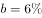
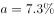
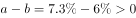
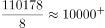
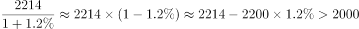

# 综合分析判断（混合增长率居中+两期比重变化+平均数计算+基期量估算）

考点：[[20-考点/资料分析/综合/综合分析判断（混合增长率居中+两期比重变化+平均数计算+基期量估算）|综合 / 综合分析判断（混合增长率居中+两期比重变化+平均数计算+基期量估算）]]
材料：[[15-材料/资料分析/184882 2016年8月及1-8月累计全国一般|184882 2016年8月及1-8月累计全国一般]]

**问法模型**：'能够从上述资料推出的是'→四选一综合分析题，逐项验证（混合增长率、两期比重、月平均、基期量），优先验证不依赖空缺增速数据的简单现期计算项

## 推理链
1. 第1步：C项只需现期量：从第2段取1-8月累计全国收入110178亿元，从第1段取8月当月9894亿元
2. 第2步：月平均公式=累计值÷月份数，110178÷8≈13772亿元（110÷8≈13.75）
3. 第3步：13772亿元＞8月当月9894亿元，C项'月平均超过8月份'成立，且此判定不需读取图中任何增速百分数
4. 第4步：A项排除：8月地方本级同比增速（图中读数，约1%量级）与1-8月累计地方增速按混合增长率居中，1-7月增速必在累计增速另一侧且大于8月增速，故'1-7月增速小于'的表述错误
5. 第5步：B项排除：1-8月税收收入增速（图中读数）大于全国累计增速，两期比重比较'部分增速＞整体增速→占比升'，即税收占比同比增加，则非税占比（隐含值110178−92637=17541亿元）同比减少，B'比重增加'错误
6. 第6步：D项排除：2016年8月非税收入2214亿元、同比增长（正的小增速），基期量=2214÷(1+r)≈2100~2200亿元区间，大于2000亿元，'不到2000亿元'错误
7. 第7步：对照选项，唯一成立的是C，故选C

**最快解法**：⚡ 简单项优先+截位直除：综合分析题先扫选项，C项'月平均'只需110178÷8≈13772亿元（110÷8≈13.75，估出1.3万+量级即可），直接大于8月当月9894亿元，完全不依赖文中空缺的增速数值，可秒锁答案；A/B/D按官方结论排除

## 易错点
- ⚠ 双口径混排：A项混合增长率必须用'同比增速'口径，若误用'同口径增速'（8月中央同口径为下降、方向为负）会直接判错方向
- ⚠ 当月与累计混排：C项月平均分母是8个月（110178÷8），勿误除以7或把8月当月9894当分子/分母，两个量级（约0.99万vs11万）相差一个数量级
- ⚠ B项两期比重方向：部分增速（税收）＞整体增速（全国）→税收占比升→非税占比降，勿把'占比增加/减少'方向弄反；且非税累计值17541亿元材料未直接给出，需110178−92637拼算，勿用8月当月2214亿元替代

## 母题抽象
> 🧩 当综合分析题问'能够推出的是'且材料部分数据缺失/空缺时，优先锁定只需现期量直接计算的选项（如'月平均=累计÷月数，再与当月比较'），用截位直除秒判；增长率类选项再用混合居中、比重增速比较、基期公式逐项排除

**同类特征**：能够从上述资料推出的是、四选一综合分析、月平均/月均超过、同比增速小于、比重同比增加、不到某基期值

## 相关题
- [[10-真题/资料分析/综合/13319330 综合分析（可推出判断），涉及增长n倍求基期量、年均增速时间口径、'四成以上'方向词甄别、增长倍数比较|13319330]]（江苏 2025，相关度1）
- [[10-真题/资料分析/综合/2050552 综合分析（基期计算＋增速趋势判断＋口径辨析）|2050552]]（吉林 2017，相关度1）
- [[10-真题/资料分析/综合/2051138 综合判断（顺差比较+基期回推+单价计算混合验证）|2051138]]（黑龙江 2017，相关度1）
- [[10-真题/资料分析/综合/2578808 综合分析题·逐项验证（核心为同比增长率比较，辅以计数-比重判断与排名对应）|2578808]]（四川 2020，相关度1）
- [[10-真题/资料分析/综合/1752654 综合分析判断（增长量计算+比重逆推总量+口径定性排除）|1752654]]（北京 2016，相关度1）

---

### 题干
能够从上述资料推出的是：

### 选项
- A. 
2016年1-7月，地方一般公共预算本级收入同比增速小于

- B. 
2016年1-8月，非税收入占全国一般公共预算收入比重同比增加

- C. 
2016年1-8月，月平均全国一般公共预算收入超过8月份
　✅
- D. 
2015年8月，全国一般公共预算收入中非税收入不到2000亿元

### 官方解析

A项：2016年8月份，地方一般公共预算本级收入同比增长；2016年1-8月累计，地方一般公共预算本级收入同比增长。由混合增长率居中原则可知，2016年1-7月，地方一般公共预算本级收入同比增速大于，错误；

B项：2016年1-8月，全国一般公共预算收入同比增长，税收收入同比增长，由两期比重公式可知，，故税收收入占比同比增加，则非税收收入占比同比减少，错误；

C项：2016年1-8月累计，全国一般公共预算收入110178亿元，则月平均为，大于8月份的9894，正确；

D项：定位材料首段末句，2016年8月非税收入2214亿元，同比增长，由基期计算公式可知，2015年8月非税收入为，错误。

故正确答案为C。

### 给定材料

        2016年8月份，全国一般公共预算收入9894亿元，同比增长。其中，中央一般公共预算收入4797亿元，同比增长，同口径下降；地方一般公共预算本级收入5097亿元，同比增长1%，同口径增长。全国一般公共预算收入中的税收收入7680亿元，同比增长，非税收入2214亿元，同比增长。

        2016年1-8月累计，全国一般公共预算收入110178亿元，同比增长。其中，中央一般公共预算收入49711亿元，同比增长，同口径增长；地方一般公共预算本级收入60467亿元，同比增长，同口径增长。全国一般公共预算收入中的税收收入92637亿元，同比增长。

> [!warning] 疑点（官方解析可能有误，待人工复核）
> 材料文字中所有'同比增长'后的百分数均空缺（依赖图片附件读取），A、B、D三项的定量核验（如D项需8月非税增速判断2214÷(1+r)是否小于2000）无法从文字材料独立复核，本笔记中相关增速结论均依据官方解析；C项判定不受此影响，因其不依赖任何增速数据
