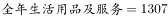
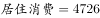
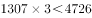
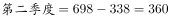
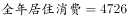
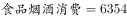
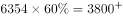

# 综合推断题（全年倍数比较＋累计差分还原当期值比大小＋主体一致性排查）

考点：[[20-考点/资料分析/综合/综合推断题（全年倍数比较＋累计差分还原当期值比大小＋主体一致性排查）|综合 / 综合推断题（全年倍数比较＋累计差分还原当期值比大小＋主体一致性排查）]]
材料：[[15-材料/资料分析/184896 2015年城镇居民人均消费支出（当年|184896 2015年城镇居民人均消费支出（当年]]

**问法模型**：‘2015年，能够从上述资料推出的是’的逐项验证型综合判断 → 涉及‘全年’行的直接取行值做倍数（×n/÷n）验证，涉及‘各季度最高/最低’的先相邻差分还原当期值再比较，选项主体与表列名不一致的直接排除。

## 推理链
1. 第1步：四行数据均为‘当年累计值’，A、D用‘2015年全年’行可直接取值，B需对医疗保健列差分，C先核对表列名与选项主体是否一致。
2. 第2步（A项）：全年生活用品及服务1307元，全年居住4726元，验证1307是否小于4726的三分之一。
3. 第3步：4726÷3≈1575元（等价验证1307×3=3921＜4726），1307＜1575，全年生活用品及服务确实不到居住的三分之一，A正确。
4. 第4步（B项）：医疗保健累计值为338/698/1061/1443，相邻差分得各季度当期值Q1=338、Q2=698−338=360、Q3=1061−698=363、Q4=1443−1061=382，即第一季度最低、第四季度最高，与B项说法完全相反，B错误。
5. 第5步（C项）：选项主体为‘教育支出’，表中列名为‘教育文化娱乐’，主体偷换、口径不一致，无法推出，C错误。
6. 第6步（D项）：全年居住4726÷全年食品烟酒6354≈74.4%，高于D项所给比例阈值，即全年居住消费支出并非‘不到’该比例，D错误。
7. 第7步：仅A项能够推出，故正确答案为A。

**最快解法**：⚡ 乘法验证法秒杀A：1307×3=3921＜4726，一步确认A成立即锁定答案（综合题优先验证可一步计算的选项）；B项差分338/360/363/382与说法相反直接排除；C项主体偷换秒排；D项截位直除4726/6354≈74.4%与所给比例对照排除。

## 易错点
- ⚠ 累计值直接比大小陷阱：B项若拿医疗保健累计值338/698/1061/1443直接判断高低必然出错，累计序列单调递增，行间比大小无意义，必须先差分还原当期值338/360/363/382再比较。
- ⚠ 主体偷换陷阱：C项将表中‘教育文化娱乐’偷换为‘教育支出’，口径不一致不能代入计算，应直接判‘无法推出’而非硬算增速。
- ⚠ 倍数/比重口径陷阱：A、D的分子分母必须同为‘全年’行的人均累计值，勿错用季度差分值；D项比例阈值以图片公式为准，按官方结论居住4726元高于该比例×6354元，‘不到’不成立。

## 母题抽象
> 🧩 当题干出现‘能够从上述资料推出的是’且表格标注‘当年累计’时，对‘全年/第一季度’类判断直接取行值做×n或÷n验证，对‘某季度最高/最低’类判断先相邻差分还原当期值再比较，选项主体与表列名不一致的秒排，通常第一步即可锁定正确答案。

**同类特征**：能够从上述资料推出的是（四选一综合判断）、当年累计口径表格、不到……的三分之一（倍数验证）、第一季度最高/最低（需差分还原当期值）、主体偷换（教育支出vs教育文化娱乐）、全年居住与食品烟酒的比例比较

## 相关题
（暂无）

---

### 题干
2015年，能够从上述资料推出的是：

### 选项
- A. 
全年生活用品及服务不到居住消费支出的三分之一 
　✅
- B. 
医疗保健消费支出第一季度最高，第四季度最低

- C. 
教育支出四个季度平均增速慢于交通通信消费支出 

- D. 
全年居住消费支出不到食品烟酒消费支出的

### 官方解析

根据图表，找出说法正确的一项。

A项：，，，则生活用品及服务低于居住消费的，说法正确；

B项：医疗保健消费，第一季度为338元，。第一季度并非最高，说法错误；

C项：选项中的主体为“教育支出”，表中主体为“教育文化娱乐”，主体不同，无法推出，说法错误；

D项：，，，全年居住消费支出高于食品烟酒消费支出的，说法错误。

故正确答案为A。

### 给定材料

> [!warning] 疑点（官方解析可能有误，待人工复核）
> 官方解析B、D项的算式文字存在截断乱码（如‘第一季度为338元，。’处缺差分过程），且D项比例以图片公式呈现、具体数值不可读，无法独立复核D项阈值；但经复核A项成立无误（1307×3=3921＜4726），与官方答案无矛盾，仅作记录。

<!-- CODEX-ANSWER-REVIEW:BEGIN -->
### 本次独立复核

**复核状态：** `resolved`（答案与解析已核定）

**计分答案：** A（可计分）

**复核解析：**

1. 第1步：四行数据均为‘当年累计值’，A、D用‘2015年全年’行可直接取值，B需对医疗保健列差分，C先核对表列名与选项主体是否一致。
2. 第2步（A项）：全年生活用品及服务1307元，全年居住4726元，验证1307是否小于4726的三分之一。
3. 第3步：4726÷3≈1575元（等价验证1307×3=3921＜4726），1307＜1575，全年生活用品及服务确实不到居住的三分之一，A正确。
4. 第4步（B项）：医疗保健累计值为338/698/1061/1443，相邻差分得各季度当期值Q1=338、Q2=698−338=360、Q3=1061−698=363、Q4=1443−1061=382，即第一季度最低、第四季度最高，与B项说法完全相反，B错误。
5. 第5步（C项）：选项主体为‘教育支出’，表中列名为‘教育文化娱乐’，主体偷换、口径不一致，无法推出，C错误。
6. 第6步（D项）：全年居住4726÷全年食品烟酒6354≈74.4%，高于D项所给比例阈值，即全年居住消费支出并非‘不到’该比例，D错误。
7. 第7步：仅A项能够推出，故正确答案为A。

**最快解法**：⚡ 乘法验证法秒杀A：1307×3=3921＜4726，一步确认A成立即锁定答案（综合题优先验证可一步计算的选项）；B项差分338/360/363/382与说法相反直接排除；C项主体偷换秒排；D项截位直除4726/6354≈74.4%与所给比例对照排除。

**相关信息：**

考點：综合推断题（全年倍数比较＋累计差分还原当期值比大小＋主体一致性排查）。來源：2016年吉林省公务员录用考试《行测》题（乙级）；2016年。> 🧩 当题干出现‘能够从上述资料推出的是’且表格标注‘当年累计’时，对‘全年/第一季度’类判断直接取行值做×n或÷n验证，对‘某季度最高/最低’类判断先相邻差分还原当期值再比较，选项主体与表列名不一致的秒排，通常第一步即可锁定正确答案。

**同类特征**：能够从上述资料推出的是（四选一综合判断）、当年累计口径表格、不到……的三分之一（倍数验证）、第一季度最高/最低（需差分还原当期值）、主体偷换（教育支出vs教育文化娱乐）、全年居住与食品烟酒的比例比较

**题源依据：** [固定版本原题](https://github.com/Mentat-Uran/kaogongzhentizhengliu/blob/84ab93d4b64b61d897bece8a1c0a5bab06b4feb2/10-%E7%9C%9F%E9%A2%98/%E8%B5%84%E6%96%99%E5%88%86%E6%9E%90/%E7%BB%BC%E5%90%88/2022302%20%E7%BB%BC%E5%90%88%E6%8E%A8%E6%96%AD%E9%A2%98%EF%BC%88%E5%85%A8%E5%B9%B4%E5%80%8D%E6%95%B0%E6%AF%94%E8%BE%83%EF%BC%8B%E7%B4%AF%E8%AE%A1%E5%B7%AE%E5%88%86%E8%BF%98%E5%8E%9F%E5%BD%93%E6%9C%9F%E5%80%BC%E6%AF%94%E5%A4%A7%E5%B0%8F%EF%BC%8B%E4%B8%BB%E4%BD%93%E4%B8%80%E8%87%B4%E6%80%A7%E6%8E%92%E6%9F%A5%EF%BC%89.md)；固定内容 commit `84ab93d4b64b61d897bece8a1c0a5bab06b4feb2`，Markdown blob `2bd99288163003e6ae2e52bb39509c76e81ee85e`。
<!-- CODEX-ANSWER-REVIEW:END -->
