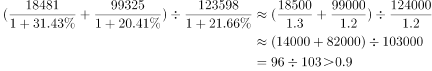

# 综合分析判断（增长率比较＋基期比重计算＋无中生有排除）

考点：[[20-考点/资料分析/综合/综合分析判断（增长率比较＋基期比重计算＋无中生有排除）|综合 / 综合分析判断（增长率比较＋基期比重计算＋无中生有排除）]]
材料：[[15-材料/资料分析/184984 2015年中国保险公司原保险保费收入|184984 2015年中国保险公司原保险保费收入]]

**问法模型**：'以下选项能够从资料中推出的是'→综合分析四选一，逐项核验：A比四大业务同比增速高低、B核对材料是否含'收益'指标、C比较保费收入与赔款给付两个流量的大小、D用基期公式还原年初占比对照90%阈值，唯一有据者为答案。

## 推理链
1. 第1步：A项定位段1，四大业务原保险保费收入各配同比增速，官方解析比较得意外险增速低于健康险，故'增长最快的是意外险业务'不成立，A排除。
2. 第2步：B项定位段3，材料只给出资金运用余额111795.49亿元及其四项构成（银行存款24349.67、债券38446.42、股票和证券投资基金16968.99、其他投资32030.41亿元），全文无任何'收益'数据，'余额'≠'收益'，B属无中生有，排除。
3. 第3步：C项跨段比较流量：段1保费收入24282.52亿元，段2赔款和给付支出8674.14亿元，24282.52÷8674.14≈2.8倍，收入远大于支出，'满足不了支出需求'不成立，C排除。
4. 第4步：D项定位段4，提取2015年末总资产123597.76亿元（较年初增长r总）、产险公司18481.13亿元（增长r产）、寿险公司99324.83亿元（增长r寿），转写文本中各增速数值缺失，须以原卷数值代入。
5. 第5步：段4基期为'年初'，套用基期公式：年初值＝年末值÷(1+较年初增速)，即年初产险＝18481.13/(1+r产)、年初寿险＝99324.83/(1+r寿)、年初总资产＝123597.76/(1+r总)。
6. 第6步：求基期比重＝[18481.13/(1+r产)+99324.83/(1+r寿)]÷[123597.76/(1+r总)]，官方解析按此模型计算结果超过90%；旁证：现期占比(18481.13+99324.83)/123597.76≈95.3%，且三项'较年初'增速同量级、差异不足以使占比跌破九成，D成立。
7. 第7步：A、B、C均被排除，唯一能从资料推出的是D，与官方答案一致。

**最快解法**：⚡ 综合判断题按'秒杀项优先'顺序排除：B——材料通篇只有'余额'没有'收益'，无中生有直接排除；C——截位直除24282.52/8674.14≈2.8倍，收入＞支出，排除；A——比较四个同比增速，健康险＞意外险，排除；D——先用现期份数放缩：(18481.13+99324.83)/123597.76≈95.3%已超九成，再按基期比重模型'现期比重×(1+r总)/(1+r部分)'严格验证年初占比仍在90%以上，锁定D。

## 易错点
- ⚠ B项偷换概念：'资金运用余额'是存量规模，'收益'材料完全未提，不能由规模或占比高低推出收益高低——综合判断题最典型的无中生有陷阱。
- ⚠ D项基期与现期混淆：问的是'2015年年初'占比而非年末占比，必须用'现期值÷(1+较年初增速)'还原基期再求比重；且段3、段4的基期表述是'较年初（2014年末）'，与段1、段2的'同比'口径不同。
- ⚠ 取数定位错段：一套材料含四套四分类（保费业务/赔款业务/资金运用构成/机构总资产），'产险公司、寿险公司总资产'只在段4，勿误用段1保费（7994.97、13241.52）或段2赔款给付（4194.17、3565.17）；C项注意24282.52＞8674.14，勿把收入与支出的大小方向看反。

## 母题抽象
> 🧩 当题干出现'以下选项能够从资料中推出的是'时，用'无中生有秒杀＋截位直除比大小＋基期比重验阈值'三步法逐项排查：材料未出现的指标（如收益、利润）直接排除，流量大小比较用截位直除，涉及'年初/基期'占比用现期值÷(1+增速)还原后再与阈值（九成＝90%）比较。

**同类特征**：以下选项能够从资料中推出的是、综合判断四选一、增长最快（增长率比较）、余额与收益（口径偷换、无中生有）、年初（基期）总资产占比、九成以上（90%阈值）

## 相关题
- [[10-真题/资料分析/综合/4628161 综合判断题（基期量+比重+结构差额+平均数四模型逐项验证）|4628161]]（新疆 2021，相关度1）
- [[10-真题/资料分析/综合/4737739 综合判断题（基期量计算+两期比重升降结论+份额倍数比较+增速对比）|4737739]]（福建 2017，相关度1）
- [[10-真题/资料分析/综合/2187642 综合判断题——城乡及东中西部两周就诊率大小比较（读数比较＋权重合成可行性判断）|2187642]]（选调 2018，相关度1）
- [[10-真题/资料分析/综合/2448411 综合判断题（两期平均数比较+区间累计求和+同比增量比较+增长量验算）|2448411]]（国考 2020，相关度1）
- [[10-真题/资料分析/综合/2448579 综合判断题（现期比重直验+增长量验证）|2448579]]（国考 2020，相关度1）

---

### 题干
以下选项能够从资料中推出的是：

### 选项
- A. 2015年保险公司原保险保费收入增长最快的是意外险业务
- B. 2015年保险公司资金运用中，股票和证券投资基金的收益最高
- C. 2015年保险公司原保险保费收入满足不了其赔款和给付支出需求
- D. 2015年年初产险公司和寿险公司总资产占保险公司总资产九成以上　✅

### 官方解析

A项：判断增长最快，即增长率比较。定位材料第一段，健康险业务原保险保费收入同比增长，意外险业务原保险保费收入同比增长，意外险健康险，意外险业务不是增长最快的，故A项错误。

B项：材料中没有提及保险资金运用的收益，只有保险资金运用的余额，B项无法推出。

C项：定位材料第一段，可知2015年保险公司原保险保费收入为24282.52亿元，定位材料第二段，可知2015年保险公司赔款和给付支出8674.14亿元，收入赔款和给付支出，故C项错误。

D项：定位材料第四段，可知保险公司总资产为123597.76亿元，增长；产险和寿险公司总资产分别为18481.13亿元和99324.83亿元，分别增长和。所以2015年初产险和寿险公司资产之和占保险公司总资产的比重为，故D项正确。

故正确答案为D。

### 给定材料

        2015年保险公司原保险保费收入24282.52亿元，同比增长，比上一年高。其中，产险业务原保险保费收入7994.97亿元，同比增长；寿险业务原保险保费收入13241.52亿元，同比增长；健康险业务原保险保费收入2410.47亿元，同比增长；意外险业务原保险保费收入635.56亿元，同比增长。

        2015年保险公司赔款和给付支出8674.14亿元，同比增长。其中，产险业务赔款4194.17亿元，同比增长；寿险业务给付3565.17亿元，同比增长；健康险业务赔款和给付762.97亿元，同比增长；意外险业务赔款151.84亿元，同比增长。

        截至2015年末，保险公司资金运用余额111795.49亿元，较年初增长。其中，银行存款24349.67亿元，占比；债券38446.42亿元，占比；股票和证券投资基金16968.99亿元，占比；其他投资32030.41亿元，占比。

        截至2015年末，保险公司总资产123597.76亿元，较年初增长。其中，产险公司总资产18481.13亿元，较年初增长；寿险公司总资产99324.83亿元，较年初增长；再保险公司总资产5187.38亿元，较年初增长；资产管理公司总资产352.39亿元，较年初增长。

