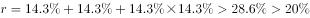
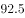
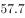
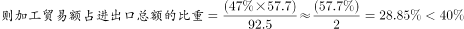
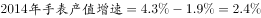
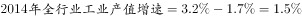

# 综合分析逐项判定（隔年增长率＝2r+r²验证、比重＝部分÷整体、'增速提高-降幅扩大n个百分点'还原上年增速、现期产值倍数比较）

考点：[[20-考点/资料分析/综合/综合分析逐项判定（隔年增长率＝2r+r²验证、比重＝部分÷整体、'增速提高-降幅扩大n个百分点'还原上年增速、现期产值倍数比较）|综合 / 综合分析逐项判定（隔年增长率＝2r+r²验证、比重＝部分÷整体、'增速提高/降幅扩大n个百分点'还原上年增速、现期产值倍数比较）]]
材料：[[15-材料/资料分析/185160 2015年我国钟表行业年度经营概况：|185160 2015年我国钟表行业年度经营概况：]]

**问法模型**：题干为'能够从上述资料中推出的是'→四选项逐项排除：D用现期产值直接比一半，A套间隔增长率公式(1+r)(1+r)−1，B用'出口总额×加工贸易占比÷进出口总额'算比重，C用'2015年增速−n个百分点'还原2014年增速后比较

## 推理链
1. 第1步：先验证数据最全的D项——材料第二段，2015年时钟（含钟心）产值162亿元，手表产值约417亿元，417÷2＝208.5亿元，162亿元<208.5亿元，时钟产值未达手表一半，D错误
2. 第2步：验证A项——第二段，零配件、定时器及其它计时仪器产值96亿元，2015年同比增长，且'增速基本保持上年水平'，故2014年增速≈2015年增速，设同为r
3. 第3步：A项所用公式——2015年比2013年的增长率＝隔年增长率＝(1+r)²−1＝r+r+r×r（两年增速相同）
4. 第4步：代入计算——隔年增长率＝2r+r²，必大于两年增速之和，代入原卷中的增速r后超过选项给定的阈值百分数，'比2013年增长X%以上'成立，A正确（注：本版材料该增速数值缺失，须按原卷完整数值代入）
5. 第5步：验证B项——第四段，加工贸易额＝出口总额57.7亿美元×加工贸易占出口比重（数值缺失），其占进出口总额的比重＝57.7×占比÷92.5，官方代入后未达选项阈值，B错误
6. 第6步：验证C项——2014年手表产值增速＝2015年手表产值增速−1.9个百分点，2014年全行业总产值增速＝2015年全行业增速−1.7个百分点（两个2015年增速数值均缺失）；按原卷数值还原后，手表2014年增速实际不低于全行业增速，'低于'不成立，C错误
7. 第7步：结论——A正确，B、C、D均错误，故正确答案为A

**最快解法**：⚡ 考场最快路径：①先用D项秒杀排除（162亿<417亿÷2＝208.5亿，纯口算）；②主攻A——抓住'增速基本保持上年水平'，两年增速同为r，隔年增长率＝2r+r²（公式法），略大于两增速之和，与选项阈值直接比较即可锁定A；③B用截位直除（57.7×占比÷92.5）、C用百分点还原（各减1.9/1.7）排除，四个选项彼此独立、互不依赖

## 易错点
- ⚠ D项指标偷换：必须用'产值'对'产值'（162亿元<417亿÷2＝208.5亿元），若误用产量（5.2亿只÷10.7亿只）或拿全行业总产值675亿元替代，会掉入'亿只/亿元'字面相近的陷阱误判D
- ⚠ B项双重口径陷阱：分子须先算加工贸易额（出口57.7亿美元×占出口比重），分母是'进出口总额92.5亿美元'而非出口总额57.7亿美元，且全程在亿美元体系内，不可与国内亿元指标混算
- ⚠ A/C项百分点还原与公式坑：'增速提高/保持/降幅扩大n个百分点'还原上年增速时方向易搞反（2014年增速＝2015年增速−n个百分点）；A项隔年增长率若漏掉r×r项或直接拿单年增速对阈值会误判；另注意本版材料多处同比百分数缺失，完整数值验证必须依赖原卷数据，不得凭空补数

## 母题抽象
> 🧩 当题干出现'能够从上述资料中推出的是'且选项混排增长率、比重、倍数判断时，先用现期数据齐全的选项（如'产值达一半以上'）口算排除，再对'比两年前（隔年）增长X%以上'类选项套公式(1+r₁)(1+r₂)−1（两年增速相同则＝2r+r²）验证阈值

**同类特征**：'能够从上述资料中推出的是'（综合分析四选一）、选项含'比2013年增长X%以上'→隔年/间隔增长率、'增速比上年提高1.7个百分点''降幅扩大1.3个百分点''增速基本保持上年水平'→上年增速还原、选项含'占进出口总额的X%以上'→比重计算（部分÷整体，分母为进出口总额）、选项含'2014年增速低于…'→两年增速各减百分点后比较、选项含'达到…一半以上'→现期倍数直接比较

## 相关题
（暂无）

---

### 题干
能够从上述资料中推出的是：

### 选项
- A. 
2015年钟表零配件、定时器及其它计时仪器产值比2013年增长以上
　✅
- B. 
2015年钟表行业海关出口总额中加工贸易额占进出口总额的以上

- C. 
2014年手表产值同比增速低于钟表全行业工业总产值增速

- D. 
2015年时钟（含钟心）产值达到手表产值的一半以上

### 官方解析

A项：定位材料第二段，2015年钟表零配件、定时器及其它计时仪器同比增长，增速基本保持上年水平。根据间隔增长率公式，，正确；

B项：定位材料第四段，进出口总额亿美元，出口总额亿美元，出口总额中加工贸易额占。，错误；

C项：定位第一段和第二段，。。，错误；

D项：定位第二段，时钟产值亿元，手表产值亿元。，错误。

故正确答案为A。

### 给定材料

        2015年我国钟表全行业实现工业总产值约675亿元，同比增长，增速比上年同期提高1.7个百分点。

        全行业全年生产手表10.7亿只，同比增长，完成产值约417亿元，同比增长，增速提高1.9个百分点；生产时钟（含钟心）5.2亿只，同比下降，完成产值162亿元，同比下降，降幅扩大1.3个百分点；钟表零配件、定时器及其它计时仪器产值96亿元，同比增长，增速基本保持上年水平。

        2015年我国钟表行业规模以上工业企业主营业务收入365.8亿元，同比增长；实现利润23.4亿元，与上年相比下降，而2015年轻工行业主营业务利润率（利润/主营业务收入）的平均水平为。

        2015年我国钟表行业海关进出口总额为92.5亿美元，同比增长，完成出口总额为57.7亿美元，同比增长，进口额34.8亿美元。出口总额中加工贸易额占，较上年缩小2个百分点。

> [!warning] 疑点（官方解析可能有误，待人工复核）
> 本版材料原文与官方解析中多处关键百分数被截断缺失（零配件/手表/全行业产值同比增速、加工贸易占出口比重、进出口及出口同比增速等），A、B、C项无法用现有文本完整复现数值，验证须以原卷完整数值为准；现有数据下D项（162<208.5）与官方判定一致，未发现官方答案本身有误

<!-- CODEX-ANSWER-REVIEW:BEGIN -->
### 本次独立复核

**复核状态：** `confirmed`（独立复算确认答案）

**计分答案：** A（可计分）

**复核解析：**

恢复公式图后四项都可独立复核。A：2015年零配件等产值同比增长14.3%，增速基本与上年相同；两年间隔增幅=(1+14.3%)²−1≈30.66%，高于20%，正确。B：加工贸易占出口额47%，故其占进出口总额=57.7×47%÷92.5≈29.33%，未达40%，错误。C：2014年手表产值增速=4.3%−1.9%=2.4%，全行业2014增速=3.2%−1.7%=1.5%，手表增速更高，C称低于错误。D：时钟产值162亿元，小于手表产值417亿元的一半208.5亿元，错误。只有A正确。

**相关信息：**

资料分析—间隔增长率、比重转换、百分点回推及倍数比较。两年连续增长用(1+r1)(1+r2)−1；加工贸易占出口的比重换成占进出口总额需乘出口/进出口。

**题源依据：** [固定版本原题](https://github.com/Mentat-Uran/kaogongzhentizhengliu/blob/84ab93d4b64b61d897bece8a1c0a5bab06b4feb2/10-%E7%9C%9F%E9%A2%98/%E8%B5%84%E6%96%99%E5%88%86%E6%9E%90/%E7%BB%BC%E5%90%88/2028364%20%E7%BB%BC%E5%90%88%E5%88%86%E6%9E%90%E9%80%90%E9%A1%B9%E5%88%A4%E5%AE%9A%EF%BC%88%E9%9A%94%E5%B9%B4%E5%A2%9E%E9%95%BF%E7%8E%87%EF%BC%9D2r%2Br%C2%B2%E9%AA%8C%E8%AF%81%E3%80%81%E6%AF%94%E9%87%8D%EF%BC%9D%E9%83%A8%E5%88%86%C3%B7%E6%95%B4%E4%BD%93%E3%80%81'%E5%A2%9E%E9%80%9F%E6%8F%90%E9%AB%98-%E9%99%8D%E5%B9%85%E6%89%A9%E5%A4%A7n%E4%B8%AA%E7%99%BE%E5%88%86%E7%82%B9'%E8%BF%98%E5%8E%9F%E4%B8%8A%E5%B9%B4%E5%A2%9E%E9%80%9F%E3%80%81%E7%8E%B0%E6%9C%9F%E4%BA%A7%E5%80%BC%E5%80%8D%E6%95%B0%E6%AF%94%E8%BE%83%EF%BC%89.md)；固定内容 commit `84ab93d4b64b61d897bece8a1c0a5bab06b4feb2`，Markdown blob `2dc690f29dcba408f4b9a05242ad11c699f22dd6`。
<!-- CODEX-ANSWER-REVIEW:END -->
