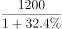
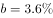

# 综合分析判断（同比升降年份计数+比重变化定性判断+基期量定性比较）

考点：[[20-考点/资料分析/综合/综合分析判断（同比升降年份计数+比重变化定性判断+基期量定性比较）|综合 / 综合分析判断（同比升降年份计数+比重变化定性判断+基期量定性比较）]]
材料：[[15-材料/资料分析/185158 某市主要农产品（粮食、甘蔗、油料、蔬|185158 某市主要农产品（粮食、甘蔗、油料、蔬]]

**问法模型**：题干出现'能够从上述资料中推出的是'→四选一综合判断题，按'先纯读数、再定性排除、最后定量计算'的顺序逐项验证，锁定唯一正确项。

## 推理链
1. 第1步：D项直接读统计图折线，2010-2015年粮食同比增速依次为1.5%、3.8%、2.1%、-6.7%、1.7%、-2.3%，同比上升年份为2010、2011、2012、2014共4年，下降年份为2013、2015共2年，4＞2，D成立。
2. 第2步：B项看文字段2，2015年水产品总量29.16万吨'同比增长'（总量增速＞0），而海洋捕捞1.09万吨'与上年持平'（分量增速=0），分量增速＜总量增速，海洋捕捞占水产品总产量的比重必然下降，与'均高于上年'矛盾，B排除。
3. 第3步：C项看文字段1，甘蔗2015年产量0.57万吨且'下降'（增速＜0），则2014年基期量=0.57/(1+增速)＞0.57万吨，两年累计产量＞0.57+0.57=1.14万吨＞1万吨，'不到1万吨'不成立，C排除。
4. 第4步：A项，2015年油料产量0.12万吨=1200吨且'增长'，2014年基期量=1200/(1+增速)，按官方解析首位商不到1，即不足1000吨，A排除（该增速数值题面空缺，以官方解析结论为准）。
5. 第5步：综上仅D项可推出，正确答案为D。

**最快解法**：⚡ 综合分析'先易后难+定性排除法'：D项纯读折线正负号（正4年＞负2年）一步锁定答案；B项用比重变化定性规则'分量增速0＜总量正增速→比重必降'秒排；C项用'下降→基期＞现期'定性（累计＞1.14万吨）秒排；A项需具体增速数值且题面空缺，放最后处理。

## 易错点
- ⚠ 双轴图陷阱：柱=产量（万吨，左轴0-6），折线=增速（%，右轴-20~20）；判断'同比上升/下降的年份'必须看折线正负而非柱子高低，且2010年柱子无前一年数据可比，只能靠折线1.5%＞0判定2010年为上升年
- ⚠ B项比重误判：误以为海洋捕捞'与上年持平'则占比不变；实际总量增长而分量零增长，占比必然下降，'持平≠比重持平'
- ⚠ C项方向搞反：甘蔗'下降'意味着2014年基期量大于0.57万吨（不是小于），两年累计必超1.14万吨；A项还需注意0.12万吨=1200吨的万吨→吨换算

## 母题抽象
> 🧩 当题干出现'能够从上述资料中推出的是'的综合判断特征时，先扫纯读数项（正负号计数、排序、加总）直接锁定答案，再用定性规则（分量增速vs总量增速判比重升降、增长/下降判基期与现期大小关系）排除干扰项，最后才做依赖具体数值的定量项。

**同类特征**：能够从上述资料中推出的是、综合分析四选一、同比上升的年份多于同比下降的年份、占水产品总产量的比重均高于上年、累计产量不到1万吨、2014年油料产量（基期量估算）

## 相关题
- [[10-真题/资料分析/综合/2031178 综合分析题（逐项验证：增长量计算、基期量反推、比重阈值判断）|2031178]]（北京 2017，相关度2）
- [[10-真题/资料分析/综合/13255455 综合分析题-逐项验证（基期量换算比较、增长率计算与比较）|13255455]]（选调 2023，相关度2）
- [[10-真题/资料分析/综合/2187869 综合分析判断（文字材料逐项验证+基期数回推）|2187869]]（山东 2018，相关度2）
- [[10-真题/资料分析/综合/2578807 综合分析题·混合增长率判断整体与部分增速关系（辅以基期倍数、增长量、两期平均数排除）|2578807]]（四川 2020，相关度2）
- [[10-真题/资料分析/综合/19283943 综合分析判断题（倍数比较+求和判断+隐含平均每场座位数反推）|19283943]]（国考 2025，相关度1）

---

### 题干
能够从上述资料中推出的是：

### 选项
- A. 2014年油料产量超过1000吨
- B. 除淡水养殖之外，其余类型的水产品2015年产量占水产品总产量的比重均高于上年
- C. 2014-2015年甘蔗累计产量不到1万吨
- D. 2010-2015年，粮食产量同比上升的年份多于同比下降的年份　✅

### 官方解析

A项：根据文字材料第一段，2015年油料产量为，增速为，代入公式：，则2014年油料产量为，首位商不了1，错误；

B项：根据文字材料第二段，2015年水产品增速为，海洋捕捞与上年持平，增速，，比重下降。则除淡水养殖，海洋捕捞也下降，错误。

C项：根据文字材料第一段，2015年甘蔗产量为0.57万吨，下降，则2014、2015年甘蔗累计产量为万吨，错误；

D项：根据图表可知，2010-2015年中，粮食产量同比上升的有2010、2011、2012和2014年共4个，下降的有2013和2015年共2个，满足上升年份数大于下降年份数，正确。

故正确答案为D。

### 给定材料

        某市2015年全年粮食总产量4.16万吨，同比下降；甘蔗产量0.57万吨，下降；油料产量0.12万吨，增长；蔬菜产量15.79万吨，下降；水果产量7.84万吨，增长。

        全年水产品产量29.16万吨，同比增长。其中海洋捕捞1.09万吨，与上年持平；海水养殖6.07万吨，增长；淡水捕捞0.18万吨，增长；淡水养殖21.81万吨，下降。

                    

> [!warning] 疑点（官方解析可能有误，待人工复核）
> 题面文字中各农产品同比增速数值空缺（仅粮食-2.3%可由图确认），官方解析A、C项算式随之留空；其中A项'首位商不了1'依赖原题油料增速数值，现有材料无法独立复算，但B、C项凭定性规则可复核无误，D项可纯读图验证，不影响答案D的正确性。
