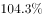
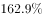
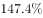
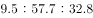
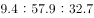
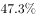

# 综合分析判断题（倍数判定＋比重结构商＋百分点还原＋年均增量比较）

考点：[[20-考点/资料分析/综合/综合分析判断题（倍数判定＋比重结构商＋百分点还原＋年均增量比较）|综合 / 综合分析判断题（倍数判定＋比重结构商＋百分点还原＋年均增量比较）]]
材料：[[15-材料/资料分析/185242 某市非公有制经济发展情况：2015年|185242 某市非公有制经济发展情况：2015年]]

**问法模型**：'能够从上述资料中推出的是'→逐项验证排三留一：A用现期÷30年前基期值与200倍比较，B用'工业占非公有制经济比重÷第二产业占非公有制经济比重'与80%比较，C用'现期比重±百分点变动'还原2010年比重后再作差，D将同期（2010—2015）年均增量比较转化为总增量比较。

## 推理链
1. 第1步：A项定位柱状图，'30年前'即2015−30=1985年，取2015年348.12亿元与1985年1.78亿元。
2. 第2步：倍数模型验证A：348.12÷1.78≈195.6倍，等价判定1.78×200=356＞348.12，不到200倍，A错误。
3. 第3步：D项定位文字段①与柱状图，民营335.24亿元、港澳台1.04亿元（2015年），比较区间同为2010—2015年共5年，年均增量高低等价于总增量高低。
4. 第4步：D项用上限放缩：港澳台2010年基数大于0，故其增量必小于1.04亿元；而2010年非公有制经济总量仅169.01亿元，民营2010年值不超过169.01亿元，民营增量≥335.24−169.01=166.23亿元＞1.04亿元，民营年均增量更高，D错误。
5. 第5步：C项定位文字段②，2010年第三产业比重=2015年比重+3.5个百分点、第一产业比重=2015年比重+3.9个百分点，故2010年'三产−一产'之差=（2015年之差）−0.4个百分点；2015年两比重具体值在所给版本空缺，按官方判定该差不等于23.7个百分点，C错误。
6. 第6步：B项定位文字段②，模型为'工业增加值占非公有制经济增加值比重÷第二产业占非公有制经济增加值比重'，判定商是否大于80%；两处比重数值在所给版本空缺，按官方结论其商超过八成，B正确。
7. 第7步：对照四项，A、C、D均被排除，仅B能推出，故正确答案为B。

**最快解法**：⚡ 综合判断'先易后难'：A用倍数速算口算排除（1.78×200=356＞348.12，不到200倍）；D用分量≤总量的上限放缩秒杀（港澳台增量上限1.04亿元＜民营增量下限335.24−169.01=166.23亿元）；再核C（百分点差须扣3.9−3.5=0.4个百分点的调整差）与B（工业占比÷第二产业占比与80%比较），锁定B。

## 易错点
- ⚠ '30年前'应从2015年倒推为1985年（1.78亿元），勿误取1990年4.63亿元；'200倍以上'可用乘法1.78×200=356与348.12比较判定，避免除法粗算失误。
- ⚠ 百分点≠百分比：C项的23.7个百分点是2010年两比重之差，须先把2015年比重分别+3.5、+3.9个百分点还原到2010年再作差（净差比2015年差还小0.4个百分点），不能拿2015年比重差直接对照。
- ⚠ D项民营/港澳台2010年基数与增速在所给版本空缺，勿误判'无法比较'，可用'分量≤2010年总量169.01亿元'放缩出增量上下限；B项依赖的工业占比与第二产业占比两处数值在所给版本空缺，须回原版材料补数，不得凭空代入。

## 母题抽象
> 🧩 当题干出现'能够从资料中推出的是'且选项混合倍数、比重商、百分点差、年均增量时，先用图表直读数据做倍数除法和'分量≤总量'的增量放缩秒杀明显错项，再对依赖文字比重的选项用'现期值±百分点变动'还原基期后验证。

**同类特征**：能够从上述资料中推出的是（综合判断）、30年前的…倍、占…比重超过八成、比重下降/上升…个百分点、年均增量高于、同一核心量多选项多模型验证

## 相关题
- [[10-真题/资料分析/综合/5102154 综合判断题——逐项验证（核心为跨图现期比重计算：TOP5之和÷全国总量，辅以增速比较、数据计数与可得性判断）|5102154]]（湖北 2022，相关度1）
- [[10-真题/资料分析/综合/16592992 综合判断题（基期比值+平均价格比较+链式现期+整体推算多模型混合验证）|16592992]]（河北 2024，相关度1）
- [[10-真题/资料分析/综合/17764866 综合判断题（产销差值的基期比较为正确项，环比增速走势-销量比值走势-两年基期总量为干扰项）|17764866]]（湖北 2024，相关度1）
- [[10-真题/资料分析/综合/19526375 综合分析判断（累计值做差求当期+基期倒推+比重计算与比重差比较）|19526375]]（国考 2026，相关度1）
- [[10-真题/资料分析/综合/2030148 综合判断题·环比升降月份计数为主验证（兼客座率定义转化、天数加权平均、日利用率×天数换算）|2030148]]（四川 2016，相关度1）

---

### 题干
关于该市非公有制经济增加值发展状况，能够从上述资料中推出的是：

### 选项
- A. 2015年该市非公有制经济的经济增加值是30年前的200倍以上
- B. 2015年该市工业增加值占第二产业非公有制经济增加值比重超过八成　✅
- C. 2010年该市非公有制经济中第三产业比重比第一产业高23.7个百分点
- D. 2010—2015年，该市港澳台经济增加值年均增量高于民营经济增加值

### 官方解析
A项：定位材料第一段及图表，2015年该市非公有制经济的经济增加值为348.12亿元，1985年为1.78亿元。，所以不到200倍，错误；
B项：定位材料第二段，工业增加值占非公有制经济增加值比重为，第二产业占非公有制经济增加值比重为。则，超过八成，正确；
C项：定位材料第二段，2015年，第一、三产业占比分别为，，与“十一五”末相比，比重下降3.9和3.5个百分点。，错误；
D项：定位材料第一段，2015年民营经济增加值335.24亿元，港澳台经济增加值1.04亿元，分别比2010年增长、。年份相同，直接比较总的增长量。民营经济的总增长量为亿元，港澳台的总增长量为。民营经济增长量大于港澳台经济增长量，错误。
故正确答案为B。

### 给定材料

        2015年，某市非公有制经济实现增加值348.12亿元，比上年净增加23.69亿元，非公有制经济增加值占GDP的比重为。其中，民营经济增加值335.24亿元，外商经济增加值11.84亿元，港澳台经济增加值1.04亿元，分别比“十一五”末（2010年）增长、和。

        2015年，非公有制经济第一、二、三产业结构之比由上年的调整为。与“十一五”末相比，第一、三产业比重下降了3.9和3.5个百分点，第二产业比重上升了7.4个百分点。在第二产业中，工业增加值占非公有制经济增加值比重为，比“十一五”末提高7.8个百分点。

> [!warning] 疑点（官方解析可能有误，待人工复核）
> 所给材料版本中占GDP比重、三类经济比2010年增速、2014/2015年三次产业比重、工业占比等关键百分数均空缺，官方解析相应位置亦以空缺呈现（如'增长量为亿元'）；其中B项'工业占比÷第二产业占比＞80%'的成立依赖原版材料完整数值，本版本无法代入复核，官方答案B按原题口径采信，未发现与官方结论矛盾的计算。
