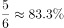
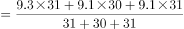
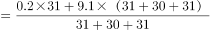
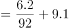

# 综合判断题·环比升降月份计数为主验证（兼客座率定义转化、天数加权平均、日利用率×天数换算）

考点：[[20-考点/资料分析/综合/综合判断题·环比升降月份计数为主验证（兼客座率定义转化、天数加权平均、日利用率×天数换算）|综合 / 综合判断题·环比升降月份计数为主验证（兼客座率定义转化、天数加权平均、日利用率×天数换算）]]
材料：[[15-材料/资料分析/185244 2015年民航航班逐月的日利用率（小|185244 2015年民航航班逐月的日利用率（小]]

**问法模型**：“能够从上述资料中推出的是”四选一综合判断 → 将各选项分别转化为可验证模型：环比升降计数、客座率阈值判断（旅客>座位总数的比例⇔客座率>该比例）、按天数加权的平均日利用率、总飞行时间=日利用率×当月天数，优先验证纯计数类选项快速锁定

## 推理链
1. 第1步：从柱状图取数，2015年下半年7—12月日利用率依次为9.9、10.0、9.4、9.3、9.1、9.1，环比基期取6月的9.1（1月无上月不参与）
2. 第2步：逐月与上月比较：7月9.9>9.1升、8月10.0>9.9升、9月9.4<10.0降、10月9.3<9.4降、11月9.1<9.3降、12月9.1=9.1持平（不计入升降）
3. 第3步：A项成立：下半年上升月份2个（7、8月）<下降月份3个（9、10、11月）
4. 第4步：验证B项：由材料定义“承运旅客数÷可提供座位数=客座率”，旅客超过座位总数某一比例即客座率超过该阈值；官方反例为4月——客座率84.1%已达标，但日利用率9.4<9.5小时，B项不成立
5. 第5步：验证C项：第四季度10/11/12月天数为31/30/31天，日利用率9.3、9.1、9.1，飞机数不变时平均日利用率=(9.3×31+9.1×30+9.1×31)÷92=843.4÷92≈9.17小时/日，官方判定其不在选项所给区间内，C项不成立
6. 第6步：验证D项：11月总飞行时间=9.1×30=273小时，12月=9.1×31=282.1小时，两月不相同，D项不成立；综上只有A项可推出，与官方答案一致

**最快解法**：⚡ 计数直判法：下半年只看柱高相对上月的变化方向——7↑、8↑、9↓、10↓、11↓、12平，2升<3降直接锁定A；其余三项各用一个反例排除：B看4月（客座率84.1%达标但日利用率9.4<9.5），D算273 vs 282.1小时，C用天数加权均值≈9.17估侧排除

## 易错点
- ⚠ 持平不算升降：12月与11月日利用率同为9.1，属持平月份，漏判持平或把持平计入任一方都会数错升降月份数；且1月无上月基期，环比只能在2—12月内做
- ⚠ 双轴图串行陷阱：柱看左轴（小时/日）、线看右轴（%），数值错位标注极易抄串（如4月柱9.4与点84.1）；验证B时把客座率数值与9.5比、或把日利用率与客座率阈值比均属口径错位；‘旅客超过座位总数’必须经客座率定义转化，不能拿客座率原始数值直接比
- ⚠ 天数不能忽略：D项同为9.1小时/日但11月30天、12月31天，总时间必不同（只比日利用率即错）；C项平均日利用率须按各月天数加权（≈9.17），用简单口径或不加权都会偏

## 母题抽象
> 🧩 当综合判断题出现‘能够推出的是’且某选项是纯环比计数（上升/下降月份数）时，先数升降方向（注意持平不计入）快速锁定，再用定义转化（旅客/座位=客座率→阈值反例）与单位换算（小时/日×当月天数、按天数加权平均）逐一排除其余选项

**同类特征**：能够从上述资料中推出的是（综合判断）、下半年与上月相比上升/下降的月份数、承运旅客数量超过座位总数（客座率阈值转化）、第四季度平均日利用率（需按天数加权）、总飞行时间＝日利用率×当月天数、双轴复合图柱线分别取数

## 相关题
- [[10-真题/资料分析/综合/5102154 综合判断题——逐项验证（核心为跨图现期比重计算：TOP5之和÷全国总量，辅以增速比较、数据计数与可得性判断）|5102154]]（湖北 2022，相关度1）
- [[10-真题/资料分析/综合/2030136 综合分析判断题（倍数判定＋比重结构商＋百分点还原＋年均增量比较）|2030136]]（四川 2016，相关度1）
- [[10-真题/资料分析/综合/16592992 综合判断题（基期比值+平均价格比较+链式现期+整体推算多模型混合验证）|16592992]]（河北 2024，相关度1）
- [[10-真题/资料分析/综合/17764866 综合判断题（产销差值的基期比较为正确项，环比增速走势-销量比值走势-两年基期总量为干扰项）|17764866]]（湖北 2024，相关度1）
- [[10-真题/资料分析/综合/19526375 综合分析判断（累计值做差求当期+基期倒推+比重计算与比重差比较）|19526375]]（国考 2026，相关度1）

---

### 题干
能够从上述资料中推出的是：

### 选项
- A. 
2015年下半年，日利用率与上月相比上升的月份数少于下降的月份数
　✅
- B. 
承运旅客数量超过航班提供座位总数的月份，航班日利用率均超过9.5小时

- C. 
如2015年各月民航飞机数不变，则第四季度平均日利用率在小时之间

- D. 
一架每天飞行且日利用率与当月均值相同的飞机，11月的总飞行时间和12月相同

### 官方解析

A项：根据柱状图可知，2015年下半年日利用率与上月相比上升的月份有2个，下降的3个，满足上升数少于下降数，正确；

B项：承运旅客数量超过航班提供座位总数的月份即客座率大于，根据柱状图可知，4月日利用率未超过9.5，错误；

C项：第四季度为10月（31天）、11月（30天）、12月（31天），根据柱状图可知，其日利用率分别为9.3、9.1、9.1，根据，错误；

D项：，根据柱状图可知，11月、12月日利率均为9.1，但天数分别为30、31天，所以总飞行时间两月不相同，错误。

故正确答案为A。

### 给定材料

日利用率：飞机在一日内平均提供的生产飞行小时数

客座率：承运的旅客数量与飞机可提供的座位数之比

> [!warning] 疑点（官方解析可能有误，待人工复核）
> 官方解析中B项‘客座率大于’后的阈值公式与C项的区间公式均未显示（图片latex缺失），导致B的阈值、C的具体区间无法从给定文字直接读取；但按官方反例逻辑（B以4月、C按加权平均≈9.17判定不符）均可独立复算排除B/C/D，A项经复算成立，与官方答案无矛盾
