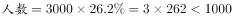
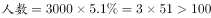
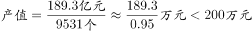
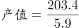
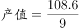
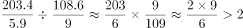

# 综合推断（占比×样本量 + 平均数计算与两期倍数比较）

考点：[[20-考点/资料分析/综合/综合推断（占比×样本量 + 平均数计算与两期倍数比较）|综合 / 综合推断（占比×样本量 + 平均数计算与两期倍数比较）]]
材料：[[15-材料/资料分析/185246 2015年某省农民工在本市（区、县）|185246 2015年某省农民工在本市（区、县）]]

**问法模型**：题干问'能从上述资料中推出的是'→四选项分别绑定图1/图2/表格，逐项定量代入验证：人数类用'占比×样本量3000'，产值类用'平均数=总量÷份数'再做两期倍数比较

## 推理链
1. 第1步：A项——图2中'已经开始自主营业'占26.2%，有效样本3000人，26.2%×3000=786人＜1000人，'超过1000名'不成立，排除A
2. 第2步：B项——图1中'家人朋友不支持'占5.1%，5.1%×3000=153人＞100人（虽是多选题，求单选项人数仍可用占比×3000），'不到100名'不成立，排除B
3. 第3步：C项——表格2011年平均每家企业产值=189.3亿元÷9531个≈198.6万元/个＜200万元（反推：9531×200万=190.62亿＞189.3亿），'超过200万元'不成立，排除C
4. 第4步：D项——2013年人均产值=203.4亿元÷5.9万人≈34.5万元/人；上一年2012年=108.6亿元÷9.0万人≈12.1万元/人
5. 第5步：倍数验证：34.5÷12.1≈2.86倍＞2倍（或交叉相乘：203.4×9.0=1830.6＞2×108.6×5.9=1281.5），'两倍以上'成立，故选D

**最快解法**：⚡ 排除法+截位直除/交叉相乘：A、B口算占比×3000（786、153）；C用反推法9531个×200万元=190.62亿＞189.3亿即不足200万；D只需证203.4/5.9＞2×108.6/9.0，交叉相乘1830.6＞1281.5，且亿元÷万人时10^4自动相消，无需精确算出人均值

## 易错点
- ⚠ 图1为多选题（各占比合计约191.1%），但求'选某项的人数'仍可用占比×3000；B项5.1%×3000=153人，易心算误判'5%的3000人不到100人'，实际153＞100
- ⚠ 单位换算陷阱：C项189.3亿元÷9531个需化为万元/个（198.6万），易直接算成0.02忘记换量级；D项亿元÷万人时10^4恰好约去，直接得万元/人
- ⚠ '上一年'指2012年（108.6亿元/9.0万人），勿错取2011年或与调查年份2015混淆；'两倍以上'即＞2倍，2.86倍满足，勿误解为恰好两倍

## 母题抽象
> 🧩 当题干出现'能推出的是/可以推出的是'且四个选项分属不同图表时，用逐项定量验证法：人数类'占比×样本总量'口算，平均数类'总量÷份数'注意亿元/万人单位相消，倍数比较用交叉相乘避免精算

**同类特征**：能从上述资料中推出的是、四个选项分别对应图1、图2、表格、超过/不到+具体人数（占比×样本量）、平均每个企业产值超200万元、是上一年的两倍以上、亿元与万人、亿元与个的单位换算

## 相关题
- [[10-真题/资料分析/综合/2015342 综合判断题+贷款总额间接换算（不良贷款余额÷不良贷款率）|2015342]]（重庆 2016，相关度1）
- [[10-真题/资料分析/综合/5102405 综合推断（年均增速比较+进出口总额加总换算+倍数比较+最值定位，逐项排除）|5102405]]（河南 2022，相关度1）

---

### 题干
能从上述资料中推出的是：

### 选项
- A. 超过1000名被调查者已经开始自主营业
- B. 不到100名调查者的家人及朋友不支持被调查者创业
- C. 2011年该省平均每个农民工回乡创办企业的产值超过200万元
- D. 2013年该省平均每名回乡农民工创业者当年创业实现的产值是上一年的两倍以上　✅

### 官方解析

A项：结合文字材料与饼状图，已经开始自主营业的，错误；

B项：结合文字材料与柱状图，家人朋友不支持的调查者，错误；

C项：根据表格可得，2011年平均每个农民工回乡创办企业的，错误；

D项：根据表格，2013年平均每名农民工回乡创业实现的，2012年平均每名农民工回乡创业实现的。，故两倍以上说法正确。

故正确答案为D。

### 给定材料

        2015年，某省对农民工在本市（区、县）创业的意愿进行了调查，共完成有效样本3000个，调查结果如下：

> [!warning] 疑点（官方解析可能有误，待人工复核）
> 官方解析文字严重残缺（各选项均未给出代入数值，如'已经开始自主营业的，错误'），但经数据验证结论无误：A为786人、B为153人、C约198.6万元、D为34.5/12.1≈2.86倍，D项判定正确

<!-- CODEX-ANSWER-REVIEW:BEGIN -->
### 本次独立复核

**复核状态：** `resolved`（答案与解析已核定）

**计分答案：** D（可计分）

**复核解析：**

A已开始自主营业人数=3000×图示比例，低于1000；B不支持人数约153人，不到100是错误断言；C用2011创办企业产值/创业者人数约198.6万元，未超过200万元。D按表中人均产值，2013约34.5万元、2012约12.1万元，倍数34.5/12.1≈2.85，大于2，故D正确。

**相关信息：**

样本占比乘3000得到人数；平均产值需用产值除创业者数后跨年比较。

**题源依据：** [固定版本原题](https://github.com/Mentat-Uran/kaogongzhentizhengliu/blob/84ab93d4b64b61d897bece8a1c0a5bab06b4feb2/10-%E7%9C%9F%E9%A2%98/%E8%B5%84%E6%96%99%E5%88%86%E6%9E%90/%E7%BB%BC%E5%90%88/2030170%20%E7%BB%BC%E5%90%88%E6%8E%A8%E6%96%AD%EF%BC%88%E5%8D%A0%E6%AF%94%C3%97%E6%A0%B7%E6%9C%AC%E9%87%8F%20%2B%20%E5%B9%B3%E5%9D%87%E6%95%B0%E8%AE%A1%E7%AE%97%E4%B8%8E%E4%B8%A4%E6%9C%9F%E5%80%8D%E6%95%B0%E6%AF%94%E8%BE%83%EF%BC%89.md)；固定内容 commit `84ab93d4b64b61d897bece8a1c0a5bab06b4feb2`，Markdown blob `7fb091bdc9fb4aea98f21ba94d47c9f38a37344e`。
<!-- CODEX-ANSWER-REVIEW:END -->
