# 综合分析判断（核心为两期平均数升降比较，兼比重估算、同比方向读数与带符号计数）

考点：[[20-考点/资料分析/综合/综合分析判断（核心为两期平均数升降比较，兼比重估算、同比方向读数与带符号计数）|综合 / 综合分析判断（核心为两期平均数升降比较，兼比重估算、同比方向读数与带符号计数）]]
材料：[[15-材料/资料分析/185290 2015年上半年全国渔业经济运行情况|185290 2015年上半年全国渔业经济运行情况]]

**问法模型**：题干为'下列说法中正确的是'的四选一综合分析题→逐项验证：A用两期平均数比较（出口额增速<出口量增速⇔每吨均价下降），B用同比方向直接读数，C用截位直除算比重与'一成（10%）'比较，D带符号统计出口额正增长的地区个数。

## 推理链
1. 第1步：A项定位第四段取数：2015年上半年出口量189.28万吨、出口额95.81亿美元，现期每吨均价=95.81÷189.28≈0.51亿美元/万吨；均价升降取决于分子（出口额）增速a与分母（出口量）增速b的大小关系。
2. 第2步：两期平均数比较规则：现期均价/基期均价=(1+a)/(1+b)，a<b⇔比值<1⇔均价同比降低；依官方解析口径（原卷数值），出口额增速低于出口量增速，故平均每吨出口价格比上年同期低，A正确。
3. 第3步：B项定位第五段读数：进口量193.80万吨、进口额41.47亿美元，同比均'下降'，两指标均低于上年同期水平，B'均高于上年同期'错误。
4. 第4步：C项定位第二、四段计算：出口量占产量比重=189.28÷2700.09≈7.0%<10%，即'不到一成'，C'一成多'错误。
5. 第5步：D项定位第四段带符号计数：官方解析确认7个主要出口市场中出口额同比上升的为东盟、中国台湾共2个（其余5个下降），D'有1个'错误。
6. 第6步：A、B、C、D中仅A成立，故正确答案为A。

**最快解法**：⚡ 考场最快解法：两期平均数比较结论——'平均数升降只看分子分母增速大小：额的增速<量的增速⇔单价下降'，A项直接比对出口额与出口量增速即可，无需计算具体均价；C项用截位直除189.28/2700.09≈189/2700≈7%<10%快速排除；B、D为带符号直接读数计数。

## 易错点
- ⚠ 均价（平均数）升降不能只看出口额或出口量各自的增降方向，必须比较'分子（额）增速'与'分母（量）增速'的大小，二者增速方向或幅度不一致时结论易反。
- ⚠ C项'一成多'口径陷阱：189.28/2700.09≈7.0%实为'不到一成'，粗略估算易把约7%误当成接近10%而错判。
- ⚠ D项正负号陷阱：7个市场增速统一接在'分别增长'之后，但其中含负值（东盟、中国台湾为正，共2个上升），须逐个带符号确认，勿默认全为正；同时亿元人民币与亿美元、量（189.28<193.80）与额（95.81>41.47）两套口径并存，读数勿串行。

## 母题抽象
> 🧩 当综合分析题出现'平均每吨价格/单价比上年同期高（低）'特征时，用两期平均数比较结论——分子增速<分母增速⇔平均数下降，直接比增速不计算均价；'占总量一成'类判断用截位直除与10%对照；'有几个上升/下降'类必须带符号逐项计数。

**同类特征**：下列说法中正确的是（四选一综合分析）、平均每吨……出口价格比上年同期低（两期平均数升降比较）、进口量和进口额均高于上年同期（同比方向读数）、占全国水产品产量的一成多（比重与10%比较）、出口额同比上升的国家（地区）有1个（带符号计数）、纯文字材料、同比增速数值空缺（须依原卷/官方口径读数）

## 相关题
（暂无）

---

### 题干
根据上述资料，下列说法中正确的是：

### 选项
- A. 2015年上半年平均每吨水产品的出口价格比上年同期低　✅
- B. 2015年上半年我国水产品进口量和进口额均高于上年同期水平
- C. 2015年上半年出口的水产品占全国水产品产量的一成多
- D. 水产品主要出口国家和地区中，2015年上半年我国对其出口额同比上升的国家（地区）有1个

### 官方解析
A项：定位材料第四段，2015年上半年水产品的出口量189.28万吨，出口额95.81亿美元，同比分别增长和，，则，，，所以2015年上半年平均每吨水产品的出口价格比上年同期低，正确；
B项：定位材料最后一段，进口量193.80万吨，2015年上半年水产品的进口额41.47亿美元，同比分别下降和，均低于去年同期水平，错误；
C项：定位材料第二、四段，2015年上半年全国水产品产量2700.09万吨，2015年上半年出口的水产品189.28万吨，因为，因此2015年上半年出口的水产品占全国水产品产量不到一成，错误；
D项：定位材料第四段，2015年上半年主要出口国家和地区中，对美国、欧盟、东盟、日本、中国香港、韩国和中国台湾的出口额分别增长、、、、、和，其中有东盟和中国台湾2个国家（地区）出口额同比上升，错误。
故正确答案为A。

### 给定材料

        据统计，2015年上半年全国渔业产值4152.56亿元，同比增长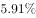；渔业增加值2260.05亿元，同比增长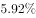，高出农林牧渔业增加值的增幅2.2个百分点。

        2015年上半年全国水产品产量2700.09万吨，同比增长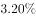，其中养殖水产品产量2114.38万吨，同比增长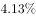。

        2015年上半年全国水产品进出口总量383.08万吨，同比下降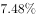，进出口总额137.28亿美元，同比下降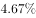。

        其中，出口量189.28万吨，出口额95.81亿美元，同比分别增长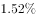和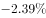。主要出口国家和地区中，对美国、欧盟、东盟、日本、中国香港、韩国和中国台湾的出口额分别增长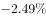、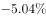、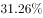、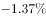、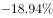、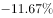和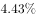。

        进口量193.80万吨，进口额41.47亿美元，同比分别下降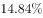和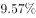，其中鱼粉进口量、进口额同比分别下降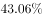和。

> [!warning] 疑点（官方解析可能有误，待人工复核）
> 所给材料文本中所有同比增速百分数均空缺，A项'出口额增速<出口量增速'与D项'东盟、中国台湾出口额同比增长'两处判断依赖原卷完整数值与官方解析给出的事实，现有文本无法独立复算；本笔记按官方解析口径记录，不影响答案A的正确性。
