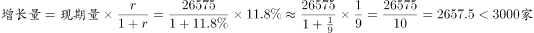
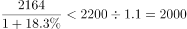
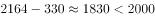
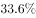
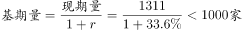

# 综合分析题（逐项验证：增长量计算、基期量反推、比重阈值判断）

考点：[[20-考点/资料分析/综合/综合分析题（逐项验证：增长量计算、基期量反推、比重阈值判断）|综合 / 综合分析题（逐项验证：增长量计算、基期量反推、比重阈值判断）]]
材料：[[15-材料/资料分析/185292 2015年全国吸收外商直接投资状况：|185292 2015年全国吸收外商直接投资状况：]]

**问法模型**：题干'能够从上述资料中推出的是'→综合分析四选一，对A/B/C/D逐项套用增长量=现期×r/(1+r)、基期=现期−增长量或现期/(1+r)、比重阈值=总计×10%逐一判定真假。

## 推理链
1. 第1步：A项取表'总计'行：2015年全国新设企业26575家、同比增速11.8%，代入增长量=26575×11.8%/(1+11.8%)≈26575×0.1055≈2805家，不足3000家，A错误
2. 第2步：B项取'一带一路'数据：2015年新设企业2164家，按官方口径其同比增长量为330家，则2014年基期=2164−330≈1834家，属'1000多家'而非'2000多家'，B错误
3. 第3步：C项以总额7813.5亿元×10%=781.35亿元为阈值逐行比对金额列：仅制造业2452.3亿元、房地产业1789.8亿元达标，批发零售744.0亿元、租赁和商务服务623.3亿元均差一点不足，共2个行业而非3个，C错误
4. 第4步：D项取信息传输、计算机服务和软件业：2015年新设企业1311家、对应第一列'同比增速'33.6%，基期=1311/(1+33.6%)≈1311/1.336≈981家，不到1000家，D正确
5. 第5步：四项中仅D可从资料推出，与官方答案D一致

**最快解法**：⚡ 百化分+截位直除逐项秒杀：A项11.8%≈1/8.5→增长量≈26575/9.5≈2800家<3000排除；C项先算一成=781.35亿元，扫金额列仅2452.3、1789.8两行超线排除；B项2164−330=1834家排除；D项1311/1.336截位直除首两位商98→约981家<1000，直接锁定D（D验证量最小，可优先验证D）。

## 易错点
- ⚠ A项漏除(1+r)：误算增长量=26575×11.8%≈3136家>3000而误判A对，正确须用现期×r/(1+r)≈2805家
- ⚠ C项分母错用9行业金额之和6384.8亿元（表中仅列部分行业，分项和≠总计），或把744.0、623.3误当超过一成，正确分母是总计7813.5亿元、阈值781.35亿元
- ⚠ D项基期现期混淆或串列：误把2015年现期1311家当2014年数据，或横向读行时把第二列金额增速40.1%误当企业数增速，正确用第一列33.6%反推基期

## 母题抽象
> 🧩 当题干出现'能够从上述资料中推出的是'且选项带整百/整千/成数阈值（'多3000家''不到1000家''一成以上'）时，用逐项排除法：增长量=现期×r/(1+r)、基期=现期/(1+r)、阈值=总计×10%，配合百化分与截位直除优先验证计算量最小的选项。

**同类特征**：能够从上述资料中推出的是、2014—2015年时间跨度、综合分析四选一、基期量反推（不到1000家）、比重一成以上、增长量约3000家

## 相关题
- [[10-真题/资料分析/综合/13255455 综合分析题-逐项验证（基期量换算比较、增长率计算与比较）|13255455]]（选调 2023，相关度2）
- [[10-真题/资料分析/综合/2028370 综合分析判断（同比升降年份计数+比重变化定性判断+基期量定性比较）|2028370]]（国考 2017，相关度2）
- [[10-真题/资料分析/综合/2187869 综合分析判断（文字材料逐项验证+基期数回推）|2187869]]（山东 2018，相关度2）
- [[10-真题/资料分析/综合/2578807 综合分析题·混合增长率判断整体与部分增速关系（辅以基期倍数、增长量、两期平均数排除）|2578807]]（四川 2020，相关度2）
- [[10-真题/资料分析/综合/19283943 综合分析判断题（倍数比较+求和判断+隐含平均每场座位数反推）|19283943]]（国考 2025，相关度1）

---

### 题干
关于2014—2015年全国吸收外商直接投资状况，能够从上述资料中推出的是：

### 选项
- A. 2015年全国吸收外商直接投资新设立企业比2014年多3000家
- B. 2014年“一带一路”沿线国家直接投资新设立企业2000多家
- C. 表中有3个行业直接投资金额占外商直接投资总额的一成以上
- D. 2014年信息传输、计算机服务和软件业外商直接投资新设立不到1000家企业　✅

### 官方解析

Ａ项：定位材料第一段，全国吸收外商直接投资新设立企业26575家，同比增长，代入增长量计算公式：，错误；

Ｂ项：定位材料第一段，从“一带一路”沿线国家吸收外商直接投资新设立企业2164家，增长，根据第一题解析,家，已知增长量为330家,则2014年“一带一路”沿线国家直接投资新设立企业为，错误；

Ｃ项：定位表格，实际使用外资金额7813.5亿元，其一成即为781.35亿元，满足条件的有制造业、房地产业两个行业，错误；

D项：定位表格，信息传输、计算机服务和软件业新设立企业数为1311家，同比增速为,则2014年信息传输、计算机服务和软件业外商直接投资新企业为，正确。

故正确答案为D。

### 给定材料

        2015年全年，全国吸收外商直接投资新设立企业26575家，同比增长；实际使用外资金额7813.5亿元，同比增长。其中从“一带一路”沿线国家吸收外商直接投资新设立企业2164家，增长；实际使用外商直接投资金额526亿元，增长。

2015年全国吸收外商直接投资状况       

> [!warning] 疑点（官方解析可能有误，待人工复核）
> 所给材料原文中全国增速与'一带一路'增速均为空缺：A项11.8%可由表'总计'行补全、D项33.6%可从表格读取，但B项判断依赖官方解析引用的'增长量330家'（对应'一带一路'增速约18%），该增速在所给材料原文中无法独立获取，仅作口径提示，判断结论与官方一致。
