# 综合分析判断题（基期量计算、混合增速居中、比重比较、增量抵消判断）

考点：[[20-考点/资料分析/综合/综合分析判断题（基期量计算、混合增速居中、比重比较、增量抵消判断）|综合 / 综合分析判断题（基期量计算、混合增速居中、比重比较、增量抵消判断）]]
材料：[[15-材料/资料分析/185294 2015年上半年A区规模以上工业总产|185294 2015年上半年A区规模以上工业总产]]

**问法模型**：'下列说法中正确的是'四选一综合判断 → 逐项套用对应公式（基期=现期/(1+g)、混合增长率居中、比重=部分/整体、增长量是否为零），优先做计算量最小、数据最直接的选项

## 推理链
1. 第1步：C项数据最直接——表格给出六大高耗能行业合计2015年上半年产值55.6亿元、同比增速-10.0%（即降幅10.0%）。
2. 第2步：基期量公式：2014年上半年产值=55.6/(1-10%)=55.6/0.9≈61.8亿元；判断'超过50亿元'无需精算，只需验证55.6>50×0.9=45，成立。
3. 第3步：C项结论：61.8>50（或55.6>45），2014年上半年六大高耗能行业产值确实超过50亿元，C正确。
4. 第4步：A项——'降幅比一季度扩大7.5个百分点'意味着一季度降幅=上半年降幅−7.5个百分点（一季度降幅更小、更慢）；上半年是第一季度与第二季度的整体，由混合增长率居中原则，二季度降幅必大于上半年降幅，即二季度降速更快，A'一季度快于二季度'错误。
5. 第5步：B项——两大主导行业产值之和=51.6+17=68.6亿元，占全区289.9亿元的比重=68.6/289.9≈23.7%，小于选项所给比例，B错误。
6. 第6步：D项——黑色金属2.1亿元(-9.3%)与电力1.0亿元(+9.3%)增速互为相反数，但基期量不同：2014年之和=2.1/0.907+1.0/1.093≈2.32+0.92≈3.2亿元≠2015年之和3.1亿元（或增量≈-0.22+0.09≈-0.13亿元≠0），D错误。
7. 第7步：综上仅C项正确，与官方答案一致。

**最快解法**：⚡ 选项圈优先法+基期阈值验证：先做C项，验证'基期>50'只需比'现期55.6'与'50×(1-10%)=45'，55.6>45直接锁定C；A项一句话排除——'降幅扩大7.5个百分点'反推一季度降幅更小，再由混合居中知二季度降幅更大；D项一句话排除——两行业增速±9.3%虽互为相反数，但基期量2.1与1.0不同，减少量(约0.22亿)与增加量(约0.09亿)不能抵消

## 易错点
- ⚠ '降幅扩大N个百分点'方向搞反：一季度降幅=上半年降幅−7.5个百分点（一季度降得更慢），反方向理解会误判A正确
- ⚠ 混合增长率居中方向记错：整体（上半年）居中偏基数大的一侧，正确顺序是二季度降幅>上半年降幅>一季度降幅，搞反会误选A
- ⚠ D项'增速互为相反数（+9.3%与-9.3%）'易误以为一增一降恰好抵消、产值之和与上年相同——增量是否抵消取决于基期量，2.1亿元与1.0亿元基期不同，减少量大于增加量
- ⚠ 口径勿混：55.6亿元是六大高耗能行业合计，289.9亿元是全区规上工业总产值；黑色金属2.1、电力1.0为小量级数据，估算时勿与几十亿量级混同

## 母题抽象
> 🧩 综合判断题'下列说法正确的是'：先挑数据最直接、计算量最小的选项用'基期=现期/(1+g)'验证，判断'基期是否超过阈值'只需比较现期与阈值×(1+g)大小；遇'降幅扩大N个百分点'反推一律'前期降幅=现期降幅−N'；遇分时段（季度/月度）增速比较大小时用混合增长率居中；遇'与上年相同'类论断用增量是否为零（或基期之和）验证

**同类特征**：下列说法中正确的是（四选一综合判断）、基期量是否超过整数阈值、降幅扩大X个百分点的方向反推、混合增长率居中比较上半年与分季度降速、部分之和占整体的比重与给定比例比较、互为相反数的两个增速下产值之和与上年同期比较

## 相关题
（暂无）

---

### 题干
关于A区规模以上工业，下列说法中正确的是：

### 选项
- A. 
2015年一季度总产值同比降速快于二季度总产值降速

- B. 
2015年上半年两大主导行业产值之和超过全区总产值的

- C. 
2014年上半年六大高耗能行业规模以上工业总产值超过50亿元
　✅
- D. 
2015年上半年黑色金属冶炼和压延加工业及电力、热力生产和供应业产值之和与上年同期相同

### 官方解析

A项：定位文字材料第一段可得，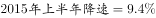，降幅比一季度扩大7.5个百分点，因此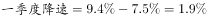。根据混合增长率居中原则，二季度降速应大于，一季度降速较慢，错误；

B项：定位文字材料第二段可得，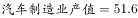，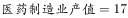，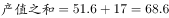，定位文字材料第一段可得，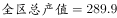，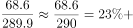，小于，错误；

C项：定位文字材料第三段可得，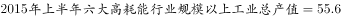，同比下降，因此2014年总产值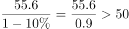，正确；

D项：定位表格可得，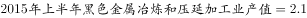，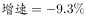，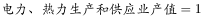，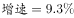。因此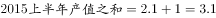，2014产值之和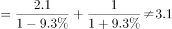， 错误。

故正确答案为C。

### 给定材料

        2015年上半年A区完成规模以上工业总产值289.9亿元，同比下降，降幅比1-5月扩大0.7个百分点，比1-4月扩大2.2个百分点，比一季度扩大7.5个百分点。

        其中，上半年A区两大主导行业汽车制造业完成产值51.6亿元，同比增长，医药制造业完成产值17亿元，同比增长。

        上半年A区六大高耗能行业七成企业生产产值低于上年同期，上半年共完成规模以上工业总产值55.6亿元，同比下降，降幅较上年同期扩大0.1个百分点。

> [!warning] 疑点（官方解析可能有误，待人工复核）
> 给定材料原文中全区同比降幅、汽车/医药行业增速及B项比例式均以图片/留空形式缺失，官方解析亦留空引用这些数值，故A/B项的数值无法从给定文本直接复核，本笔记按官方解析口径采信其'错误'判定；C项可由表格数据（55.6、-10.0%）独立核验且与官方答案一致。

<!-- CODEX-ANSWER-REVIEW:BEGIN -->
### 本次独立复核

**复核状态：** `resolved`（答案与解析已核定）

**计分答案：** C（可计分）

**复核解析：**

恢复题图和公式后，C项所列六大高耗能行业2015年上半年增加值55.6亿元、同比下降10%，其上年同期值=55.6÷0.9≈61.78亿元，高于50亿元，C成立。排除项核对：B中两主导行业合计68.6亿元，占289.9亿元的68.6÷289.9≈23.66%，低于25%；A中上半年降幅较一季度扩大7.5个百分点，故二季度降幅大于一季度，A所述相反；D中两项相反增幅因基数不同不抵消，按2.1÷0.907+1.0÷1.093≈3.23计算，不等于现期合计3.1。故选C。

**相关信息：**

资料分析—基期量、比重和增量抵消；基期量须除以1+r，下降10%用0.9；异基数的正负增速不能直接相加抵消。

**题源依据：** [固定版本原题](https://github.com/Mentat-Uran/kaogongzhentizhengliu/blob/84ab93d4b64b61d897bece8a1c0a5bab06b4feb2/10-%E7%9C%9F%E9%A2%98/%E8%B5%84%E6%96%99%E5%88%86%E6%9E%90/%E7%BB%BC%E5%90%88/2031188%20%E7%BB%BC%E5%90%88%E5%88%86%E6%9E%90%E5%88%A4%E6%96%AD%E9%A2%98%EF%BC%88%E5%9F%BA%E6%9C%9F%E9%87%8F%E8%AE%A1%E7%AE%97%E3%80%81%E6%B7%B7%E5%90%88%E5%A2%9E%E9%80%9F%E5%B1%85%E4%B8%AD%E3%80%81%E6%AF%94%E9%87%8D%E6%AF%94%E8%BE%83%E3%80%81%E5%A2%9E%E9%87%8F%E6%8A%B5%E6%B6%88%E5%88%A4%E6%96%AD%EF%BC%89.md)；固定内容 commit `84ab93d4b64b61d897bece8a1c0a5bab06b4feb2`，Markdown blob `81a22482e309183e7077bca06ecf24cfd89ad47f`。
<!-- CODEX-ANSWER-REVIEW:END -->
