# 综合判断题（两期比重差＋年均增长率估算＋跨期队列极值推断＋趋势判断）

考点：[[20-考点/资料分析/综合/综合判断题（两期比重差＋年均增长率估算＋跨期队列极值推断＋趋势判断）|综合 / 综合判断题（两期比重差＋年均增长率估算＋跨期队列极值推断＋趋势判断）]]
材料：[[15-材料/资料分析/185342 2000、2005、2010三个年份|185342 2000、2005、2010三个年份]]

**问法模型**：'以下说法正确的是'→逐项代入验证：A看两期女性总量能否支持'顶峰后逐年减少'，B按5年年龄组上移一组对齐队列后取职称差值下界，C用(1+r)^10与总倍数对照检验'每年约8%'，D用截位直除算两期未评职称比重之差（百分点）

## 推理链
1. 第1步：A项取文字段总量：2005年女性教师558625人，2010年为723566人，后一时点反增164941人，'2005年达顶峰后逐年减少'直接被否定（且2006—2009年无数据，'逐年'本身无从验证）
2. 第2步：B项做队列对齐：2010年41—45岁教师即2005年36—40岁教师（5年上移一组），查表2005年36—40岁高级教师69292人，2010年41—45岁高级教师142633人
3. 第3步：B项差值142633−69292=73341≈7.3万人，即该队列中新评上高级者至少7万多人，与选项'6万多'不符（且材料未给评级方式，跨级评级无法精确计算）
4. 第4步：C项算总倍数：1518194÷756850≈2.006倍；若按每年约8%增长，1.08^10≈2.16>2.006，故年均增长率应小于8%（约7.2%），C错误
5. 第5步：D项算两期比重：2000年未评职称占比68253÷756850≈9.0%，2010年占比97973÷1518194≈6.5%
6. 第6步：D项比重差9.0%−6.5%≈2.6个百分点，即'下降了近3个百分点'，与选项表述吻合，故D正确

**最快解法**：⚡ 先做D项定量锁定（截位直除＋百化分）：98/1520≈6.5%、68/757≈9.0%，差约2.5~3个百分点即'近3个百分点'，直选D；再用1.08^10≈2.16与2.006倍对比秒排C，A看2010年723566＞2005年558625秒排，B算142633−69292≈7.3万（至少7万多）排除

## 易错点
- ⚠ D项分母必须用'合计'列全体教师数（756850、1518194），误用31—45岁三组小计作分母会算错比重差；比重下降的表述单位是'百分点'而非'%'
- ⚠ B项队列匹配陷阱：2010年41—45岁对应2005年36—40岁，错配成2005年41—45岁（高级75782人）会得出错误差值；同时'未评职称'是表中独立行，直接读数，勿当差额漏读
- ⚠ C项年均增长率不能把10年总增幅约100%÷10当作年增长率来粗验，也不能直接采信'约8%'，须用(1+r)^n模型与总倍数对照；A项仅两个截面时点无法断言'逐年'趋势，且两时点间实为增加

## 母题抽象
> 🧩 当综合判断题的选项分别涉及趋势、跨期队列推断、年均增长率和两期比重时，优先算比重差（两次截位直除即可定量锁定答案），年均增长率用(1+r)^n与总倍数对照排除，跨期推断先按'每5年年龄组上移一组'对齐队列再取差值下界，趋势表述须两端数据同时支持

**同类特征**：综合判断——说法正确的是、顶峰后逐年减少（趋势判断）、跨5年队列评职称（极值推断）、每年约8%速度增长（年均增长率）、比重下降近3个百分点、职称×年龄交叉表读数定位

## 相关题
（暂无）

---

### 题干
以下说法正确的是（    ）。

### 选项
- A. 
我国普通高中专任教师中，女性教师人数在2005年达到顶峰后逐年减少

- B. 
2005年我国36-40岁一级普通高中专任教师中有6万多人在2010年评上了高级教师

- C. 
2000-2010年我国普通高中专任教师人数以每年约速度增长

- D. 
2010年我国未评职称的普通高中专任教师占专任教师总人数的比重，比2000年下降了近3个百分点
　✅

### 官方解析

A项：定位表格可得，2005年女性教师人数为558625人，2010年为723566人，

方法一：没有2006-2009年的数据，所以条件不足，无法确定是否逐年减少；

方法二：仅看2010年和2005年人数是增加的，故不可能在2005年以后逐年减少，说法错误；

B项：定位表格可得，2005年的36-40岁高级教师为69292人,在2010年为41-45岁，对应高级教师为142633人，二者差值即新增加高级教师人数，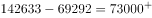人，故新评上的高级教师人数至少应为7万多人，说法错误；

C项：定位表格可得，2000年普通高中专任教师人数为756850人，2010年为1518194人，则2010年比2000年的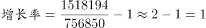，若以每年约速度增长，则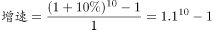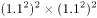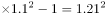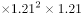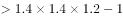，故年均增长率应小于，说法错误；

D项：定位表格可得，2010年，普通高中专任教师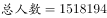人，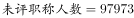人，；2000年，普通高中专任教师人，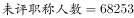人，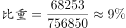，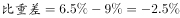，下降了近3个百分点，说法正确。

故正确答案为D。

注：B项，因材料中没有提及评级方式，若可以跨级评职称，则新评上高级教师的不一定是原来的一级老师，无法计算确切数值，选项仍然错误。

### 给定材料

        2000年、2005年、2010年我国普通高中专任教师总人数分别为756850人、1299460人、1518194人。其中，女性人数分别为273110人、558625人、723566人。

        从年龄结构看，2000年、2005年、2010年31-35岁普通高中专任教师总人数分别为185873人、265509人、322829人，其中，女性人数分别为68346人、117838人、164175人；36-40岁普通高中专任教师总人数分别为117242人、248837人、272313人，其中，女性人数分别为35751人、95566人、122953人；41-45岁普通高中专任教师总人数分别为55522人、137235人、239616人，其中，女性人数分别为15728人、42931人、93641人。

