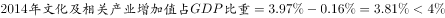
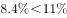
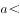
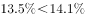
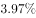
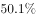

# 综合分析：增长量比较（大大则大）＋基期比重回推＋比重升降定性判断

考点：[[20-考点/资料分析/综合/综合分析：增长量比较（大大则大）＋基期比重回推＋比重升降定性判断|综合 / 综合分析：增长量比较（大大则大）＋基期比重回推＋比重升降定性判断]]
材料：[[15-材料/资料分析/185418 2015年全国文化及相关产业增加值（|185418 2015年全国文化及相关产业增加值（]]

**问法模型**：综合分析题'能够从上述材料中推出的是'，D项问两类产业增加值'谁增量更高'→套用定性模型'现期量大且增速大，则增长量必大（大大则大）'，逐项定性排除

## 推理链
1. 第1步：A项——材料第一段：2015年占GDP比重比上年'提高0.16个百分点'，故2014年比重=2015年比重−0.16个百分点，回推后低于2015年现值，未超过选项所给阈值，A错误排除（2015年占比具体百分数在给定文本中被挖空，按官方解析判定）
2. 第2步：B项——文化制造业增加值11053亿元，官方解析判定其增速低于全国总量增速（部分增速<总体增速），故2015年占文化及相关产业的比重较2014年下降，B'高于2014年'错误，排除
3. 第3步：C项——文化创意和设计服务业增加值4953亿元，官方解析判定其增速低于文化服务业（13640亿元）的增速，部分增速<总体增速⇒占文化服务业比重下降，C'高于2014年'错误，排除
4. 第4步：D项——提取数据：文化服务业现期量13640亿元、文化制造业现期量11053亿元，13640>11053；官方解析判定文化服务业增速>文化制造业增速（增速具体数值在给定文本中被挖空）
5. 第5步：模型规则——增长量=现期量×r/(1+r)，其中r/(1+r)随r增大而增大，故'现期量大且增速大'是'增长量大'的充分条件（大大则大）
6. 第6步：结论——文化服务业现期量与增速双大，其2015年增加值增量必高于文化制造业增量，D正确

**最快解法**：⚡ 大大则大定性秒杀：D项现期量13640亿元>11053亿元、且增速服务业>制造业，两'大'齐备直接判'服务业增量>制造业增量'，零计算锁定答案；A项用'基期比重=现期比重−0.16个百分点'回推排除；B、C项用'部分增速<总体增速⇒比重下降'定性排除

## 易错点
- ⚠ '提高0.16/0.5/0.2/0.4个百分点'是比重变化量不是增速，A项必须用'2015年比重−0.16个百分点'回推2014年比重，不能把百分点当增长率直接代入计算
- ⚠ 比重升降方向易判反：部分增长率>总体增长率⇒比重上升，部分增长率<总体增长率⇒比重下降（B、C均因部分增速更小而下降）
- ⚠ 增量比较若硬算'现期×r/(1+r)'费时且本材料增速数值全被挖空，应识别'大大则大'充分条件直接定性；另注意C项'占文化服务业的比重'与第4段'占文化及相关产业的比重'分母口径不同，不可混用

## 母题抽象
> 🧩 当综合分析题出现'A的增量是否高于B/某期比重是否高于上年'特征时：比较增量用'现期量大+增速大⇒增量必大'（大大则大）零计算判定；比较比重升降用'部分增速vs总体增速'定性判定，均不需算出具体数值

**同类特征**：能够从上述材料中推出的是、增加值增量高于、占…比重高于（上年）、比上年提高X个百分点、大大则大、部分增速与总体增速比较

## 相关题
- [[10-真题/资料分析/综合/4652204 综合判断题（核心验证点：两期比重升降判定；辅助：增长率比较、逐年数据核对、消费总量加总）|4652204]]（北京 2022，相关度1）
- [[10-真题/资料分析/增长/12536408 增长量比较|12536408]]（四川 2024，相关度1）
- [[10-真题/资料分析/综合/2033414 综合判断题（倍数验证+增长率大小比较）|2033414]]（河南 2016，相关度1）
- [[10-真题/资料分析/综合/2049612 综合判断题（倍数比较＋当月比重与分数门槛比较＋比重变化方向＋增长率比较）|2049612]]（山东 2017，相关度1）
- [[10-真题/资料分析/综合/2049744 综合分析-逐项验证（核心为平均数之累计拆分求月均，兼查倍数、增长量、均价降幅比较）|2049744]]（山东 2017，相关度1）

---

### 题干
能够从上述材料中推出的是：

### 选项
- A. 
2014年文化及相关产业的增加值占GDP比重超过

- B. 
2015年文化制造业增加值占文化及相关产业的比重高于2014年

- C. 
2015年文化创意和设计服务业增加值占文化服务业的比重高于2014年 

- D. 
2015年文化服务业增加值增量高于文化制造业增量 
　✅

### 官方解析

A项：根据文字材料第一段可知，，错误；

B项：根据文字材料第一段“2015年，全国文化及相关产业增加值27235亿元，比上年增长”和文字材料第二段“文化制造业比上年增长”可知，，即部分量的增长率总体量的增长率，故比重下降，错误；

C项：根据文字材料第三段“文化创意和设计服务增加值增长”和文字材料第二段“文化服务业增长”可知，，即部分量的增长率总体量的增长率，故比重下降，错误；

D项：根据文字材料第二段“文化服务业增加值13640亿元，增长”和“文化制造业增加值11053亿元，比上年增长”可知，文化服务业现期量13640亿元文化制造业11053亿元，文化服务业增长率文化制造业，大大则大，2015年文化服务业增加值增量高于文化制造业增量，正确。

故正确答案为D。

### 给定材料

       2015年，全国文化及相关产业增加值27235亿元，比上年增长（未扣除价格因素）。在2014年增长的基础上继续保持两位数增长，呈快速增长态势。2015年文化及相关产业增加值占GDP的比重为，比上年提高0.16个百分点。

       2015年，代表文化内容的“文化产品的生产”创造的增加值为17071亿元，而“文化相关产品的生产”创造的增加值为10165亿元；且“文化产品的生产”作为我国文化产业的主体，增速达，远高于“文化相关产品的生产”的的增速。从产品类型看，文化制造业增加值11053亿元，比上年增长，占，文化批发零售业增加值2542亿元，增长，占；文化服务业增加值13640亿元，增长，占。

       2015年文化休闲娱乐服务业和以“互联网+”为主要形式的文化信息传输服务业实现增加值分别为2044亿元和2858亿元，增速分别达和，占文化及相关产业的比重分别为和，均比上年提高0.5个百分点；广播电视电影服务业实现增加值1227亿元，占比，比上年提高0.2个百分点，文化创意和设计服务业实现增加值4953亿元，增长，占比，比上年提高0.4个百分点。

> [!warning] 疑点（官方解析可能有误，待人工复核）
> 给定文本中全部增速与占比具体数值被挖空，官方解析对A、B、C的判定（制造业增速<总量增速、创意设计增速<文化服务业增速、2014年比重未超选项阈值）依赖被挖空的原始数值，无法在文本内直接复核；但D项判定所需现期量13640亿元>11053亿元在文中完整，'大大则大'逻辑自洽，不影响正确答案D

<!-- CODEX-ANSWER-REVIEW:BEGIN -->
### 本次独立复核

**复核状态：** `confirmed`（独立复算确认答案）

**计分答案：** D（可计分）

**复核解析：**

恢复公式图后可逐项核算。2015年文化及相关产业增速11%，文化服务业14.1%，文化制造业8.4%，文化创意和设计服务13.5%，A项2015文化产业占GDP约3.97%，比上年高0.16个百分点，所以2014年为3.81%，未超过4%。B项制造业增速8.4%低于文化产业整体11%，其占比下降。C项创意设计服务增速13.5%低于文化服务业14.1%，其在文化服务业中的占比下降。D项增长量可直接比较：服务业现值13640亿元、增速14.1%，增长量约13640×14.1/114.1≈1685亿元；制造业现值11053亿元、增速8.4%，增长量约11053×8.4/108.4≈857亿元。服务业增加值增量更大，唯一答案D。

**相关信息：**

资料分析—增长量比较与比重变化；同一总体中部分增速低于整体增速，则部分占比下降；比较增长量可用“现期量×增长率/(1+增长率)”，不能只比较增速。

**题源依据：** [固定版本原题](https://github.com/Mentat-Uran/kaogongzhentizhengliu/blob/84ab93d4b64b61d897bece8a1c0a5bab06b4feb2/10-%E7%9C%9F%E9%A2%98/%E8%B5%84%E6%96%99%E5%88%86%E6%9E%90/%E7%BB%BC%E5%90%88/2033372%20%E7%BB%BC%E5%90%88%E5%88%86%E6%9E%90%EF%BC%9A%E5%A2%9E%E9%95%BF%E9%87%8F%E6%AF%94%E8%BE%83%EF%BC%88%E5%A4%A7%E5%A4%A7%E5%88%99%E5%A4%A7%EF%BC%89%EF%BC%8B%E5%9F%BA%E6%9C%9F%E6%AF%94%E9%87%8D%E5%9B%9E%E6%8E%A8%EF%BC%8B%E6%AF%94%E9%87%8D%E5%8D%87%E9%99%8D%E5%AE%9A%E6%80%A7%E5%88%A4%E6%96%AD.md)；固定内容 commit `84ab93d4b64b61d897bece8a1c0a5bab06b4feb2`，Markdown blob `09ca64311006b32cbd1ae008b21dc8a4c150c17f`。
<!-- CODEX-ANSWER-REVIEW:END -->
