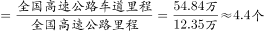
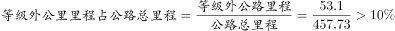
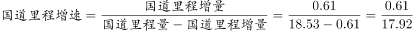
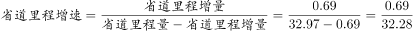

# 综合判断四选一（核心验证增速=增量÷基期量，兼查平均数=车道里程÷公路里程、比重=部分÷总体）

考点：[[20-考点/资料分析/综合/综合判断四选一（核心验证增速=增量÷基期量，兼查平均数=车道里程÷公路里程、比重=部分÷总体）|综合 / 综合判断四选一（核心验证增速=增量÷基期量，兼查平均数=车道里程÷公路里程、比重=部分÷总体）]]
材料：[[15-材料/资料分析/185420 2015年年末全国公路状况：公路总里|185420 2015年年末全国公路状况：公路总里]]

**问法模型**：题干为'能够从上述材料中推出的是'的四选一综合判断→逐项验证：A用文字增量直读、B用54.84÷12.35求平均车道数、C用53.1÷457.73验占比是否超一成、D用增量÷基期后首数法比较两分式大小。

## 推理链
1. 第1步：提取数据——文字段：国家高速公路7.96万公里（增加0.65万公里）、高速公路里程12.35万公里、高速公路车道里程54.84万公里；国道18.53万公里（+0.61）、省道32.97万公里（+0.69）；表1：等级外53.1万公里；文字：公路总里程457.73万公里
2. 第2步：验A项——国家高速公路增量为恰好的0.65万公里，选项称'增加了0.65万公里以上'（要求超过0.65），材料数据不支持，A错误
3. 第3步：验B项——平均车道数=车道里程÷高速公路里程=54.84÷12.35≈4.4条，不在5~6之间，B错误
4. 第4步：验C项——等级外占比=53.1÷457.73≈11.6%，超过一成（10%），并非'一成以下'，C错误
5. 第5步：验D项——国道增速=0.61÷(18.53-0.61)=0.61÷17.92，首数商3（约3.4%）；省道增速=0.69÷(32.97-0.69)=0.69÷32.28，首数商2（约2.1%）
6. 第6步：3.4%＞2.1%，国道里程增速快于省道，D能从材料推出，故选D

**最快解法**：⚡ 综合判断'先直读后速算'：A项文字直读排除（材料增量恰为0.65万公里，不满足'以上'）；B项截位直除54.84/12.35≈4.4排除；C项取457.73×10%≈45.8＜53.1，排除；D项首数法：0.61/17.92首数商3，0.69/32.28首数商2，首数3＞2直接锁定D，无需精算。

## 易错点
- ⚠ D项增速比较的分母必须是基期（国道18.53-0.61=17.92、省道32.97-0.69=32.28），直接用现期18.53、32.97当分母属基期现期混淆（本题碰巧结论相同但口径错误）
- ⚠ B项双口径陷阱：'车道里程54.84万公里'与'高速公路里程12.35万公里'是不同口径，平均车道数=车道里程÷公路里程≈4.4，勿颠倒分子分母，也勿把车道增量5.28万公里误代入
- ⚠ C项'一成'=10%，且等级外53.1万公里属于技术等级维度、包含在总里程457.73内，分母不能错用技术等级里程404.63；A项'以上'表述需核验是否严格大于，材料给的增量是恰好的0.65万公里

## 母题抽象
> 🧩 当题干出现'能够从材料中推出的是'的四选一综合判断时，先用文字段可直接核对的增量/'以上、以下、一成'等表述排除明显项，再对剩余项分别套增速=增量÷基期、平均数=总量÷份数、比重=部分÷总体，用首数法或截位直除比较大小，先易后难逐项排错。

**同类特征**：能够从上述材料中推出的是（综合判断四选一）、增速=增加量÷基期量的比较、车道里程与公路里程双口径求平均车道数、'以上''一成以下'等百分比表述核验、首数法比较两个分式、行政等级（国/省道）与技术等级（等级外）双维度混合设错

## 相关题
（暂无）

---

### 题干
关于2015年全国公路状况，能够从上述材料中推出的是：

### 选项
- A. 
国家高速公路里程增加了以上

- B. 
全国高速公路平均车道数在5~6之间

- C. 
等级外公路里程占公路总里程的一成以下

- D. 
国道里程增速快于省道里程增速
　✅

### 官方解析

A项：，错误；

B项：最后一段，全国高速公路里程12.35万公里，全国高速公路车道里程54.84万公里。每个车道的平均里程等于高速公路里程，所以平均车道数，错误；

C项：，错误；

D项：，首数商3；，首数商2，明显前者大于后者，正确。

故正确答案为D。

### 给定材料

        2015年年末全国公路总里程457.73万公里，其中技术等级公路里程404.63万公里，占公路总里程的比重比上一年提高1.0个百分点。

        各行政等级公路里程分别为：国道18.53万公里、省道32.97万公里、县道55.43万公里、乡道111.32万公里、专用公路8.17万公里，比上年末分别增加0.61万公里、0.69万公里、0.23万公里、0.81万公里和0.14万公里。

         全国高速公路里程12.35万公里，比上年末增加1.16万公里。其中，国家高速公路7.96万公里，增加0.65万公里。全国高速公路车道里程54.84万公里，增加5.28万公里。

> [!warning] 疑点（官方解析可能有误，待人工复核）
> 所给官方解析文本中A、C、D项的计算式因公式图片未渲染而缺失（如'A项：，错误'），已按材料数据补全验算：A项增量恰为0.65万公里、C项53.1÷457.73≈11.6%超一成，均与官方'错误'结论一致；D项0.61÷17.92首数商3＞0.69÷32.28首数商2，与官方结论一致，不影响答案D；另A项'以上'是否含本数存在表述歧义，官方按'须超过0.65万公里'口径判定。
