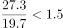

# 综合判断题（倍数验证+增长率大小比较）

考点：[[20-考点/资料分析/综合/综合判断题（倍数验证+增长率大小比较）|综合 / 综合判断题（倍数验证+增长率大小比较）]]
材料：[[15-材料/资料分析/185422 2015年中国电子商务市场：总体交易|185422 2015年中国电子商务市场：总体交易]]

**问法模型**：'能够从上述材料中推出的是'→ 逐项验证四选项：倍数类选项用'基准×倍数'反向口算判真伪，增速比较类选项按文字中各增速排出大小序列后比对方向词，唯一成立的即为答案

## 推理链
1. 第1步：A项从统计图1读取预测/延续期数据：2016年交易规模19.7万亿元、2018年27.3万亿元
2. 第2步：A项用反向乘法验证'超过1.5倍'：19.7×1.5=29.55万亿元>27.3万亿元，即27.3÷19.7≈1.39倍<1.5倍，A错误
3. 第3步：B、C、D均定位文字段三个细分行业增速（原卷完整文字），大小关系为：在线旅游>本地生活服务O2O>网络购物
4. 第4步：B项'在线旅游增长率高于O2O增长率'与该大小关系方向一致，正确
5. 第5步：C项称'O2O增长率低于网络购物'，而文字中O2O增速高于网络购物，方向相反，C错误
6. 第6步：D项'2012~2015年总规模增长率均高于网络购物'只需一个反例：2015年总增速（图1右轴折线）22.7%低于网络购物增速，D错误
7. 第7步：四项中唯一可推出的是B

**最快解法**：⚡ 反向验证法+增速排序比较：A项口算19.7×1.5=29.55>27.3，一步排除（避免硬除27.3÷19.7）；B/C/D为同一处文字增速的大小比较，按'在线旅游>O2O>网络购物'排序后对方向词——B'高于'与序一致、C'低于'与序相反、D用2015年反例（总22.7%<网络购物增速）秒杀，锁定B

## 易错点
- ⚠ 双轴图+预测期陷阱：A项必须用图中延续数据2016年19.7与2018年27.3（'将超过'对应预测表述），勿误用2015年16.4；且比较1.5倍时用19.7×1.5=29.55反向口算更快更稳，直接相除27.3÷19.7既慢又易算错成'超过1.5倍'
- ⚠ 方向词陷阱：C项问'低于'、实际文字中是'高于'，B项问'高于'、恰好成立，'高于/低于'看反即错；D项'均高于'属全称判断，只需举2015年一个反例（22.7%低于网络购物增速）即可否定，不必逐年验算2012-2015
- ⚠ 增速对号入座陷阱：在线旅游、O2O、网络购物三个指标增速在原卷文字中紧邻排列，本题给定文本恰为空白，考场须精确定位各指标对应数值，勿把O2O与在线旅游的增速互换（否则B、C判断完全颠倒）；另注意2015年总增速22.7%须读图1右轴折线，勿与柱值16.4混淆

## 母题抽象
> 🧩 当题干出现'能够从上述材料中推出的是'且选项含'超过N倍'时，用'基准×N'反向口算与实际值比较即可排除；当选项为'增长率高于/低于'的比较时，先把文字中各指标增速排成大小序列再对方向词；含'均/都'的全称判断只需找一个反例即可推翻

**同类特征**：能够从上述材料中推出的是、超过……的1.5倍（预测年倍数判断）、增长率高于/低于（文字增速比较）、2012~2015年……均高于（全称判断找反例）、双轴折线柱状图+饼图复合材料、逐项排除型综合判断

## 相关题
- [[10-真题/资料分析/综合/4652204 综合判断题（核心验证点：两期比重升降判定；辅助：增长率比较、逐年数据核对、消费总量加总）|4652204]]（北京 2022，相关度1）
- [[10-真题/资料分析/综合/2033372 综合分析：增长量比较（大大则大）＋基期比重回推＋比重升降定性判断|2033372]]（河南 2016，相关度1）
- [[10-真题/资料分析/增长/2033402 基期量计算（总量×饼图占比换算现期后÷(1+r)）|2033402]]（河南 2016，相关度1）
- [[10-真题/资料分析/综合/2049612 综合判断题（倍数比较＋当月比重与分数门槛比较＋比重变化方向＋增长率比较）|2049612]]（山东 2017，相关度1）
- [[10-真题/资料分析/综合/2049744 综合分析-逐项验证（核心为平均数之累计拆分求月均，兼查倍数、增长量、均价降幅比较）|2049744]]（山东 2017，相关度1）

---

### 题干
能够从上述材料中推出的是：

### 选项
- A. 2018年中国电子商务市场交易规模将超过2016年的1.5倍
- B. 2015年在线旅游市场交易规模增长率高于本地生活服务O2O市场　✅
- C. 本地生活服务O2O市场2015年交易规模增长率低于网络购物市场
- D. 2012~2015年电子商务市场交易规模增长率均高于网络购物市场

### 官方解析

A项：定位图表，2016、2018年电子商务市场交易规模为19.7万亿元、27.3万亿元，则后者是前者的倍，错误；

B项：定位文字材料，2015年在线旅游交易市场规模增长，本地生活服务O2O交易规模增长，前者高于后者，正确；

C项：定位文字材料，本地生活服务O2O交易规模增长，网络购物市场增长，前者高于后者，错误；

D项：定位文字材料，以2015年为例，中国电子商务市场交易规模增长，网络购物市场增长，前者低于后者，错误。

故正确答案为B。

### 给定材料

        2015年中国电子商务市场交易规模16.4万亿元，增长。其中网络购物增长，在线旅游增长，本地生活服务O2O增长。2015年中国移动网购市场交易规模达2.1万亿元，同比增长。

> [!warning] 疑点（官方解析可能有误，待人工复核）
> 给定材料文字中总体、网络购物、在线旅游、O2O、移动网购各增长率数值均为空白（原卷有完整数值），B/C/D三项的增速比较在所给文本内无法独立验证，本笔记按官方解析给出的方向'在线旅游>O2O>网络购物'记录；另官方解析A项'后者是前者的□倍'处倍数数值缺失，实际计算为27.3÷19.7≈1.39倍，与解析'错误'结论一致。上述均为材料/解析文本留空问题，不影响官方答案B

<!-- CODEX-ANSWER-REVIEW:BEGIN -->
### 本次独立复核

**复核状态：** `resolved`（答案与解析已核定）

**计分答案：** B（可计分）

**复核解析：**

恢复增长率图后：在线旅游39.9%，本地生活服务O2O为38.3%，网络购物36.2%，2015年交易规模增速22.7%。A的倍数27.3÷19.7≈1.386，小于1.5；B比较39.9%与38.3%，在线旅游增速更高，正确；C称O2O增速低于网络购物，但38.3%>36.2%，错误；D称2012—2015总体交易规模增速一直高于网络购物，2015年总体仅22.7%，低于网购36.2%，错误。唯一正确项为B。

**相关信息：**

资料分析—增长率比较与选非；直接比较同周期的百分率，选项用“始终/一直”时，找到一个反例年度即可否定。

**题源依据：** [固定版本原题](https://github.com/Mentat-Uran/kaogongzhentizhengliu/blob/84ab93d4b64b61d897bece8a1c0a5bab06b4feb2/10-%E7%9C%9F%E9%A2%98/%E8%B5%84%E6%96%99%E5%88%86%E6%9E%90/%E7%BB%BC%E5%90%88/2033414%20%E7%BB%BC%E5%90%88%E5%88%A4%E6%96%AD%E9%A2%98%EF%BC%88%E5%80%8D%E6%95%B0%E9%AA%8C%E8%AF%81%2B%E5%A2%9E%E9%95%BF%E7%8E%87%E5%A4%A7%E5%B0%8F%E6%AF%94%E8%BE%83%EF%BC%89.md)；固定内容 commit `84ab93d4b64b61d897bece8a1c0a5bab06b4feb2`，Markdown blob `9d433b18885cb581db77b364488974ccb59b6fd0`。
<!-- CODEX-ANSWER-REVIEW:END -->
