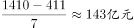
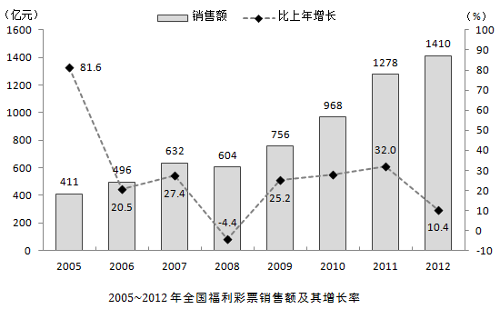

# 综合判断题（逐年趋势判断+年均增长量计算+年均增速比较）

考点：[[20-考点/资料分析/综合/综合判断题（逐年趋势判断+年均增长量计算+年均增速比较）|综合 / 综合判断题（逐年趋势判断+年均增长量计算+年均增速比较）]]

**问法模型**：题干出现'下列判断不正确的是'的选非问法 → 对三个分句逐条独立验证，全部错误项即为答案

## 推理链
1. 第1步：从柱状图提取关键数据：2005年411亿元、2007年632亿元、2008年604亿元、2010年约968亿元、2012年1410亿元
2. 第2步：判断(1)'逐年增加'要求每一年均高于前一年，核对2008年604亿元<2007年632亿元，出现下降，(1)错误
3. 第3步：判断(2)年均增量公式=（末年值-基期前一年值）÷年份数，2006~2012共7年，基期为2005年：(1410-411)÷7=999÷7≈143亿元≠131亿元，(2)错误
4. 第4步：判断(3)年均增速比较，两个区间都是5年（2008~2012基期2007年，'十一五'2006~2010基期2005年），年数相同只需比较'末年值÷基期值'
5. 第5步：2008~2012为1410÷632≈2.23，'十一五'为968÷411≈2.36，2.23<2.36，故2008~2012年均增速慢于'十一五'，(3)错误
6. 第6步：(1)(2)(3)三个判断均不正确，选非题故选D

**最快解法**：⚡ 综合判断+速算技巧：①趋势判断直接找图上'回落点'（2008年604<2007年632）；②年均增量用截位直除999÷7≈143，排除131；③年均增速比较用'现期/基期倍数比较法'：年数相同直接比1410/632与968/411，无需开n次方

## 易错点
- ⚠ 年均增量基期口径：2006~2012七年的年均增量应以2005年（首期前一年）为基期，除以7而非除以8，也不能误用2006年作基期
- ⚠ 年均增速比较不必真算(1+r)^n，只需比较'末年÷基年'的倍数（年数相同时）
- ⚠ 选非题方向看反：误选'正确'的判断或漏找(1)中2008年这一处下降拐点

## 母题抽象
> 🧩 当题干出现'下列判断不正确的是'并混合逐年趋势、年均增量、年均增速比较时：趋势题在图中找下降年份即可证伪；年均增量=(末年-首期前一年)÷年份数；年均增速比较先看年数是否相同，相同则直接比末年/基年倍数，验证后再排除

**同类特征**：选非题：判断不正确的是、逐年增加态势、年平均增加量、年平均增速快于/慢于、十一五等五年规划的年份界定、柱状图数据提取

## 相关题
（暂无）

---

### 题干
下列判断不正确的是：
（1）2006~2012年七年，全国福利彩票的销售额是逐年增加的态势
（2）2006~2012年七年，全国福利彩票销售额年平均增加131亿元
（3）2008~2012年五年，全国福利彩票销售额年平均增速快于“十一五”时期全国福利彩票销售额年平均增速

### 选项
- A. （1）（2）
- B. （1）（3）
- C. （2）（3）
- D. （1）（2）（3）　✅

### 官方解析

（1）定位柱状图可得，2008年的销售额为604亿元，低于2007年的销售额632亿元，故2006~2012年，销售额不是逐年增加的，错误；

（2）定位柱状图可得，2005年销售额为411亿元，2012年为1410亿元，2006~2012七年的年平均增量为，错误；

（3）年均增长率比较，只需比较的大小。定位柱状图数据，分别为：“十一五”即2006~2010五年、2008~2012五年，后者小于前者，错误。

不正确的为（1）（2）（3）。

本题为选非题，故正确答案为D。

### 给定材料

